# 拆书会第226期：Y模型之后重新理解《毛选》

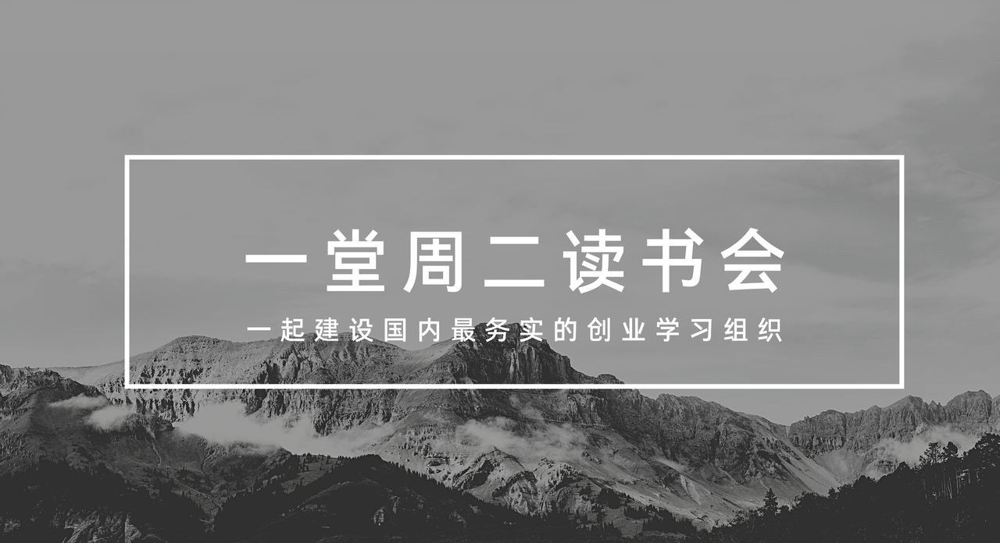

### 本期拆书嘉宾：**古董**

- 一堂运营负责人

- 一堂MBA，2000+学分，30+万字作业

- 一堂山东学习中心主理人

- 一堂私董会NPC督导

- 一堂初阶营/进阶营教练，高阶营助教

- 线下连锁经营专家，餐饮连锁创业10+年

- 从0起盘、十年百店、年营收过亿

- 曾任美资500强公司中国招聘负责人、A股上市公司运营总监

- 兼具创业1号位、管理咨询、大厂HR三重视角

- 在一堂分享过6节案例课、多次关于如何科学学习一堂的开放麦

| 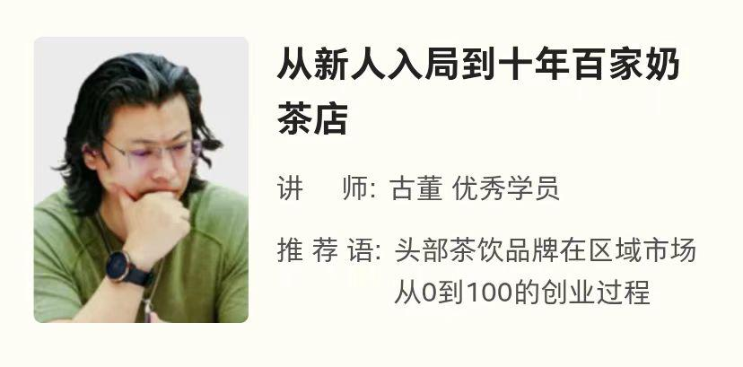 | 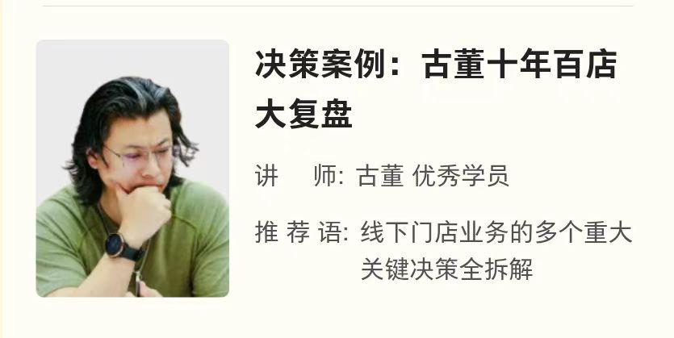 |
| --- | --- |

| 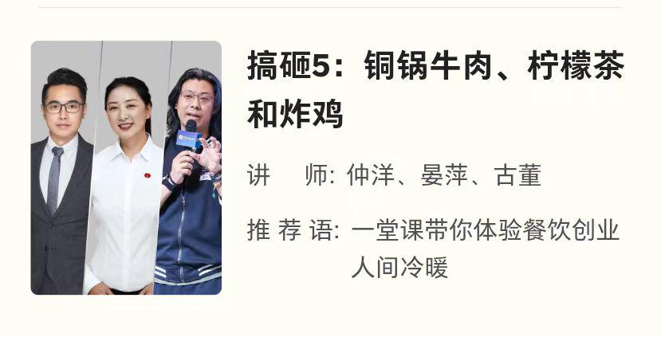 | 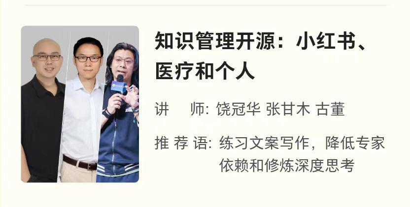 | 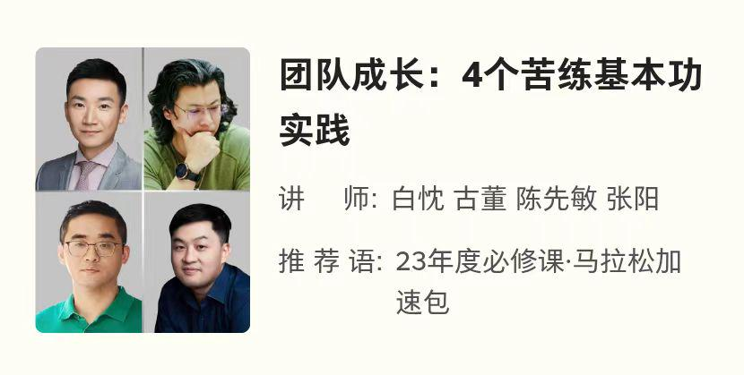 | 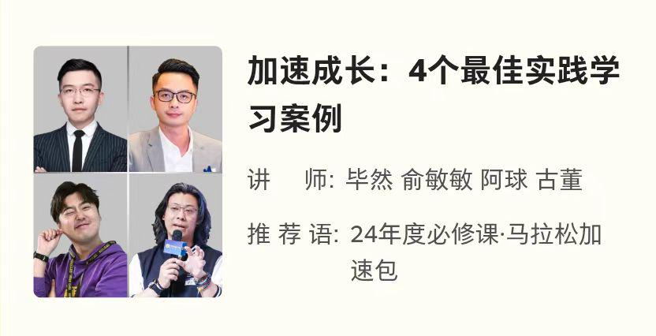 |
| --- | --- | --- | --- |

🗺 古董开放麦：《如何科学地学习一堂》

> 🤗大家在学习中会遇到各种 “小卡点”，比如：
> 🔹时间不够用/课程太多/学完找不到场景实践···
> 💡所以这次直播，古董分享了对于“高效学习一堂”的经验和实践
> 📺回放： [https://air.yitang.top/live/17ggGU8eq5](https://air.yitang.top/live/17ggGU8eq5)
> 📚文稿：[古董：如何在一堂高效学习](https://yitanger.feishu.cn/wiki/BSztwZlmmixD3WkY4wycsUGqnhe)

### **《毛泽东选集》**作者：毛泽东

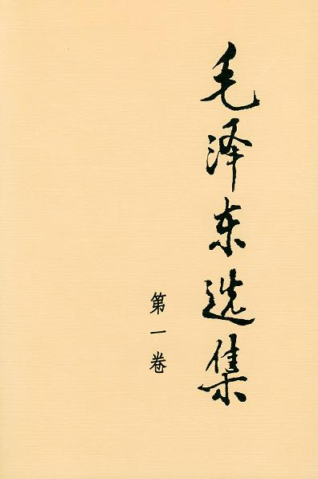

【调研】想问问大家，看过《毛选》、看过之前的「MBA战略笃定营」或者《水水拆毛选》？

💡读过看过的同学请扣：1

💡一个都没有的同学请扣：0

## 课后交作业

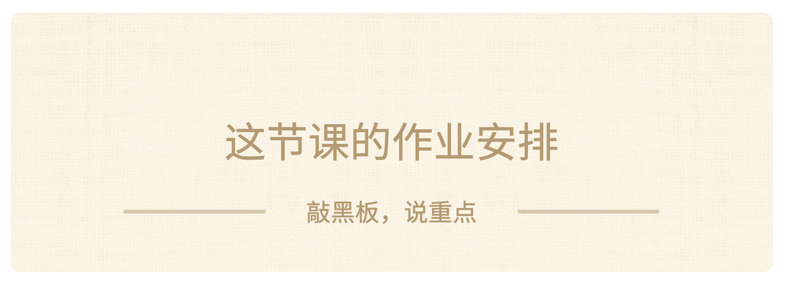

【💡 本周作业】围绕今天的主题，做两个题目：

> **第一个作业：分析题**
> 你理解的Y模型和毛泽东哲学思想，有哪些共性的地方？以及对于使用Y模型解决具体的问题，你还有哪些困惑或者建议？
> **第二个作业：一页纸拆书**
> 请你用飞书文档，给一堂同学，写一份完整的图文并茂的拆书分享稿，书籍的选择不限，可以是商业类，管理类，经济类，传记类等等。
> 一页纸拆书允许使用AI 工具辅助，但最终判断、筛选、重写和提交必须由人负责。你可以用 AI 帮你追问、整理素材、生成初稿，但不能直接提交纯 AI 稿。
> 写得好的同学，我们会邀请你作为拆书官，到读书俱乐部做直播分享。

## 直播开始

## 背景

### 山顶营+反复学习Y模型之后，重新理解《毛选》

最近两个月，教研磨课的重点一直围绕着Y模型，在磨课和做课的过程当中，所有人对于Y模型的体感都越来越深刻。

这次MBA的山顶营之后，重新理解《毛选》，豁然开朗，一下子理解了：

- 《毛选》到底在讲什么？

- 背后的内核是什么？

- 在具体问题面前如何落地？

- 与Y模型的关系？

- 在哲学体系中的位置？

### 回顾

一堂在过去几年，有过几次对于《毛选》的解读。

读书俱乐部早期，水水老师分别在第70和71期，分2次拆过《毛选》，其中第71期的NPS高达0.86，历史Top 3；

一堂MBA探索营当中，Truman围绕「战略笃定」也交付过两节解读《毛选》的课；

还有好几位同学（路禹、Jacky、秀慧、刘星）也分享过「战略笃定」主题的开放麦。

| 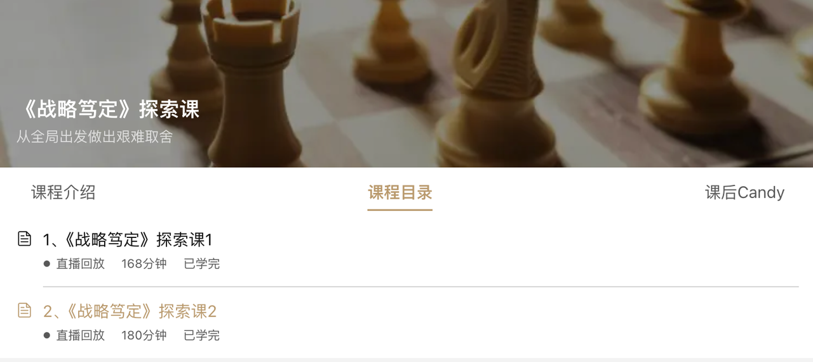 | 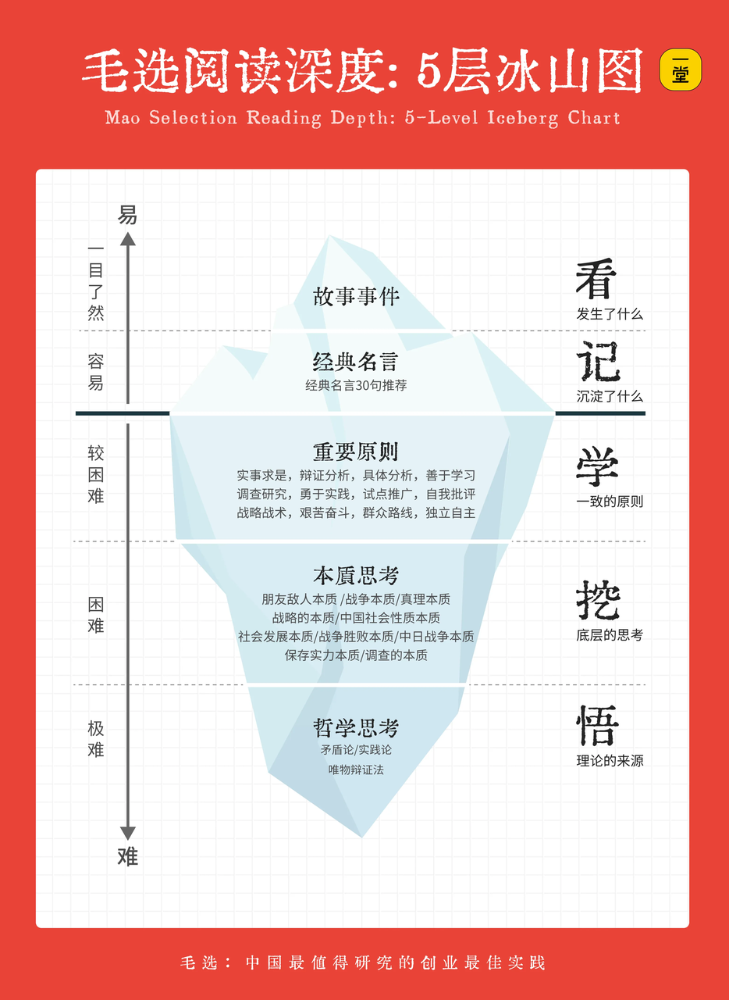 | 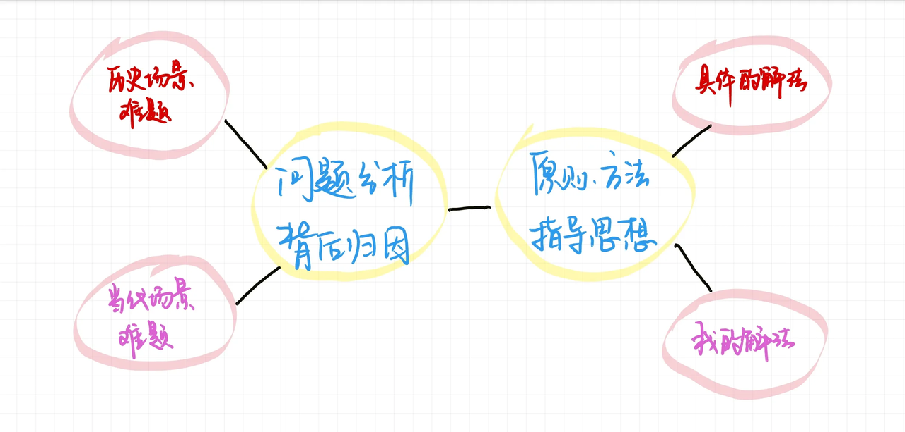 |
| --- | --- | --- |

这次重新拆《毛选》，我自己的理解是：在Y模型的基础之上去重新理解。

| 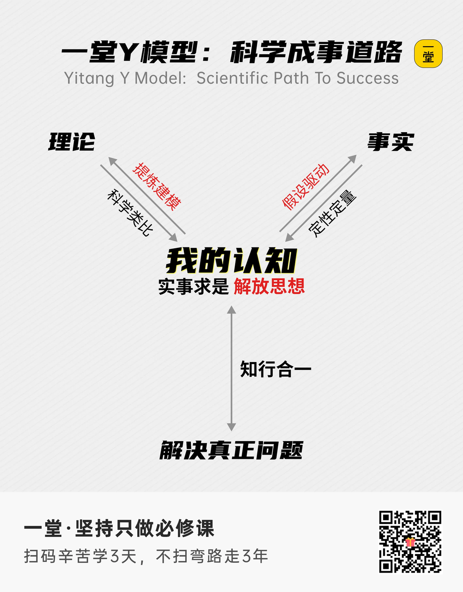 | 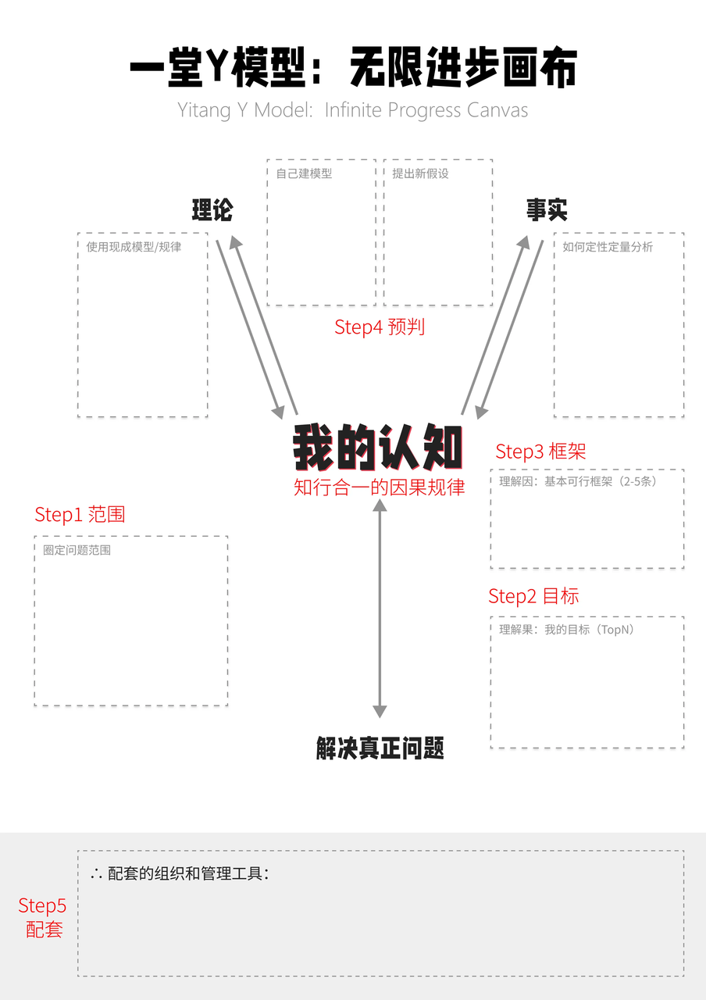 | 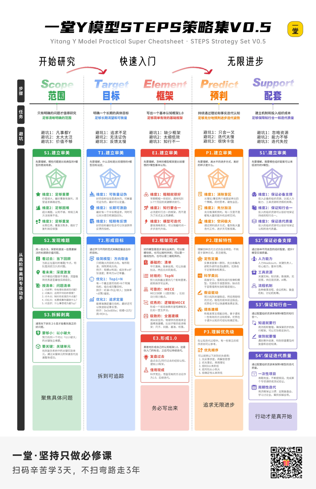 |
| --- | --- | --- |

Y模型的核心：

- 试图回答2个问题：认识世界+改造世界

- 认识世界：关键是「我的认知」，目标是「解决问题」

- 我的认知

  - 本质：是客观因果规律，换个说法，可以是KSFs（关键成功要素），也可以是主要矛盾

  - 手段：是从客观世界中拿认知、拿反馈、做迭代

  - 判断标准：用结果和事实说话

Y模型，一定程度上是在《毛选》的基础之上，被一堂所发现、所构建的；但这并不妨碍我们在学习Y模型之后，回过头来再重新理解毛选。这个视角反而能够帮助我们看到更多《毛选》背后的思想底色，以及帮助我们进一步击穿对于Y模型的认知和实践。

回到《毛选》，很多人读《毛选》时，会遇到同一个困境：每一篇都读得懂字，读完却不知道他到底在讲什么体系。

原因其实不复杂——**《毛选》里没有体系。**四卷 159 篇是 24 年间的文章、讲话、电报、报告汇编，他不是在写教科书，是在解决眼前的事。

**而这就是我们今天在Y模型之后重新理解《毛选》要做的**

- 毛选的本质，在当时是解决方案，在今天是案例分析

- 对于案例分析，重点不是看答案，而是看背后的解题思路

- 如何洞察背后的解题思路/Why和How——关键在于理解上百个案例背后的规律

- 如何理解《毛选》背后的规律——关键是识别《毛选》的思想内核/方法论，以及这些思想内核/方法论具体的落地过程

- 如何理解内核和落地过程——这就是今天重新理解《毛选》要做的

---

## 毛选讲什么

### 2.1 《毛选》在讲什么

《毛选》主要是在对一系列具体现实问题的分析、判断、决策和行动纲领、行动方案

——类似案例，除了「两论」

| 卷 | 时间跨度 | 篇数·初版 | 初版时间 | 当时要解决的核心问题 | 代表作 |
| --- | --- | --- | --- | --- | --- |
| 第一卷 | 1925—1937 | 17 篇 | 1951.1 | 人少枪少被围剿， 怎么活下来 | 《中国社会各阶级的分析》 《湖南农民运动考察报告》 《井冈山的斗争》 《星星之火，可以燎原》 《反对本本主义》 《实践论》 《矛盾论》 |
| 第二卷 | 1937.7—1941.5 | 40 篇 | 1952.4 | 日本人打进来， 能不能赢、要打多久 | 《论持久战》 《反对自由主义》 《〈共产党人〉发刊词》 《新民主主义论》 |
| 第三卷 | 1941.3—1945.8 | 31 篇 | 1953.4 | 队伍大了但毛病多， 怎么把队伍整明白 | 《改造我们的学习》 《整顿党的作风》 《反对党八股》 《为人民服务》 《论联合政府》 |
| 第四卷 | 1945.8—1949.9 | 70 篇 | 1960.9 | 最后决战与建国， 仗怎么打、国怎么建 | 《目前形势和我们的任务》 《将革命进行到底》 《党委会的工作方法》 《论人民民主专政》 |
| 第五卷 | 1949—1957 | — | 1977 | 建国后的社会主义改造与建设 | 《论十大关系》 《关于正确处理人民内部矛盾的问题》 |

> - **主体四卷**：时间跨度 1925—1949，共 24 年；1991 年第二版合计 159 篇，其中延安时期创作的约 112 篇【原文依据：人民日报相关记述】
> - **关于第五卷，要单独说明**：这一卷 1977 年出版，收 1949—1957 年文献（含《论十大关系》《关于正确处理人民内部矛盾的问题》等），后来停止发行，今天市面少见。我们这里讨论的《毛选》**主体是四卷**，第五卷只在必要处提及。
> - **篇幅差异**：上表各卷篇数是**第一版**的数目，相加为 158 篇。而 1991 年第二版四卷合计为 **159 篇**。差额 1 篇来自第二版的增补，具体篇目**【待核】**。若引用总量，这里以"1991 年第二版 159 篇"为准。

### 2.2 《毛选》为何难读

要理解这一点，就要明白：**这不是一本从头写到尾的理论著作。 它是文章、讲话、电报、报告的汇编。**

所以它读起来不像教材，更像一个人在艰难处境里，一次次分析思考"现在该怎么办"留下的印记——**「解决方案」**。

整体而言，《毛选》在文字上，有3个显著的特点：

**一、文体极杂**

里面有：调查报告（《湖南农民运动考察报告》是走村入户问出来的）、哲学讲义（《实践论》《矛盾论》原本是抗大的讲课提纲）、军事电报、追悼会讲话（《为人民服务》只有几百字）、也有通篇批评自己人的文章（《反对党八股》《改造我们的学习》）。

结果就是：有的篇目十分钟读完，有的要啃一周。**不知道这一篇是什么文体，就会用错读法。**

**二、每篇都在谈具体问题**

他几乎不空谈，都是被某件具体的事逼出来的：某场仗打输了、某个主张推不动、队伍里某种风气要治。有具体的对象，有具体的问题。

所以——**知道他在回应谁，文章一下就通了；不知道背景，会觉得莫名其妙。** 这是多数人读不下去的第二个原因。

> 类比需求，类比孔子，类比佛经——都是面对具体人、具体场景之下的具体问题的具体答案，而不是一个泛泛的放之四海皆准的标准答案。
> 理解这一点，很重要。

**三、有大量注释**

每篇前面有背景、后面有注释，把人物、事件、当时的分歧交代清楚。

跳过注释直接读正文，是读不下去的第三个原因。

### 2.3 《毛选》的基本结构

《毛选》四卷的核心内容，可以概括成两部分：

**一小部分是「方法」**：两论（认识论之《实践论》+辩证法之《矛盾论》）

**其他主要是「用法」**：用唯物辩证法对具体社会问题做分析——谁是自己人、敌人是谁、现在处在哪个阶段、怎么办——就是唯物史观的具体实践和落地

| 卷 | 时间跨度 | 篇数·初版 | 初版时间 | 当时要解决的核心问题 | 代表作 |
| --- | --- | --- | --- | --- | --- |
| 第一卷 | 1925—1937 | 17 篇 | 1951.1 | 人少枪少被围剿， 怎么活下来 | 《中国社会各阶级的分析》 《湖南农民运动考察报告》 《井冈山的斗争》 《星星之火，可以燎原》 《反对本本主义》 《实践论》 《矛盾论》 |
| 第二卷 | 1937.7—1941.5 | 40 篇 | 1952.4 | 日本人打进来， 能不能赢、要打多久 | 《论持久战》 《反对自由主义》 《〈共产党人〉发刊词》 《新民主主义论》 |
| 第三卷 | 1941.3—1945.8 | 31 篇 | 1953.4 | 队伍大了但毛病多， 怎么把队伍整明白 | 《改造我们的学习》 《整顿党的作风》 《反对党八股》 《为人民服务》 《论联合政府》 |
| 第四卷 | 1945.8—1949.9 | 70 篇 | 1960.9 | 最后决战与建国， 仗怎么打、国怎么建 | 《目前形势和我们的任务》 《将革命进行到底》 《党委会的工作方法》 《论人民民主专政》 |
| 第五卷 | 1949—1957 | — | 1977 | 建国后的社会主义改造与建设 | 《论十大关系》 《关于正确处理人民内部矛盾的问题》 |

> - 唯物论：世界是物质的，意识是物质的反映
> - 辩证法：凡事内部都有矛盾，矛盾推动事物变化——《矛盾论》
> - 认识论：人怎么认识世界、怎么判断认识对不对——《实践论》
> - 唯物史观：历史唯物主义，用唯物辩证法对具体社会问题做分析：从抽象的「生产力决定生产关系，经济基础决定上层建筑」，到具体的「谁是自己人、敌人是谁、现在处在哪个阶段、怎么办」
> - 辩证逻辑：论理学，思维的形式与规律
> 没理解的，我们先记着。后面几部分都会展开。「方法」我们在第五部分专门讲，「用法」在第六部分专门讲。

---

## 六个最重要的实践经验

具体展开之前，我们先用归纳的方式，把毛泽东反复使用的六个实践经验提炼出来。这六个实践经验，不需要任何哲学基础。

> **先说明一点：以下六条是个人归纳，不是标准答案，毛泽东本人没有列过这样一张清单。**换个人来归纳，可能是五条，也可能是八条。

这份清单的价值，是让你先有一个经验性的抓手，不是断言这就是他的分类。每条的原理在后面哪一节展开，3.2 统一标注。

### 3.1 六个经验

- **先调查，再判断**

**一句话**：不懂情况就别开口，先去看、去问。

**出处**：《反对本本主义》（1930）

**原文**："没有调查，没有发言权。"

**注意**：这句话针对的不是"不努力"，是"照本本办事"——书上怎么写、外国怎么干，我们就怎么干。

- **只抓最要紧的那一个**

**一句话**：不平均用力，先找出当前最关键的那一个，其他先放一放。

**出处**：《矛盾论》（1937）

**道理**：矛盾处处都有，但在任何一个时刻，只有一个是主要的。抓住它，其他问题会跟着松动；抓错了，力气全白费。

- **先分敌友，再定策略**

**一句话**：先算清谁的利益和你一致，谁赞同谁反对，为什么，再决定怎么办。

**出处**：《中国社会各阶级的分析》（1925）

**原文**："谁是我们的敌人？谁是我们的朋友？这个问题是革命的首要问题。"

**关键**：他不是在问"谁表态支持我"，是在算"谁的利益与这件事同向"。主观态度是结果，客观利益才是原因。

- **集中力量打歼灭战**

**一句话**：宁可十次里赢一次赢干净，不要十次都打个平手。

**出处**：《目前形势和我们的任务》（1947）十大军事原则

**道理**：资源永远不够。平均分配等于处处薄弱，集中一处才能形成决定性优势。

- **干一遍、总结、再干**

**一句话**：认识从做的过程中来，做完要总结，总结完再去做。

**出处**：《实践论》（1937）

**原文**："实践、认识、再实践、再认识，这种形式，循环往复以至无穷。"

**注意**：这不是"多干就行"。关键在"总结"这一环——不复盘的重复，只是重复。

- **长期看有希望，眼前极其认真**

**一句话**：对最终胜负可以藐视，对眼前这一仗必须重视。

**出处**：《论持久战》（1938）等

**道理**：长期悲观会让人放弃，短期乐观会让人轻敌。两个方向相反的判断必须同时成立，才撑得住一场持久的事。

### 3.2 这些经验如何形成

六条不是格言集，各有出处。

> **第 1、5 条来自认识论（5.1），**
> **第 2、4、6 条来自辩证法（5.3），**
> **第 3 条来自唯物史观（6.5）。**

**但要知道它们是如何形成的，要往下看2层：**

- **怎么想的：主要源自《实践论》和《矛盾论》，这是毛泽东的思想源头**

- **怎么做的：主要是对于「唯物史观」在具体问题上的应用，这是毛泽东的实践方式**

而「两论」是这一切的源头，所以下一步先追源头。

---

## 追根溯源：抗大&两论

1937 年 7、8 月，他在抗大讲“辩证法唯物论”（"辩证唯物主义"的旧译），周二、周四上午讲课四小时，下午参加学员讨论，历时三个多月，累计 100 多小时，讲稿叫**《辩证法唯物论（讲授提纲）》**，共三章。《实践论》是第二章第十一节，《矛盾论》是第三章里的一节。这是一本没写完的讲稿。

### 4.1 为何要在抗大开课

三个原因，叠加在一起：

1. **要统一思想路线**

遵义会议解决了「军事和组织问题」，但「思想路线」一直没动。照搬本本和外来指示的做法，靠山还在，屡次造成灾难。党内需要清算教条主义，但一直没有合适场合。到陕北后才有空隙做这件事。

当时还有一个外部契机：苏联哲学界正在批判德波林学派，而党内教条主义的理论靠山与这个学派有关联。他在《矛盾论》里直接写了"这件事引起了我们的极大的兴趣"。

回到当下的现实世界，作为1号位，也一定要重视「构建共识」的必要性和价值。

我一直有一个主观的论断——1号位最重要的职责，就是在3件事上：定方向、建共识、调资源。

2. **干部太少了**

长征出发 8 万人，到陕北剩 2 万。他说剩下的"要以一当十、当百、当千"，原则上每个人都该当干部用，所以必须先树立2万人的世界观。

回到一堂的语境，我们一直在说：一堂的课程是为谁准备的？是为想做事想成事的人准备的。立足于「改造世界」，这是我们理解《毛选》、理解「Y模型」、理解「实事求是」的基础。

「毛泽东思想」是手段、「用Y模型构建认知循环」是手段、甚至「实事求是」本身也是手段；「解决问题」、「改造世界」，才是目标。

一定要区分目标和手段，才能在目标上盯紧，在手段上保持灵活。

3. **主要矛盾换了**

中日民族矛盾上升，阶级斗争降为次要，战略策略都要转。转换之前得让干部先换脑子。

回到一堂讨论的商业环境中，外部环境的变化，会带来战略调整；而战略调整的一揽子动作中，「舆论造势」、「表达顶层的态度」、「在组织中构建新共识」，都是必须的组织配套机制。

### 4.2 一本没写完的教材

- **时间**：1937 年 7、8 月

- **场合**：延安抗日军政大学（当时文献中也称"红军大学"）

- **频率**：有"每周两次、每次四小时"的记载，也有"每次两小时、还参加学员讨论"的记载，另有"共 100 多个小时"的说法。

- **规模**：约 6 万字，**3 章 16 节**

**三章十六节的结构如下**

| 章 | 标题 | 节数与内容 |
| --- | --- | --- |
| 第一章 | 唯心论与唯物论 | 4 节： 哲学中的两军对战 唯心论与唯物论的区别 唯心论发生与发展的根源 唯物论发生与发展的根源 |
| 第二章 | 辩证法唯物论 | 11 节： 无产阶级革命的武器 同旧哲学遗产的关系 宇宙观与方法论的一致 唯物辩证法的对象 物质论／运动论／时空论／意识论／反映论／真理论／实践论 |
| 第三章 | 唯物辩证法 | 只写出 1 节： 矛盾统一法则 |

> **第三章原计划是 11 节**：
> - 三个根本法则（矛盾统一、质量互变、否定之否定）
> - 八对范畴（本质与现象、形式与内容、原因与结果、根据与条件、可能与现实、偶然与必然、必然与自由、链与环）。
> 七七事变后讲课中断，**这 10 节没有写成，也没有讲。**

### 4.3 三个关键特点

**一、「两论」是核心**

**这本教材实际上是"十四节提纲 + 两篇长文"。**

- 前十四节：

都是提纲式的，非原创的，简明扼要地过一遍本体论、物质论、意识论、真理论等马克思哲学的基础认知。

- 两论：

只有《实践论》、《矛盾统一法则》两节被详细展开。这两节加起来占全稿一半以上的篇幅。

  - **《实践论》＝第二章第十一节**

  - **《矛盾论》＝第三章第一节**（延安油印时原题《矛盾统一法则》）

也就是说，今天被视为"毛泽东哲学代表作"的两篇，本来是一门课讲稿里的两节。

**二、"如何认识/改造世界"比"解释世界是什么样"更重要**

用一堂对于【实事求是】的解读，来重新诠释一下，就是：

「实事」很重要，是必要和基础；但「求是」才是更重要的。

这从《唯物论》与《认识论》、《矛盾论》的篇幅差别上，也能看出来：

- 「实事」的部分，《唯物论》的篇幅不大，只有纲要，而且基本是转述，没有太多原创内容。

- 「求是」的部分，在毛泽东眼里，《实践论》和《矛盾论》，都是属于「求是」的范畴。这两篇是原创性的，被详细展开，加起来占全稿一半以上的篇幅。今天被视为最重要的"毛泽东哲学代表作"。

> 讲稿里他明确说："唯物辩证法是唯一科学的认识论，也是唯一科学的论理学（逻辑学的旧译）。"【原文】——在他那里，辩证法与认识论是一回事，所以展开辩证法就等于展开认识论。
> 1956 年他自评"《实践论》算是比较满意的"；1965 年又说"《实践论》是讲认识过程，说明人的认识是从什么地方来的，又向什么地方去"。

合起来看：**这是他哲学讲义的取向——本体论讲到够用，认识论与辩证法才花力气展开。**

明确一下范围，是"哲学讲义"，不是"全部写作"。这个判断只对他讲哲学、写哲学专论时成立。

四卷里大量篇幅是政治、军事、社会分析，不属于哲学写作；但却是他的哲学思想在具体社会问题上的实践。

**理解这一点的价值，在两方面**：

1. **阅读上**——主线是「两论」，不是唯物论那几节。想省时间，从两论入手，不必先啃物质论、时空论。

2. **理解上**——它和 后面5.5 的「第一个选择」是同一件事：本体论回答"世界是什么"，认识论回答"人怎么认识、怎么改造"。他轻前者、重后者，不在乎形而上地讨论研究哲学，真正关心的是动手改造世界。

**三、是面向农民和士兵的**

讲内外因用"孵鸡蛋"：温度能使鸡蛋变鸡子，不能使石头变鸡子。

这种例子在讲稿里到处都是——它是照着"让听的人当场听懂"写的，不是照着发表写的。

### 4.4 两个注意

**第一，对"三大规律"的态度**

一般讲唯物辩证法，说的是三大规律：质量互变、对立统一、否定之否定。三条并列，是教科书的标准写法。

**但《矛盾论》里只有一条**——「对立统一」。

原因 4.2 已经交代：《矛盾论》是讲授提纲第三章第一节的改写，而第三章原计划 11 节（3 个法则 + 8 对范畴），只写成了第一节，其余 10 节因战争中断，从没写过。

更准确的说法是：《毛选》中，并没有专门论述「质量互变」与「否定之否定」——这一方面是因为讲授提纲第三章未写完；另一方面，更重要的内因，是**他自己并不认为那两条有多么的重要，并不该与「对立统一」并列，「对立统一」才是《矛盾论》的核心——《矛盾论》原文中把对立统一称为"最根本的法则"**。

两个原因，并不冲突，但不能混为一谈。

> 四卷之外，他两次明确表态：
> - **1964 年 8 月 18 日北戴河同哲学工作者谈话**（《关于哲学问题的讲话》）。有人问"主席能不能讲讲三个范畴的问题"，他答："恩格斯讲了三个范畴，我就不相信那两个范畴……质量互变、否定之否定同对立统一规律平行的并列，这是**三元论，不是一元论**。最根本的是一个对立统一……没有什么否定之否定。"（另有参加者龚育之的记录稿，措辞略异，思想一致；引用须注明是哪一版）
> - **1965 年在李达《马克思主义哲学大纲》上的批注**（后题为《辩证法的核心是对立统一规律》）："辩证法的核心是对立统一规律，其他范畴如质量互变、否定之否定、联系、发展等等，都可以在核心规律中予以说明。"
> 两段都收在《毛泽东文集》第 8 卷《学习马克思主义的认识论和辩证法》里（五段合编）。

**学界对这两段有不同解读**：

- 一种是：他明确否认了另外两个规律的独立地位。

- 另一种（傅志伟，《哲学动态》2025 年第 2 期）：他否定的只是这两条规律的**基础性地位**，规律本身并不否认——他也讲过"肯定—否定，肯定—否定，每一个环节既是肯定，又是否定"，那其实是在讲否定之否定的内容，只是认为可以被对立统一涵盖。

**所以准确理解毛泽东的《矛盾论》，是三句话**：

- 他只专门阐述了第一条规则（对立统一）

- 他说了对立统一是根本、是核心，三条不是并列位置；

- 他并没有专门讲另外两条规则，只是少量地提及过。

**第二，原创性主要集中在《两论》**

| 章 | 标题 | 节次 | 内容 | 判断 |
| --- | --- | --- | --- | --- |
| 第一章 | 唯心论与唯物论 | 1—4 | 哲学中的两军对战 唯心论与唯物论的区别 唯心论发生与发展的根源 唯物论发生与发展的根源 | 基本转述。哲学史叙述，苏联教科书开篇都是这个结构 |
| 第二章 | 辩证法唯物论 | 5—8 | 无产阶级革命的武器 同旧哲学遗产的关系 宇宙观与方法论的一致 唯物辩证法的对象 | 框架是教科书的； 第 7 节"宇宙观就是方法论"有他自己的侧重——教科书是把世界观和方法论分开讲的 |
| 第二章 | 辩证法唯物论 | 9—14 | 物质论／运动论／时空论／意识论／反映论／真理论 | 最纯的转述，基本是《唯物主义和经验批判主义》框架的压缩 |
| 第二章 | 辩证法唯物论 | 15 | 实践论 | 原创：两个飞跃、相对真理与绝对真理、矛盾的特殊性、主要矛盾与主要方面 |
| 第三章 | 唯物辩证法 | 16 | 矛盾统一法则 |  |

> - 前十四节都是提纲性质，"简明扼要地论述"，只有最后两节被"详细地加以展开阐述"，成为全稿"最为详细、最为深刻、最为精彩的内容"；这部东西叫"讲授提纲"，正是据此而来。
> - 前十四节原创性低，依据是——这些题目在苏联教科书体系里都有对应章节（米丁、西洛可夫那两本他批注过的书就是这个结构），讲稿是给干部补基础的，以及学界通行看法是"原创集中在两论"。
> - 原创性低不等于没价值。要论证"认识来源于实践"，得先讲清唯心论为什么会脱离实践——所以第一章那四节是实践论的前半段。没有这个铺垫，"实践是认识的基础"就是一句孤零零的断言。**1～14是基础，15～16是结论。**

### 4.5 版本演化和毛泽东自己的评价

**版本演化**：

1937 年讲课   
→ 总政治部整理记录稿，经他同意油印（中央档案馆藏 1937 年 9 月油印本）  
→ 1938 年 4 月起在广州《抗战大学》半月刊"新哲学讲座"专栏连载，标明"毛泽东主讲"   
→ 1940 年经他修改，八路军军政杂志社出内部单行本   
→ 新中国成立前公开印行 20 多次   
→ **新中国成立初期他亲自把其中两节整理出来收入《毛选》，全本始终没有进**   
→ 1958 年天津人民出版社出过单行本。

所以今天想看全本，得找 1940 年单行本系统的翻印本，或日本竹内实编《毛泽东集》里的整理本。**《毛选》里永远只有那两节。**

**自己对于「两论」的评价**：

- 1956 年 3 月 14 日对越南劳动党总书记长征（本名邓春区）、印尼共产党总书记艾地：对《实践论》"是比较满意的，《矛盾论》就并不很满意"。

- 1965 年 1 月 9 日对美国记者斯诺："其实，《矛盾论》不如《实践论》那篇文章好。《实践论》是讲认识过程，说明人的认识是从什么地方来的，又向什么地方去。"

- 另据转述，他讲过"我花了四天三夜的时间，才准备好了讲课提纲，讲矛盾统一法则，哪知只半天就都讲完了"，"我折本了"

---

## 两论——毛泽东哲学思想精髓

### 5.1 认识论——《实践论》：四个要点

**一、来源：实践，而且是"变革对象"的实践**

不是"观察"得来，是"动手"得来。《实践论》的例子：要知道梨子的滋味，就得亲口吃一吃。光看别人吃、光听描述，在这套体系里不叫认识。

**二、过程：两个飞跃**

- 第一次飞跃：感性→理性，物质→精神

无数外界现象经眼耳鼻舌身反映到头脑，先是感性认识；材料积累多了产生飞跃，变成理性认识——这是第一次飞跃。

- 第二次飞跃：认知→实践，精神→物质

然后把这套认识放回实践中检验——这是第二次飞跃。

**第二次飞跃意义更大**，因为只有它能证明第一次飞跃对不对。

**三、标准：实践结果**

"判定认识或理论之是否真理，不是依主观上觉得如何而定，而是依客观上社会实践的结果如何而定。真理的标准只能是社会的实践。"【原文】

在《人的正确思想是从哪里来的？》里说得更直白：检验真理"此外再无别的检验真理的办法"。【原文】

**四、落地：把认识论写成了可执行的工作方法、行动方案**

这是他最独特的地方。他把认识论从哲学命题变成了组织程序，变成了动作：

- "没有调查，没有发言权"→ 是对应调查研究的动作要求和制度

- "从群众中来，到群众中去"→《关于领导方法的若干问题》里的决策流程和制度

- 试点—总结—推广 → 政策执行的标准动作

**把一个哲学思想落到一套完整的工作流程中，这在哲学史上很少见。** 这也是为什么他的认识论读起来不像哲学，像工作手册。

**一个细节能看出他的自觉**：《实践论》的副标题是"论认识和实践的关系——知和行的关系"。他用"知和行"翻译"认识和实践"，是刻意把这套东西接进中国的知行传统，而不是留给学院派讨论。

**这一节要强调的一句话**：认识论的核心不是"认知怎么形成"，而是"认知凭什么算对"。前者心理学也能答，后者才是它的地盘。

### 5.2 「自由是必然的认识和世界的改造」

这是理解《实践论》过程中最精华的一句话，但也是特别需要讲清楚的的一句话——因为它一句话里塞了六个词，而这六个词在当下的日常意思和它在这句话里的意思**几乎全都不同**。把这六个词拆开，等于把整条认识论的出口讲了一遍。

**这句话的出处：它不是一篇文章，是一段被摘出来的文字。**

原属 1941 年 9 月前后所写的《驳第三次"左"倾路线》（原题《关于一九三一年九月至一九三五年一月期间中央路线的批判》），全文 5 万余字，逐条批驳 9 个文件，故又称"九篇文章"。本段约 800 字，收入《毛泽东文集》第 2 卷（人民出版社 1993 年版）第 343—344 页。

> **这里有两套标题：**
> - **全文（5 万余字）的标题**：原题《关于一九三一年九月至一九三五年一月期间中央路线的批判》，后经他本人改定《驳第三次"左"倾路线》。
> - **本段（约 800 字）的标题，是编者后加的**：1983 年 12 月 25 日《人民日报》为纪念毛泽东诞辰九十周年公开发表**这一段**时，由编者拟定《自由是必然的认识和世界的改造》这个题目。

**它的流传经过很不寻常**：

- 写完后**没有发表**，只给刘少奇、任弼时两人私下看过。延安整风时若发表，不利于团结犯错误的同志。

- 此后二十多年未再提及。

- 1964 年春，他忽然批给刘少奇、周恩来、邓小平、彭真、康生、陈云、吴冷西、陈毅等人阅看，说"请提意见，准备修改"。

- 1965 年 1 月，又批给谢富治、李井泉、陶铸阅看，并讲："此文过去没有发表，现在也不宜发表，将来（几十年后）是否发表，由将来的同志们去作决定。"

- 1965 年 5 月，他在长沙动手修改，改定《驳第三次"左"倾路线》。

- 1976 年 8 月，他还请人把这篇文章读给他听。一个月后他逝世了。

**全文 5 万余字至今未公开发表**，1993 年《毛泽东文集》第 2 卷收的是节选，约 5000 余字。

> **两个引用注意**
> **第一，"所谓必然，就是客观存在的规律性"不在 1941 年那篇里。** 它出自 1962 年 1 月 30 日《在扩大的中央工作会议上的讲话》。网上大量文章把它当作 1941 年原文引用，两处混在一起会出错。
> **第二，1941 年版和 1962 年版差一个"对"字。** 1962 年是"自由是**对**必然的认识和**对**客观世界的改造"，1941 年是"自由是必然的认识和世界的改造"。

#### 六个词的解析

| 词 | 日常义 | 句中义 | 辨析 |
| --- | --- | --- | --- |
| 自由 | 不受约束、想干什么干什么（权利／状态） | 对自身处境的控制力（能力／程度） | 对立面从"被别人管"变成"我自己糊涂" |
| 必然 | 一定发生（对结果的预言） | 客观规律性（对结构的判断） | 从形容词变成名词，从"注定"变成"规律" |
| 认识 | 知道、了解、认得 | 通过实践摸透规律 | 从信息获取变成实践过程 |
| 世界 | 地球、全球（地理） | 哲学范畴的世界， 包括客观世界、主观世界 | 从地理概念变成存在概念 |
| 改造 | 修理、纠正（"改造思想"） | 实践——有目的地改变对象 | 从"复原"变成"改变形态" |
| 和 | 并列连词（A 和 B） | 递进、补足（两道工序） | 从并列关系变成先后环节 |

- **自由**

日常说自由，说的是"没人管我"。这是权利，有或没有。这里说的自由，是"我能不能掌控自己的处境"。这是能力，有多少之分。

所以它的对立面不是被管，是糊涂。他 1962 年说得很直白：没认识规律之前，"我们的行动总是不自觉的，带着盲目性的。这时候我们是一些蠢人。"【原文】

不自由在他看来就是蠢，不是被压迫。

还有两层要补充：

自由**不是摆脱规律，是依据规律行动**（这是与自由主义自由观的根本分界）；

自由**不是开关，是刻度**——"必然王国到自由王国"是长期过程，他 1962 年承认对社会主义建设"还有一个很大的未被认识的必然王国"。

- **必然**

日常说的必然，是"一定发生"——明天必然下雨，他必然会来。这是对某件事的结果做预言。

这里说的必然是名词，指**客观存在的规律性**。他自己给了七个字的定义："所谓必然，就是客观存在的规律性。"【原文，1962.1.30】

差别有多大？如果读成"一定发生"，整句就变成"自由就是知道事情一定会怎样"——那是宿命论，正好相反。

**必须分清：承认必然不等于宿命论。** 宿命论说"既然注定，努力也没用"，所以放弃行动；这里的必然说"既然有规律，就能按规律办事"，所以必须行动。区别就在承不承认人的作用。

恩格斯把这个界限划得很清楚："自由不在于幻想中摆脱自然规律而独立，而在于认识这些规律，从而能够有计划地使自然规律为一定的目的服务。"【原文，《反杜林论》】

- **认识**

日常的"认识"至少三个意思：认识一个人（相识）、认识一个问题（了解）、认识到了（意识到）。这里三个都不是。

它有三个硬条件：

1. **必须经过实践，尤其是"动手改变对象"的实践。** 只看、只听，在这套体系里不叫认识。

2. **是过程，不是状态。** 有深浅、有反复：感性→理性→回到实践验证。

3. **对象是规律，不是现象。** 掌握一堆情况却没看透规律，他称之为"经验主义"。

所以这个词最贴切的现代汉语对应不是"知道"，是"**探索、摸透**"。

- **世界**

日常说世界是地理概念：世界各地、全世界。这里是哲学概念——与"主观世界"相对的客观存在，包括自然界和社会关系。

判断依据在上下文，不靠猜。原文紧接着就说："一个中国的马克思主义者，如果不懂得**从改造中国中去认识中国，又从认识中国中去改造中国**……"

"世界"在这里直接落成了"中国"。**"改造世界"不是"改造全球"，是改变你所面对的那个现实。**

而且，这个世界也包括自己的主观世界。**《实践论》结尾即"改造客观世界，也改造自己的主观世界"**。

- **改造**

现代汉语中意思改变得比较重的一个词。"改造思想""劳动改造"让它带上了惩罚、纠正、翻新的味道。

但在这个句子里，**"改造"就是"实践"的同义词**——有目的地改变客观对象的活动。来源是马克思《关于费尔巴哈的提纲》第十一条："哲学家们只是用不同的方式解释世界，问题在于改变世界。"

**这个字是整句的落点。** 没有它，命题就退回"自由是对必然的认识"——那正是他要反对的旧哲学。这也是《实践论》中第二次飞跃的必要性和价值。

- **和**

读成并列，就曲解这句话了："自由 = 认识"且"自由 = 改造"，一个东西不能既等于 A 又等于 B。

正确读法是：**"和"连接的是一个过程的两道工序，缺一道不成立。**

原文依据是这句："马克思的贡献，不是否认这个真理，而是在承认这个真理之后**补充了它的不足**，加上了根据对必然的认识而'改造世界'这个真理。"【原文】

"补充它的不足"——说明后半句是在前半句上**加**上去的，不是并排放着的。另一句佐证："必然王国之变为自由王国，是必须经过**认识与改造两个过程**的。"两个**过程**，有先后。

这句话——自由是必然的认识和世界的改造——相对准确的意思，大概是：

> **我们对于世界的改造能力，取决于我们：先通过实践去探索世界的客观规律，然后再依照规律通过实践去在客观世界中拿结果。**
> **它分两道工序——认识和改造；只做前一道是空谈，只做后一道是盲动。**

对照常见的误读版本：

> "自由就是知道事情一定会怎样，然后去改变世界。"

#### 在批谁

1941 年那段的靶子是第三次"左"倾路线：

- **"认识"缺位**：不了解中国实际，靠本本和外来指示办事。

- **"改造"过剩**：改造中国的愿望极强，要打大城市、要速胜。

- **结果**：原文写得很刻薄——"结果不但碰破了自己的脑壳，并引导一群人也碰破了脑壳"、"盲人骑瞎马，夜半临深池"。

**所以这句话的真实分量不在形而上，而在一句判决：没有认识做前提的改造，是拿命去赌。**

它同时判决了另一类人——只认识、不改造的（旧哲学家、"只解释世界"的人）。两边都不算「自由」。

#### 理论谱系

| 阶段 | 命题 | 区别 |
| --- | --- | --- |
| 斯宾诺莎 | 自由是对必然的认识 | 只有一半：被动地认识必然，自由实际消失于必然之中 |
| 黑格尔 | 改造了此命题 | 补了主体性，但忽视实践， 追求的是一种权利，精神上的自由 |
| 马克思 | 自由是必然的认识和世界的改造 | 补全了构成：认识与改造两个要素都在了 |
| 毛泽东 | 把两个要素明确为有先后、可反复的过程，并让"改造"兼作检验 | 从"自由由什么构成"， 发展成"自由如何达成、路线如何判对错" 追求的是一种能力和结果 |

**这里要分清两件事。**

**马克思讲的是"自由的构成"**：

- 认识与改造，两个要素并列摆在一起，回答"自由由什么组成"。

- 马克思说"问题在于改变世界"，但没说过"改变世界是检验认识的标准"。

**毛泽东讲的是"自由的达成"和"自由的判断"**：

- 这两个要素有先后（"必须经过认识与改造两个过程"）、要反复、而且第二步同时承担检验第一步的功能，回答"怎么才算走到了自由"。

- 把"改造"同时当作"检验"，是毛加的那一层——也正是 1965 年他自述里"没有实践证明嘛，必须在实践中证明"要说的意思。

- 这个命题到他手里，主要不是用来号召（"我们要争取自由"），而是用来**判断实践路线对不对**的。

> 1941 年那篇写的不是"我们要自由"，而是：
> "他们只有一个改造世界或改造中国……的主观愿望，而没有一个象样的图样。"
> 这是拿"有没有图样（即认识）"当尺子，判他们有改造无认识。**命题的用途从描述变成了判据。**

#### **毛泽东自己的评价**

1965 年 1 月 14 日，他在中央工作会议上讲过一句自述：

> "马克思讲了自由是必然的认识和世界的改造，说从来的哲学家是各式各样地说明世界，但是重要的乃在于改造世界。**我抓住了这句话，讲了两个认识过程，改造过程**（指《实践论》）。单讲自由是必然的认识就自由了？没有实践证明嘛，必须在实践中证明。"【原文】

这句话把 1941 年那段和 1937 年《实践论》直接连成了一条线：**"两个认识过程"的框架，是他自己认定的核心贡献。**

上面那句是记录稿的省略句式，意思是：两个过程，《实践论》都讲了。

1963 年《人的正确思想》给过最干净的名字："一个正确的认识，往往需要经过**由物质到精神，由精神到物质**，即**由实践到认识，由认识到实践**这样多次的反复，才能够完成。"【原文】《实践论》收尾那句"实践、认识、再实践、再认识"，就是这两个过程转起来的样子。

**要害在第二个过程。** "单讲自由是必然的认识就自由了？没有实践证明嘛"——只停在认识，自由还没有到手；**认识落地改造了世界、被实践证明成立，才算数**。这正是他自认讲到位的地方：马克思把两个要素都给了，他补的是把两个要素展开成两个有先后、可反复、第二个兼作检验的过程。

### 5.3 辩证法——《矛盾论》：一个核心，三个动作

**先澄清一件事**

唯物辩证法的常规说法是三大规律——质量互变、对立统一、否定之否定，三条并列。但在毛泽东的《矛盾论》这里只有一条：**对立统一**。

> 1964 年 8 月 18 日北戴河谈话里他说得很直白："质量互变、否定之否定，同对立统一规律平行的并列，这是**三元论，不是一元论**。最根本的是一个对立统一……没有什么否定之否定。"
> 1965 年在李达《马克思主义哲学大纲》上的批注同此意："辩证法的核心是对立统一规律，其他范畴如质量互变、否定之否定……都可以在核心规律中予以说明。"（两段的完整引文与学界分歧见 4.4）

**在这里有「三个倾向」，可以帮助我们进一步理解毛泽东心中的《矛盾论》。**

- **特殊性优先于普遍性**

回答的是「怎么分析」的问题。

矛盾处处有，但每一处的矛盾都不一样。这是他反教条主义的哲学根据，也是"必须中国化"的论证方式。

- **内因论**

回答的是「为什么发生变化」的问题。

外因通过内因起作用（孵鸡蛋的例子）。

- **斗争性绝对、统一性相对**

回答的是「矛盾本质的性质」的问题。

意思是矛盾的统一是暂时的、有条件的，对立才是常态——这条容易读成"要斗争"，其实他说的是"别指望冲突会自己消失"。这是他在批注里就定下的判断。

**为什么说理解《矛盾论》中只讲「对立统一」这件事重要**：它决定了你怎么理解毛泽东的辩证法。

三大规律并列，那是一套**马克思哲学体系中的完整的世界观**。

《矛盾论》里的辩证法，不讲"三大规律介绍"，只讲**「对立统一」规律怎么用**。

> "事物的矛盾法则，即对立统一的法则，是唯物辩证法的最根本的法则。"【原文，《矛盾论》】

**操作上只有三个动作**：

1. **抓主要矛盾**——当前最要紧的那一个是什么

2. **抓矛盾的主要方面**——这件事内部，哪一面占主导

3. **具体问题具体分析**——同一套规律，落到不同对象上结论不同

其余都是这三句的展开。

### 5.4 《实践论》与《矛盾论》的关系

#### **辩证法也就是认识论**

毛泽东自己说"**辩证法也就是认识论**"。

这句话不是毛泽东发明的。

列宁在《谈谈辩证法问题》里就写过"辩证法也就是（黑格尔和）马克思主义的认识论"。

毛泽东在《矛盾论》里接着讲，讲稿里说得更直接："唯物辩证法是唯一科学的认识论，也是唯一科学的论理学（逻辑学的旧译）。"

学界把这个概括为辩证法、认识论、逻辑学贯通成"三位一体"。

所以他不是把两门学问硬捏在一起，是继承了一个已有的判断，然后往前推了一步。

**为什么能通？**因为在他的用法里：

- **功能上互补**

  - 辩证法回答：**现在的主要矛盾是哪个？**负责提出判断——找矛盾、分主次；

  - 认识论回答：**我判断得对不对？去试一下看结果。负责验证判断**——拿去试、看结果。

- **逻辑上同一**

  - 辩证法的核心命题是"事物内部有矛盾"，这本身就是一条关于"怎么认识事物"的指示：你没法在认识一个东西之前先知道它有没有矛盾，你只能通过分析它的矛盾来认识它。

  - 所以"事物是什么"和"怎么认识它"，在这里是同一件事。

- **行动闭环**

  - **看清处境 → 动手 → 看结果 → 修正判断。**

所以两者不是两个学科，是一个动作的前半段和后半段。

可以把这套东西概括成一个动作：在具体处境里找出主要矛盾，动手解决，用结果校正判断。**这是本文的概括，不是他的原话。**

**这个闭环长什么样——拿《论持久战》走一遍。**

| 步 | 做什么 | 归属 |
| --- | --- | --- |
| 一 | 看清处境：把中日双方摆开，列出四对矛盾——敌强我弱、敌小我大、敌退步我进步、敌寡助我多助 | 辩证法 |
| 二 | 推出判断：四对矛盾合起来看，结论只能是持久战，而且分三个阶段 | 认识 |
| 三 | 拿去做：真打起来，看阶段判断对不对、哪一阶段来得早或晚 | 检验 |
| 四 | 按结果修正：哪一步估错了，重新分主次，回到第一步 | 回到辩证法 |

**四步不是四个学科，是同一件事的四个阶段。**

这是毛泽东反复主张、反复使用的方法。

从1930 年《反对本本主义》到 1963 年《人的正确思想》，这条线确实一以贯之。但“反复”不等于“每次”：他自己 1962 年就说过“最近几年我们不是干过许多蠢事吗”——那就是没走通这个环的时候。**主张一贯，不等于实践一贯。**

#### 也有边界

**但这个闭环，也是有前提/边界的。**

《论持久战》 1938 年 5 月写成，是对此后七年走向的预测，最终验证用了七年。这个判断闭环，凭什么可以成立？

靠三件事：

1. **可观察**——结果有明确标记。一场仗输了就是输了，一个城市丢了就是丢了，不用争论"算不算失败"。

2. **可归因**——结果能对上具体判断。赢得干脆还是输得彻底，对应得出"敌强我弱、敌小我大"哪一条估对了、哪一条估错了。

3. **可切分**——长判断有中途检查点。它判断的不是一场仗，是一条轨迹；每一场会战、每一次阶段转换（武汉、广州失守进入相持）都是一次回看机会，估错了不必等 1945 年终局才改。

而且这个判断本身就有反馈输入：它写于开战十个月后，南京失守、台儿庄、徐州会战这一轮战局，已经把"速胜论"和"亡国论"两个旧判断淘汰了——"持久战"是从这轮反馈里长出来的判断，不是空口预言。

但是，到了社会/经济领域，很多时候难在**归因**：一个结果由无数原因合成，成功和运气分不开，你说不清"这个结果证明了哪个判断"；也没有天然检查点，一件事的影响几年才显形。**"看结果"这一招，在那个领域会退化成"挑对自己有利的结果来解释"。** 这是这套方法的边界，7.4 会专门讲。

#### 也有风险

方法论的优点和风险，往往来自同一处：

- 抓主要矛盾

这一条，强在能集中力量办大事；风险在于**缺一个“抓错了怎么发现”的自查环节**——方法只说集中打哪，不告诉你怎么发现自己判断错了。“集中优势兵力打歼灭战”在战场上是对的，在社会治理上未必。

- 实践检验真理

这一条，强在不容许空谈；风险在于社会领域里**结果难归因**——一个结果由无数原因合成，成功和运气分不开，检验周期又长。于是“结果”很容易被拿来做论证：滑成“结果好就是对”的唯结果论，或者滑成“以后总有一天会成功”的自我辩护。他自己在《人的正确思想》里其实碰到了这个难题，给出的解法是“力量对比不足时暂时失败不代表思想错误”，这实际上是给检验标准打了个补丁。

- 强调能动性

这一条，强在不服输；代价是他**把制度看作可随时调整的工具**——相信人对了事情就对，对“制度会自己长出惯性”这一维关注不足。

- 缺唯物史观专篇

这一条，导致他的社会分析主要靠阶级框架。碰到阶级框架解释不了的东西（技术变迁、官僚制的自我膨胀），工具就不够用。

他理解的认识论是“边干边校正”，他理解的辩证法是“一次只抓一个主要矛盾”，两者合成一套在不确定处境里持续行动的方法。 

这套方法的效力极强，前提是对于发展阶段和主要矛盾的变化非常敏锐；代价是判断错了往往要等结果出来才发现，而那时代价已经付了。

**也正因为如此，才有下一部分《如何实践：唯物史观》。** 唯物史观不是另起一套闭环，是这个闭环搬进"结果难归因"的社会领域之后，他用来判断的那套依据：判阶段、分敌友、定策略。

### 5.5 毛泽东的三个选择

**先说结论**

- 目标：不是解释世界，而是改造世界

- 判定标准：不是普遍规律，而是具体实践

- 交付：不是哲学原理，而是行动动作

先说清对照面。

这里拿来对照的，**不是他当年批注的苏联哲学教科书**——那是他的来源，不是他的对手。对照面是学院哲学的常规写法：由原理、范畴、论证链构成体系，以理论自洽为目标。

虽然他从未说过"我要偏离教科书"，但是行为比言语更诚实。但把两边摆在一起，更能说明他的选择。

三个维度，其实是三个问题，任何人都会遇到：

1. **为什么做**——把事想明白，还是把事做成？

2. **凭什么判对错**——符合某个通行框架/权威理论，还是在这个处境里真的有效？

3. **交出什么**——一份理论/体系/框架，还是一个能指导实践的东西？

面对这3个问题，毛泽东都选了后者。这就是他的哲学思想能直接用的原因。

#### 第一个选择｜目标：解释世界，还是改造世界？

**学院常规**：哲学的任务是形成关于世界的正确认识。一套理论讲得通、自洽，就算完成——**理论本身即目的**。

**他的选择**：**哲学是工具**。马克思那句"哲学家们只是用不同的方式解释世界，问题在于改变世界"，他反复引用。

**依据**：《实践论》副标题直接写"知和行的关系"；正文说"十分重要的问题，不在于懂得了客观世界的规律性，因而能够解释世界，而在于拿了这种对于客观规律性的认识去能动地改造世界"。

**代价**：**理论论证被缩减。** 纯理论问题他大多跳过——本体论的细节、认识的形式结构、逻辑的推演规则，几乎不讨论。所以谁想从《毛选》里找一套完整的认识论学说，会找不到。**他能给的不是"认识的结构是什么"，而是"怎么判断、怎么行动"**。

**对做事的人**：不要指望从这里拿到理论全图，只能拿到判断和动作。想补理论体系，得去别处。

#### 第二个选择｜判定标准：符合原理，还是具体处境里管不管用？

这一处最重要，也最容易被读成"他不重视理论"。不是的。

**学院常规**：一个判断对不对，看它是否符合经过检验的原理体系。逻辑自洽、与既有理论相容，就算成立。

**他的选择**：一个判断对不对，看它在这个具体处境里有没有效果。"此外再无别的检验真理的办法。"

**依据**：《实践论》《人的正确思想》把实践定为唯一标准；"具体问题具体分析"被反复强调；《矛盾论》里"矛盾的特殊性"占的篇幅最大；他痛恨"言必称希腊"。

**关键区分**：他不是不重视普遍规律，而是**不拿普遍规律当判断标准**。普遍规律负责"往哪儿看"，具体结果只看"对不对"。这两件事在他那里分工明确。

**代价**：**普遍性被牺牲。** 他的具体结论很难搬到另一场景——1940 年判断中国社会性质的那套推理，换个国家、换个行业就照搬不动。这也是为什么读《毛选》要**读方法不读结论**：结论是给那个处境的，方法是能带走的。

**对做事的人**：评估一个方案，看它在这个场景里的结果，不看它是否符合某个通行框架。同时要接受一个后果——"它在别处有效"不能作为这里有效的依据。【内核/边界】

#### 第三个选择｜交付：原理，还是能上手的动作和行动？

**学院常规**：章节、范畴、论证链条，一层一层推下来。

**他的选择**：判断句和"怎么干"的条款。

**依据**：《党委会的工作方法》十二条；《关于领导方法的若干问题》；连两论本身都是**讲课提纲**，不是论文。

**必须说明**：他的文本之所以是判断而非体系，很大程度上由**写作场景**决定——讲话、电报、文件、讲课提纲，要求的都是"怎么办"，不是原理推演。这既是场景约束，也与他主观偏好"不愿把理论写成公式"有关系，**但两者不能等同**。

**代价**：**体系性不外显**。他不是没有体系，他常年的分析、判断、行动的稳定性和一致性，充分说明他的思想的非常体系的，才能保证这种稳定性和一致性。这里说的是体系性不外显，得读者得自己拼装**。** 读完四卷，手里是一堆判断，不是一张地图。今天读书俱乐部的重新理解《毛选》，正是为了解这道题。

**对做事的人**：拿到的是能直接用的东西，但要自己补全地图——不补，就会只在熟悉的情境里有效。

#### 三个选择的共同根源

三个选择，虽然有毛泽东个人的偏好，但更重要的客观原因，是由当时具体的问题和处境决定的：**他的读者是干部，不是研究者、不是同行。**

读者不同，评价标准就不同：写给人看逻辑是否完备，写给人用看能不能上手。

所以这不是失误，是选择。**但选择有成本，成本就是上面那三条代价——理论论证被缩减、普遍性被牺牲、体系性不外显。**

**一句总结：他把哲学从"知识"改造成了"工具"——代价是它不再回答"是什么"，只回答"怎么办"。**

**给做事的人的三条自检**：

- 我做这件事，是为了把它想明白，还是为了把它做成？

- 我判断它对不对，是看它符合哪个框架，还是看它在这个处境里有没有效？

- 我最后交出去的，是一份说明，还是一个能用的东西？

三个都选后者，就是他那条路。

补充一点：**这不是说前三个选项没有价值。** 想明白是做成的前提，他自己的《实践论》讲的就是这件事。区别只在于——**他把前者当路，不当终点。**

---

## 如何实践：唯物史观

### 6.1 何谓"唯物史观"

**这四个字可以拆开看：**

- **唯物**——不是说"只讲物质、不讲精神"。它说的是一件事：**追原因要追到物质条件那一层为止。** 人的想法当然起作用，但想法本身是被处境塑造的——先有活不下去的处境，才有造反的念头，不是反过来。

- **史观**——关于历史怎么变化的看法。

合起来一句：**社会的样貌和走向，由它怎么生产、怎么分配决定，不由人们的意愿决定。**

**它给出一条理解人、理解社会变化的因果链，这是整套东西的骨架：**

人要先活着 → 就得生产 → 生产要用工具、要和人合作 → 这就形成了**生产力和生产关系** 

→ 这套关系决定了谁占有什么、谁听谁的，这就是**阶级** 

→ 阶级关系又决定了政治、法律、文化，这就是**上层建筑** 

→ 生产力一变，旧关系容纳不下，就要改。

一句话：**生产力 → 生产关系 → 上层建筑。** 箭头主要是单向的，反向也有影响，但影响的大小不一样。

**比如我们去理解：一个王朝为什么会亡？**

- 一种答案：皇帝昏庸、奸臣当道、人心不古。

- 另一种答案：土地兼并到了极限、人口超过了产出、财政崩了。

两种答案都"有道理"，但方向不同。第一种把原因归到**人的品性和想法**；第二种把原因归到**物质条件**。

前者是**唯心史观**，后者是**唯物史观**。

《毛选》当中有大量的文章，都是在讲毛泽东**如何基于唯物史观去做具体的判断**——谁是自己人、现在什么阶段、该打哪一点。这些文章、这些判断是具体的、甚至是零散的，但它们背后有一个统一的判断方法——唯物史观。

所以，不理解「唯物史观」这四个字，就很难去把毛选当中很多独立的文章当做一个一贯的分析判断去串起；理解了，就会看出它们其实是同一判断原则对于三个不同对象的判断实践——**判断动力、判断敌友、判断阶段**。

**这里有个常见的误读要小心：它不是宿命论。**

"经济基础决定上层建筑"容易被读成"人做什么都没用"。不是的。恩格斯晚年专门澄清过上层建筑有反作用，毛本人更是从头到尾强调人的能动性——他一辈子做的事，就是组织人去改变结构。

但要分清分寸：**反作用是"在决定关系之内"的反作用，不是和经济五五开。** 承认这一点，才不会把唯物史观读成"只要努力就能改变一切"，也不会读成"反正注定，等它自己变"。

**这套理论不是毛泽东发明的。** 它是马克思的，来源很清楚。

毛泽东的贡献不在提出理论，在**实践**——把唯物史观这套分析框架去看当时的中国社会，然后据此做判断。

所以，**《毛选》四卷里没有一篇系统讲历史唯物主义哲学理论的文章，全部是他的具体实践案例。**

**具体的三个判断，后面几节就是这三个判断的展开：**

| 判断对象 | 要分析的问题 | 出处 |
| --- | --- | --- |
| 判断动力 | 推动变化的到底是什么？不是谁的意志，是利益结构 | 6.3 的八个命题（骨架） |
| 判断敌友 | 每一层人的利益，和这件事同向还是反向？ | 6.5（6.4 是这一项的技术标准：具体怎么把人分层） |
| 判断阶段 | 现在这个社会是什么性质？因此当前能做什么任务？ | 6.6 |

### 6.2 为什么它没有专篇

四卷里没有一篇系统讲历史唯物主义的文章。原因有三：

1. **讲稿断在辩证法。** 1937 年那本提纲三章：唯物论、认识论、辩证法。**唯物史观根本不在原定计划里**——那是另一门课的内容。

2. **写原理书与他的主张冲突。** 他一贯反对"本本"，反对把理论当现成公式。要他写一本《历史唯物主义原理》，逻辑上自相矛盾。

3. **在他的用法里，唯物史观不是"学说"是"判据"。** 判据不需要写成体系，需要能用、能快速出结论。

**所以它的存在方式是：判断敌友、判断阶段、判断主要矛盾。每条背后都有骨架，但骨架从不外露。**

**毛泽东的唯物史观是如何长出来的——回看毛泽东的文章，可以大约找到九个节点**：

| 年份 | 篇目 | 当时要解决的具体问题 | 长出的理论 |
| --- | --- | --- | --- |
| 1925 | 中国社会各阶级的分析 | 国共合作出现裂痕，革命"成效甚小"是策略错 | 阶级分析法 + 敌友划分 |
| 1927 | 湖南农民运动考察报告 | 党内说农民运动"糟得很"，要实地看看 | 社会力量的真实分布 |
| 1930 | 反对本本主义 | 照搬本本导致失败 | 调查研究作为认识前提 |
| 1933 | 怎样分析农村阶级 | 查田运动把中农贫农错划成地主富农，要纠偏 | 可操作的阶级划分标准 |
| 1939 | 中国革命和中国共产党 | 要讲清"中国是什么社会" | 社会性质判断 |
| 1940 | 新民主主义论 | 要回答"中国向何处去" | 革命阶段论 |
| 1945 | 论联合政府 | 七大要说明党的政策凭什么算好 | 生产力标准 |
| 1949 | 论人民民主专政 | 建国，要说明新国家的性质 | 国家学说 |
| 1957 | 关于正确处理人民内部矛盾的问题（四卷外） | 社会主义改造完成后，社会矛盾变了性质 | 两类矛盾学说 |

**注意 1933 年那一行**：他写那篇不是为了理论，是为了纠错——查田运动把大批中农、贫农错划成地主富农，苏区动荡。所以那篇不是论文，是**纠偏文件**，由中央工农民主政府通过，作为划分阶级成分的标准。

> 他自己也承认这套东西是调查出来的，不是读书读出来的。1941 年他说："到井冈山之后，我作了寻乌调查，才弄清了富农与地主的问题……贫农与雇农的问题，是在兴国调查之后才弄清楚的。"【原文】

### 6.3 八个重要命题

以下八条是从四卷各处抽出来的。

| # | 命题 | 他的表述 | 出处 | 与标准版的差异 |
| --- | --- | --- | --- | --- |
| 1 | 社会存在决定社会意识 | 【原文】"人们的社会存在，决定人们的思想。而代表先进阶级的正确思想，一旦被群众掌握，就会变成改造社会、改造世界的物质力量。" | 人的正确思想是从哪里来的？ | 决定关系讲得短，反作用讲得极长 |
| 2 | 生产力是最终判据 | 【原文】"中国一切政党的政策及其实践在中国人民中所表现的作用的好坏、大小，归根到底，看它对于中国人民的生产力的发展是否有帮助及其帮助之大小，看它是束缚生产力的，还是解放生产力的。" | 论联合政府（《毛选》第 3 卷第 1079 页） | 完全一致。四卷里最明确的一次"生产力标准" |
| 3 | 经济地位决定政治态度 | 【重建】按占有状况与收入来源分层，再由利益方向推断态度 | 中国社会各阶级的分析 | 标准版的应用，但加了"态度"这个变量 |
| 4 | 阶级划分要有技术标准 | 【原文】见 6.4 | 怎样分析农村阶级（1933） | 比标准版更技术化，像操作规程 |
| 5 | 国家是阶级压迫的工具 | 【重建】国家机器服务于统治阶级，革命须打碎旧机器 | 论人民民主专政、新民主主义论 | 一致，但"对谁民主、对谁专政"讲得更具体 |
| 6 | 人民群众是历史创造者 | 【原文】"人民，只有人民，才是创造世界历史的动力。" | 论联合政府 | 一致，但加了前提：群众须被领导和组织 |
| 7 | 历史阶段论 | 【重建】中国革命分两步，不能"毕其功于一役" | 新民主主义论 | 一致，是他反"左"倾的核心武器 |
| 8 | 社会变革的根本原因在内部矛盾 | 【原文】社会发展"主要地不是由于外因而是由于内因"【待核：准确原文位置】 | 矛盾论 | 一致，但被操作化为"主要矛盾" |

### 6.4 阶级划分的技术标准

《怎样分析农村阶级》（1933 年 10 月）是四卷里**唯一一篇纯操作文件**——没有论证，只有标准。

#### 三条判断标准

翻成白话是三个问题：

1. 占不占有生产资料（土地、工具）？

2. 自己参不参加劳动？

3. 是剥削别人、被人剥削、还是两不相干？

**这三条判据全是经济指标，没有一条是政治态度**——这是它最"唯物"的地方——先按经济地位分层，态度是后面推出来的，不是分层的依据。

#### 五类阶级的原文定义

| 阶级 | 【原文】判定标准 |
| --- | --- |
| 地主 | "占有土地，自己不劳动，或只有附带的劳动，而靠剥削农民为生的，叫做地主。地主剥削的方式，主要地是收取地租，此外或兼放债，或兼雇工，或兼营工商业。但对农民剥削地租是地主剥削的主要的方式。" |
| 富农 | "富农一般占有土地……一般都占有比较优裕的生产工具和活动资本，自己参加劳动，但经常地依靠剥削为其生活来源的一部或大部。富农的剥削方式，主要是剥削雇佣劳动（请长工）。" |
| 中农 | "中农许多都占有土地……中农自己都有相当的工具。中农的生活来源全靠自己劳动，或主要靠自己劳动。中农一般不剥削别人……但中农一般不出卖劳动力。" |
| 贫农 | "贫农有些占有一部分土地和不完全的工具；有些全无土地，只有一些不完全的工具。一般都须租入土地来耕，受人地租、债利和小部分雇佣劳动的剥削。" |
| 工人（含雇农） | "工人（雇农在内）一般全无土地和工具……完全地或主要地以出卖劳动力为生。" |

#### 最有价值的一句

> 【原文】"**中农一般不要出卖劳动力，贫农一般要出卖小部分的劳动力，这是区别中农和贫农的主要标准。**"

这一句是整篇的技术核心。它把"穷"这个模糊感受，换成了一个可观察的行为指标：**你卖不卖自己的劳动力。**

为什么重要：它说明他的阶级划分不是按"感觉穷不穷"，是按**在生产关系中的位置**。同样是穷，出卖劳动力的是贫农，不出卖的是中农——两者政策待遇不同。

#### 四种特殊情况怎么处理

原文还专门处理了几种边界，逻辑很细：

- 破产了但**仍不劳动**、生活水平超过中农的，**仍算地主**（按关系不按现状）

- 帮地主收租管家的，生活超过中农的，**与地主同等看待**

- 靠高利贷为主要生活来源、生活超过中农的，**与地主同等看待**

- 有大量好地、不雇工但靠地租债利剥削的，**仍算富农**

**这套处理的思路：看收入的性质（来自剥削还是来自劳动），不看收入的多少。** 这是唯物史观最纯粹的一次落地。

### 6.5 敌友判定的标准

**全社会六类（1925）**

《中国社会各阶级的分析》用的不是农村五类，而是全社会的六类：

| 阶级 | 包含 | 【原文】对革命的态度 |
| --- | --- | --- |
| 大资产阶级 （地主和买办阶级） | 军阀、官僚、买办、大地主、反动知识界 | "极端反革命"，是"我们的敌人" |
| 中产阶级 （民族资产阶级） | 小工商业者、小地主、高级知识分子 | "半反革命"；右翼"可能是我们的敌人"，左翼"可能是我们的朋友"——"我们要时常提防他们" |
| 小资产阶级 | 自耕农、手工业主、小知识阶层、小商人 | 分右中左三部分：右翼"平时近似中产阶级之半反革命，战时可附和革命"；中央"平时中立，战时参加"；左翼较倾向革命 |
| 半无产阶级 | 半自耕农、贫农、小手工业者、店员、小贩 | "对于革命宣传极易接受"，是"我们最接近的朋友" |
| 无产阶级 | 产业工人、都市苦力、雇农 | "革命运动的领导力量" |
| 游民无产者 | 失地农民、失业手工业者 | "很能勇敢奋斗，但有破坏性，如引导得法，可以变成一种革命力量" |

**1925 年原文还附了一张人数与态度对照表**（1951 年收入《毛选》时表述有修改，人数数据是否保留于通行版**【待核】**）：

| 阶级 | 子类 | 人数 | 原文态度 |
| --- | --- | --- | --- |
| 大资产阶级 | — | 100 万 | 极端反革命 |
| 中产阶级 | 全体（内含左右翼） | 400 万 | 右翼邻近反革命；左翼有时可参加革命，但易与敌人妥协；"全体看来都是半反革命" |
| 小资产阶级 | 富裕部分（右翼） | 1500 万 | 平时近似中产阶级之半反革命，战时可以附和革命 |
|  | 自足部分（中央） | 7500 万 | 平时中立，战时参加 |
|  | 不足部分（左翼） | 6000 万 | 欢迎 |
| 半无产阶级 | 半自耕农 | 5000 万 | 参加 |
|  | 半益农（半贫农） | 6000 万 | 积极参加 |
|  | 贫农 | 6000 万 | 勇敢奋斗 |
|  | 手工业工人 | 2400 万 | 同半益农 |
|  | 店员 | 500 万 | 同贫农 |
| 无产阶级 | 工业无产阶级 | 300 万 | 主力军 |
|  | 都市苦力 | 200 万 | 次于工业无产阶级的主力军 |
|  | 农业无产阶级 | 2000 万 | 勇敢奋斗 |
| 游民无产者 | — | 2000 万 | 可引为革命的力量 |

> **说明**：
> 1. **"平时／战时"不是修辞，是原文的分档条件。** 小资产阶级那三档，态度都随局势变化——富裕部分平时近于反革命、战时可附和；自足部分平时中立、战时参加。把它们压成"右翼半反革命、中央中立、不足部分欢迎"三个标签，就丢了这个条件。
> 2. **原表把游民无产阶级并入无产阶级统计**（300＋200＋2000＋2000＝4500 万），但在阶级划分上它单列为第六类。另外"半益农"是原文用词，今多作"半贫农"。
> 3. **三个大类的合计**：小资产阶级 1.5 亿、半无产阶级约 1.99 亿、无产阶级（含游民）4500 万。其余两类的 100 万与 400 万，就是原文末尾所说的"真敌人"与"可友可敌的中间派"。

**这张表的意义**：他把"敌友"变成了一个**可以算数的问题**。真朋友 3.95 亿，真敌人 100 万，中间派 400 万——结论直接出来了。

#### 判定的三个步骤

| 步 | 动作 | 关键 |
| --- | --- | --- |
| 一 | 按经济地位分层（不按态度、不按言辞） | 判据是占有、劳动、剥削关系 |
| 二 | 算利益方向（这件事会让这一层得到什么、失去什么） | 态度由利益推出，不由表态推出 |
| 三 | 定团结／争取／打击名单 | 朋友、最接近的朋友、可能的朋友（要提防）、敌人 |

**核心洞察：他从不问"谁支持我"，他只算"谁的利益与这件事一致"。态度是结果，不是原因。**

**一个改动，很能说明问题**

1925 年原文的开篇是：

> "中国革命三十年而成效甚小，并不是目的错，完全是**策略错**。"

1951 年收入《毛选》时，他改成：

> "**谁是我们的敌人？谁是我们的朋友？这个问题是革命的首要问题。**"

前者是当时的政治判断（针对国共合作的具体局面），后者被抽象成了一条普遍原理。

**这个改动本身就是一次"从具体到一般"的操作**——把一个具体策略问题，提升成了方法论的第一问。

**一处学界提醒**

有研究者指出：毛泽东划阶级用的不是严格的"生产力标准"，而是**贫富标准**，"这可能是更符合革命动员的方便法门"。

这是学界的一种解读，**不是定论**。但它提示一个事实：他的阶级划分服务于动员，不完全服务于理论——我们在理解毛泽东的表述时，须注意这个目的差别。

### 6.6 阶段如何判断

《新民主主义论》的论证不是"中国革命应该分两步"一句结论，是四步推导：

| 步 | 判断 | 依据 |
| --- | --- | --- |
| 一 | 社会性质：中国是半殖民地半封建社会 | 生产关系的实际状况 |
| 二 | 革命性质：因此当前只能是资产阶级民主革命 | 社会性质决定革命性质 |
| 三 | 革命任务：反帝、反封建 | 由性质推出对象 |
| 四 | 策略：联合一切可以联合的力量，包括民族资产阶级 | 由任务推出统一战线 |

**这条链条的用处，在于它能定位错误发生在哪一步：**

- **"一次革命论"**（"左"）：跳过民主革命直接搞社会主义 → 错判了社会性质

- **"二次革命论"**（右）：把领导权让给资产阶级 → 错判了革命性质

**方法论价值**：任何阶段判断都可以套这四步——先定"现在这个系统是什么性质"，再定"因此当前能做什么任务"，再定"所以该联合谁"。**顺序不能颠倒**，颠倒了就会出现"任务超出性质"的冒险，或者"任务低于性质"的保守。

### 6.7 原创性

#### 三项原创

**一、社会主要矛盾可以整体切换（最实用的一条）**

【原文】"由于中日矛盾成为主要的矛盾，国内矛盾降到次要和服从地位，中国革命处于新的发展阶段。"（1937 年 5 月《中国共产党在抗日时期的任务》）

标准唯物史观讲生产力与生产关系的矛盾贯穿始终。他加了一层——**同一历史阶段内部，主要矛盾会整体转移**。

**解决了什么问题**：如果阶级矛盾是永恒动力，为什么抗战时期要跟地主、跟蒋介石合作？答案：主次会换。换了之后，原来的敌人可能变成盟友；阶级斗争不是取消，是**服从于民族斗争**。

**操作价值**：它给"战略转向"提供了哲学合法性。任何组织要换方向，第一步都是论证"主要矛盾变了"。

**二、两类矛盾学说**

1957 年《关于正确处理人民内部矛盾的问题》（四卷外）把社会矛盾分成两类：

- **敌我矛盾**：对抗性，用专政方法解决

- **人民内部矛盾**：非对抗性，用民主、说服、教育方法解决

这是对《矛盾论》"对抗在矛盾中的地位"一节的后续展开——**《矛盾论》只开了一行，1957 年才写完。**

**三、"人民"的动态化**

"人民"不是固定群体，是随主要矛盾变动的政治范畴：

| 时期 | 谁算人民 | 依据 |
| --- | --- | --- |
| 1925—1927 | 工人、农民、小资产阶级、民族资产阶级 | 反帝反封建 |
| 抗战（1937—1945） | 加上地主中的抗日派、部分大资产阶级 | 民族矛盾上升为主要矛盾 |
| 解放战争（1946—1949） | 官僚资产阶级、地主阶级被排除 | 阶级矛盾重新成为主要矛盾 |
| 建国后 | 民族资产阶级又进入 | 恢复生产的需要 |

**双面后果**：

正面是极强的策略弹性——总能把多数人划进来，只打击少数；

风险是**边界由政治判断划定，缺乏独立的客观标准**。

#### 一处疑问：手段变成了目的

**之前他说过什么**

1945 年《论联合政府》里有一段判断标准（《毛选》第 3 卷第 1079 页）：

> "中国一切政党的政策及其实践在中国人民中所表现的作用的好坏、大小，**归根到底**，看它对于中国人民的生产力的发展是否有帮助及其帮助之大小，看它是束缚生产力的，还是解放生产力的。"【原文】

分量在"归根到底"四个字上——它不是说生产力是唯一标准，是说**别的标准追到最后，都要落到这一条上**。

**后期重点在哪**

从他后期的论述看，判断一项政策对不对，着力点更多落在两处：**生产关系有没有改变**（所有制、分配关系），**思想有没有改造**（人的观念、作风）。

关键在于：**这两件事，在 1945 年那套逻辑里是手段。** 改变生产关系是为了解放生产力，改造思想是为了让人能办事。手段服务于目的，位置很清楚。

但后期的论述里，它们本身越来越像目的——改变关系、改造思想，不再需要"因此生产力发展了"来证明自己。

**为什么说是"错位"，不是"矛盾"？**

不是他前后说了相反的话，也不是他改了口。是同一句话在不同时期被用在不同的落点上：

|  | 判断一项政策好不好，最终的标准是什么？ |
| --- | --- |
| 1945 年的表述 | 生产力有没有发展 |
| 后期的实际着力点 | 生产关系有没有改变、思想有没有改造 |

**为什么要专门标出来？**

因为只取一头，都会得出片面结论：

- **只读 1945 年那句**，会以为他一生都是彻底的结果导向，拿生产力当尺子量一切。

- **只看后期的着力点**，会以为他是所有制导向，把改变关系本身当成目的。

两种解读都能自圆其说。

**所以，理解和判断一个思想体系：**

1. 不能只看他说了什么，还要去理解：在什么时间/对谁说的/是想解决什么问题的？

2. 不能只看他说了什么，也要看他他怎么做的？

3. 所有不一致的地方，恰恰是最需要我们理解的，尤其是背后的Why，尤其要理解目标和手段的区别。

---

## 两个坚持

前面五个部分都在讲他说了什么、做了什么。这一部分讲他**不肯做什么**——这部分更能看出他的性格，也更能解释《毛选》四卷为何呈现为我们看到的样子。

**先说结论**

**毛泽东有两个坚持**：

一，他不肯把东西写成体系；

二，他坚持那几门学问本来就是一回事。

《毛选》四卷提供的是毛泽东**哲学思想在面对具体问题使用记录**，不是哲学体系本身。

这带来一个实际取舍：**想要体系，得配讲授提纲和文集；想要方法，四卷够用——而且比读讲稿更有效。** 因为体系是抽象出来的，方法是在具体处境里长出来的。抽象出来的体系谁都能复述；长在处境里的方法，才带得走。

**而且这个不是残缺，是选择。**

他本人就不倾向于写成体系——他一贯反对把理论当成现成公式使用。所以如果要求他自己写一本"哲学原理"，与他的主张本身就矛盾。**正是这个矛盾，解释了四卷为什么是这个样子。**

还有一层，很多人会在这里绊住：**连"实践论范畴""矛盾论范畴"这种切分，他也不承认。** 7.3 会看到他自己的说法——辩证法、认识论、论理学是一个东西。那套分科是后来研究者为了方便做的切分，不是他本人的框架。

### 7.1 反对体系化

**四个"不"：不拆分、不分层、不写体系、不把理论当现成公式。**

1. **讲授提纲断在第三章不是意外。** 他本来可以补完那 10 节，但始终没补。战后二十多年也没回头补。

2. **他反复批"本本"。** 《反对本本主义》整篇就是反对"书上怎么写就怎么干"。

3. **他痛恨"言必称希腊"。** 这个说法出自《改造我们的学习》，指的正是靠背诵外来术语过日子的学风。

4. **他拒绝把自己的东西固定成公式。** 1965 年他谈到那篇 5 万字长文时说"现在也不宜发表，将来是否发表，由将来的同志们去作决定"——连发表都交给后人判断。

**为什么这跟他自洽？** 因为**他要反对的，正是"把相对真理固化成公式"**。详见下一节。

### 7.2 这个坚持的哲学根据：规律存在 ≠ 我已经掌握

这一节是全篇哲学上最深的地方，也最容易被误读。

**先拆三个不同的问题：**

| 问题 | 层面 | 答案 |
| --- | --- | --- |
| 客观规律存在吗？ | 存在论 | 存在，独立于人的意识 |
| 我们能掌握它吗？掌握到什么程度？ | 认识论 | 只能相对地、渐进地、近似地掌握 |
| 既然只掌握了一部分，该怎么办？ | 实践论 | 边做边验，随时准备修正 |

**规律独立存在，是他的前提，不是他的结论**：

- 《实践论》："人们要想得到工作的胜利即得到预想的结果，**一定要使自己的思想合于客观外界的规律性**，如果不合，就会在实践中失败。"【原文】——"合于"这个词，只有在规律独立于思想而存在时才成立。

- 他造了一个概念叫"**未被认识的必然王国**"（1962）。如果规律依赖认识才存在，"未被认识"这四个字就是空话。**正因为规律在那里、而我们还没认识到，才叫"未被认识"。**

**那么危险在哪？** 危险不是"相信客观规律存在"，危险是"**相信自己已经拿到了它**"。

这两者的心理结构完全相反：

- 相信"有规律存在" → 谦卑：**我可能还没认识到**

- 相信自己"已掌握规律" → 危险：**我不用再检验了**

他用词很克制，但意思清楚——真正出问题的不是承认规律，是把"我掌握的"等同于"规律本身"。

**他自己的解法是绝对真理与相对真理**（《毛选》第 1 卷第 295 页）：

> "在绝对真理的长河中，人们对于在各个一定发展阶段上的具体过程的认识**只具有相对的真理性**。无数相对的真理之总和，就是绝对的真理。"【原文】

这个结构同时装下了两件事：**绝对真理存在**（规律就在那里）；**但我们每次掌握的只是相对的一部分**。而且"总和"是无穷过程——他下一句就是"客观现实世界的变化运动永远没有完结，人们在实践中对于真理的认识也就永远没有完结"。

所以"我掌握了客观规律"这句话，在他的框架里只有一个合法形式：

> **"我在当前阶段、对这个具体过程，掌握了相对真理。"**

超出这个范围的断言，都是把相对当绝对。

**"碰壁"的局限**

 他说过"碰了钉子""碰破脑壳"，路径确实是撞了才知道。但碰壁的逻辑是不对称的：**碰壁能证明"我错了"，不能证明"我全对了"。**

他自己处理过这个漏洞。《人的正确思想》里说：先进阶级有时失败，"并不是因为思想不正确，而是因为在斗争力量的对比上……暂时还不如反动势力那一方"。这是给"碰壁法"打补丁——**失败不一定证明认识错，也可能是力量不够**。反过来同样成立：成功也不一定证明认识全对。

**所以碰壁是必要通道，不是精确判定器。**

### 7.3 理论统一观：三者同一

他明确否认过哲学分支之间的分科。原话是：

> "唯物辩证法是马克思主义的科学方法论，是认识的方法，是论理的方法，然而，它就是世界观……所以在马克思主义者手里，世界观同方法论是一个东西，**辩证法、认识论、论理学，也是一个东西**。"【原文，转引；《文集》卷次页码待核】

《矛盾论》里也鲜明提出"**辩证法也就是认识论**"。

**为什么能通？** 因为在他的用法里：

- 辩证法告诉你"事物内部有矛盾，抓主要矛盾"

- 认识论告诉你"认识来自实践，回到实践验证"

- 两者合起来就是同一个动作：**在实践中发现矛盾 → 在矛盾分析中形成认识 → 用认识指导实践解决矛盾**

所以不是两门学问，是一套动作的两个侧面。这也是为什么他说"三者是一个东西"——不是修辞，是实话。

### 7.4 这两个坚持和他的短板，是同一件事

| 他的坚持 | 直接后果（好） | 同一件事的另一面（代价） |
| --- | --- | --- |
| 反对体系化 | 不空谈，全部落在能用的判断上 | 没有唯物史观专篇，社会分析只能靠散落的判断，读者得自己拼 |
| 强调能动性、强调人的作用 | 不服输，能在绝境中找出路 | 把制度看作可随时调整的工具，缺“制度会自己长出惯性”这一维 |
| 抓主要矛盾 | 能集中力量办事 | 缺“抓错了怎么发现”的自查环节——方法只说集中打哪，不说怎么发现自己判断错了 |
| 相信实践检验 | 不容许空谈 | 社会领域结果难归因（多因合成、成功与运气难分），容易滑成“结果好就是对” |

**一个优点和它的代价，从来是成对出现的。** 这套方法的强处和它的盲区，是同一件事的两面——不是因为他不聪明，是因为任何方法都有它照不到的地方。

---

## 《毛选》中的哲学思想

### 8.1 与辩证唯物主义的关系

- **辩证唯物主义**是**总名**（唯物论、辩证法、认识论三块合起来，不是"辩证法"的别名）

另有两个概念：

- **唯物辩证法**（加"唯物"是标明基础，指辩证的是客观世界本身）

- **辩证法唯物论**（1937 年讲稿第二章的标题，是"辩证唯物主义"的旧译，词序颠倒，同一个东西）

三个名字的分别写在附录 A 第一组。

《毛选》中的哲学思想与辩证唯物主义的关系，这个问题，要分两层答，否则会含混。

**按篇目算：不算。** 四卷里没有一篇系统讲唯物论、讲物质与意识、讲辩证法三大规律的专论。以纯哲学命题立题的，只有两论那两节。

**而且四卷只收了讲授提纲中的两节**——认识论一节、辩证法一节。**唯物论部分（物质论、运动论、时空论、意识论）因此不在四卷之内。**

**按思想算：算，而且辩证唯物主义是全书的底层。** 只不过，它是"用"出来的，不是"讲"出来的——你看不到他论证"世界是物质的"，只能看到他用这套东西去判断一场仗该不该打、一个阶级该不该团结。

### 8.2 对于哲学分类的调整

**当时通行的哲学分类** 

唯物论、辩证法、认识论、唯物史观、辩证逻辑，五块并列。

恩格斯先立下"辩证唯物主义＋历史唯物主义"的两分；五块是 1930 年代苏联教科书细化的——毛泽东 1937 年那本讲稿就照这个框架讲，所以这套分法对他并不陌生。

#### **五处调整**

毛泽东没写过"我认为哲学分为几块"这样的话，反而认为其中几门是"一个东西"（7.3）。

他的理解，其实是做了很多的调整：压缩一块、收窄一块、抬高一块、并掉一块、下沉一块。

**这些调整，合起来，恰恰能体现他心中的重点所在。**

| 哲学分支 | 马哲的分类方式 | 毛泽东的调整 |
| --- | --- | --- |
| 唯物论（本体论） | 独立一块：物质与意识谁第一性、运动、时空 | 压缩——只作前提，讲到够用。讲稿第一章＋第二章前四节，基本是转述 |
| 辩证法 | 独立一块：三大规律并列 | 收窄——只展开对立统一，且认为三条不该并列（见 4.4）。《矛盾论》、军事著作 |
| 认识论 | 独立一块：人怎么知道、知道得对不对 | 抬高，并与辩证法合并——"辩证法也就是认识论"。《实践论》《人的正确思想》《反对本本主义》 |
| 辩证逻辑（论理学） | 独立一块：思维的形式与规律 | 并入后搁置——"论理学也是一个东西"。只在讲稿和批注里提，未展开 |
| 唯物史观（历史唯物主义） | 独立一块 | 下沉——不作原理讲，全部化为具体判断，散在四卷各篇（第六部分整部分就是这些判断） |

**马哲的分类方式，毛泽东并没有否认过，但每一块内涵其实都调整过了。他的重点，就写在这些动作里。**

> **一个层级的说明**：这五块并不在同一层——前四块都在"辩证唯物主义"之内，唯物史观是与之并列的另一半（历史唯物主义）。把它们并称"五分支"，是教材编排的习惯说法。
> **一个结构性事实**：讲稿三章，正好只覆盖了前三块。第四块（唯物史观）从头到尾没有作为哲学原理讲过——**不是漏了，是下沉了**。

#### 五处延伸

前面那张表讲的是"哲学分支"。但还有五个东西不属于任何一个分支，它们是这套方法伸到具体领域之后，各自长成的专门哲学。中央党史和文献研究院的表述说得很清楚：

> "在此之后，毛泽东的**军事哲学、政治哲学、艺术哲学以及党的建设中的哲学、工作方法中的哲学**等等，都是毛泽东哲学思想在不同领域中的具体运用和进一步展开。"【原文】

| 专门哲学 | 代表作 |
| --- | --- |
| 军事哲学／军事辩证法 | 中国革命战争的战略问题、论持久战、目前形势和我们的任务 |
| 政治哲学 | 新民主主义论、论人民民主专政、关于正确处理人民内部矛盾的问题 |
| 艺术哲学 | 在延安文艺座谈会上的讲话 |
| 党建哲学 | 关于纠正党内的错误思想、改造我们的学习、整顿党的作风 |
| 工作方法哲学 | 关于领导方法的若干问题、党委会的工作方法 |

**这五个不叫"分支"，因为不是哲学内部的分科**，是同一套方法在五个领域的结果——官方表述用的词是"具体运用和进一步展开"。分支说的是"哲学管哪几块"，延伸说的是"这套方法伸到哪儿去了"，两件事不能混。

#### 基本没有的

通行分法里还有几块，毛泽东是**真的没专门写过**：

- **自然辩证法**：恩格斯有专著，他没有（谈过自然科学的零散话题，但无专门著作）

- **伦理学体系**：有《为人民服务》《纪念白求恩》这类，是道德动员，不是伦理学体系

- **美学体系**：文艺理论有，美学没有

- **语言哲学、心灵哲学、宗教哲学**：没有

### 8.3 四卷内/外

如果想完整地理解毛泽东的哲学思想体系，只看毛选会缺一块。以下这份清单可以参考：

**《毛选》四卷之内（重要篇目）**

| 篇目 | 卷次 | 内容 |
| --- | --- | --- |
| 中国社会各阶级的分析 | 一 | 敌友划分、阶级分析 |
| 怎样分析农村阶级 | 一 | 阶级划分技术标准 |
| 反对本本主义 | 一 | 调查研究、反教条 |
| 实践论 | 一 | 认识论 |
| 矛盾论 | 一 | 辩证法 |
| 中国革命战争的战略问题 | 一 | 军事辩证法 |
| 论持久战 | 二 | 辩证法最完整的应用 |
| 新民主主义论 | 二 | 阶段论、社会性质 |
| 改造我们的学习 | 三 | 实事求是 |
| 关于领导方法的若干问题 | 三 | 群众路线（认识论落地） |
| 为人民服务 | 三 | 宗旨 |
| 论联合政府 | 三 | 生产力标准 |
| 目前形势和我们的任务 | 四 | 十大军事原则 |
| 将革命进行到底 | 四 | — |
| 党委会的工作方法 | 四 | 工作方法十二条 |
| 论人民民主专政 | 四 | 国家学说 |

**《毛选》四卷之外（必读）**

| 文献 | 出处 | 为什么重要 |
| --- | --- | --- |
| 《辩证法唯物论（讲授提纲）》全本 | 1940 八路军军政杂志社单行本系统；日本竹内实编《毛泽东集》 | 两论的母体，含唯物论那一章 |
| 人的正确思想是从哪里来的？ | 《毛泽东文集》第 8 卷第 320—321 页 | 认识论最凝练的版本，1100 字 |
| 自由是必然的认识和世界的改造 | 《毛泽东文集》第 2 卷第 343—344 页 | 认识论的出口命题 |
| 读《辩证法唯物论教程》批注 | 《毛泽东哲学批注集》，中央文献出版社 1988 年版 | 两论的直接准备，1.2 万字 |
| 关于正确处理人民内部矛盾的问题 | 1957 年 | 两类矛盾，补完《矛盾论》只开了一行的问题 |

### 8.4 内核与落地

#### 内核

官方研究框架的表述是：「两论」为"毛泽东哲学思想中两篇最主要的代表作"，它们"标志着毛泽东哲学思想在其自身的发展中达到了理论化和系统化"。【原文】

换句话说，**他的哲学原创性，主要集中在「两论」**；其余部分多为同一套方法在不同领域的运用记录。

这不是贬低——能把一套方法用出五个领域，本身就是极难的事，但要分清"创造方法"和"使用方法"。

#### 实践

毛泽东的哲学思想，最大的特点其实就是它的实践性。

具体的实践体现在：他基于两论的内核，用唯物史观的分析框架，去解决大量的具体的社会问题和战争问题。

类比一堂的课程，

两论，就相当于是我们的核心方法论

唯物史观，就相当于我们落地篇中的落地框架

### 8.5 《毛选》四卷的局限性

前面几节讲他怎么想、怎么用。这一节简单聊一下其**局限性**。

| 局限性 | 具体表现 | 后果 |
| --- | --- | --- |
| 生产力：用得多，分析得少（限四卷之内） | "解放生产力"作为目标反复出现，但对技术、分工、效率、经济结构本身的理论分析很少。四卷内的经济篇（《经济问题与财政问题》等）是工作指导，不是生产力理论 | 在四卷范围内，当阶级框架解释不了问题（技术变迁、经济结构变化），手上工具不够用 |
| 把制度看作可随时调整的工具 | 制度讨论其实很多（党委制、民主集中制、军队建制、合作社），但很少讨论制度一旦建立会产生的自我维持惯性 | 无法解释"好人进了坏制度也变坏"这类现象 |
| "人民"的边界由自己定 | 边界随主要矛盾变动，缺外部约束机制 | 概念因此有弹性可用，也因此可随时为需要服务 |
| 抓主要矛盾，缺自查程序 | 方法告诉你集中力量打哪一点，不告诉你怎么发现自己抓错了。实践检验能兜底，但结果出来得慢、且难归因 | 判错时往往要等结果出来才发现，代价已经付了 |

**这四个局限性其实不在同一个层面上**，性质不同：

| 局限性 | 性质 |
| --- | --- |
| 生产力 | 用得少——不是标准缺位，是分析对象缺位 |
| 制度 | 少一个维度——不是没有制度思想，是缺"惯性"这一维 |
| 人民边界 | 概念弹性大——不是不严谨，是标准由自己定 |
| 自查程序 | 方法内部的缺口——不是执行偏差，是框架本身没有这一环 |

**《毛选》四卷外的补充情况**

- **关于第一条**

四卷之外，他不缺这一块：1959 年 12 月至 1960 年 2 月，他带读书小组通读苏联《政治经济学教科书》，逐章发表了大量理论分析——生产力与生产关系的三个方面（所有制、人与人的关系、分配制度）、商品生产与价值规律、平衡与不平衡、经济发展的波浪式前进。那是他对生产力本身最集中的一次理论研究。

- **关于第四条**

他 1956 年在《论十大关系》里用"统筹兼顾"处理了多个矛盾并存的安排——重工业与轻工业、沿海与内地、经济与国防、中央与地方。那正是"抓主要矛盾"之外的另一半。

但《论十大关系》在四卷之外。所以准确的表述是：**四卷之内缺这一半，四卷之外补过。**

**真正的“体系”在四卷外面**

如果目标是获取完整的哲学体系，只看毛选会缺一块：

- 《辩证法唯物论（讲授提纲）》全本——三章，第一章讲唯物论（物质与意识、唯物论与唯心论的对立），《实践论》只是第二章第十一节，《矛盾论》只是第三章的一节。也就是说，四卷里恰好缺了“唯物论”这一章。要体系，只有这里有。

- 《人的正确思想是从哪里来的？》（1963，约一千字）——认识论最凝练的版本，“物质可以变成精神，精神可以变成物质”，收入《毛泽东文集》第八卷。

- 《关于正确处理人民内部矛盾的问题》（1957）——社会主义条件下的矛盾学说，十二个题目，是《矛盾论》的后续展开。

- 《自由是必然的认识和世界的改造》（1941）、《读〈辩证法唯物论教程〉批注》——前者是《毛泽东文集》里的短文，后者是他的哲学读书笔记，八十年代后陆续整理出版。

> 补充一个事实：
> 《毛选》的哲学术语基本沿用苏联教科书系统（西洛可夫、爱森堡那本《辩证法唯物论教程》他批注过），
> 但例子全来自中国史书和打仗经验。所谓“中国化”，实际操作就是用外来框架、装本土材料。

---

## 与Y模型的关系

### 9.1 重新理解《毛选》

前面花了这么大的篇幅去讲《毛选》，不知道大家是否已经开始对它有一个宏观且准确的认识：

- 一堆案例分析

- 一个内核：两论

- 落地篇：唯物史观（我用Y模型做XX）

- 三个选择：

  - 不是理解世界，而是改造世界

  - 不奉普遍规律理论为圭臬，而是强调以具体实践结果为检验标准

  - 不是给理论体系（朝向形而上的自洽），而是给行动指导（朝向行动和结果）

- 两个坚持

  - 坚持不把东西写成理论和体系

  - 坚持马哲的那几门学问本来就是一回事

### 9.2 Y模型与毛泽东思想的关系

1. 毛选的内核是两论（认知论，即《实践论》+辩证法，即《矛盾论》），Y模型≈实践论+部分矛盾论

2. 实践论≈自由是对必然（客观规律）的认识和对世界的改造

3. 毛泽东的3个底层选择：

  4. 目标：不是理解世界，而是改造世界

  5. 判定标准：不是符合普遍原理，而是在具体的问题上是否管用

  6. 交付：不是交付原理/模型，而是交付工具、行动方案

4. 这3个底层选择背后的根源：读者是广大干部，不是研究者。大家学习毛选，是要解决问题的，不是构建理论。

### 9.3 未来对Y模型可能的发展和迭代

**基本讲清楚了【如何认知世界】**

1. 以【认知迭代】为中心，是基于IPO的底层认知框架和逻辑，AI时代的重要元能力/元框架

2. 以【贝叶斯】为基础

3. 【内核/边界】，是科学类比、调用既有理论的关键

4. 【定性定量】，是理解事实的关键

5. 【假设驱动】，是在事实中探索认知、探索规律的关键

6. 【拆+建模】，是在既有认知的基础上，形成新认知、新框架、新理论的关键

7. 【我的认知】，构建过程中，或许还可以把矛盾论的工具吸纳进去

**未讲清楚【如何改造世界】**

1. 虽然强调了用认知指导实践、用实践反馈修正认知，但改造世界的底层框架和逻辑并未展开

2. 我对于改造世界的初步认知是：

  3. **定目标：【目标/手段】**明确目标，区分目标和手段，设立正确的目标，盯紧目标并保持手段上的灵活性，是改造世界的第一步

  4. **定阶段：【发展阶段/主要矛盾】**也就是2/8法则，也就是要把问题放到时间和空间这2个维度去分析，放到空间结构中去理解对象和关系，放进更大的时间尺度中看发展和变化，选择正确的战场，这是改造世界的第二步

  5. **定责利：【分清敌友/统一战线】**确定发展阶段之后，要理解当下的利益格局，谁支持谁反对，谁获利谁负责；在改造世界的过程中，千万不能忽略了「人」和「共识」的影响

  6. **定路径和资源：【背景-目标-路径-资源】**通往罗马大概率不是「有且只有」唯一一条路的，把「路径」和「资源」一并考虑、评估，这是改造世界的第三步

  7. **定策略和分析工具：【方法论/策略】**这其实就是Y模型中心位置「我的认知」在具体问题面前的具象化

  8. **定流程和执行工具：【工作流/工具箱】**「工具」和「流程」有时是放在一起聊的，有时是合并在一起的，但是从实操的角度，值得单独拉出来讨论

  9. **定量分析：【数据/定量】**量化数据是描述世界的指针、是改造世界的方向；数据在空间和时间上的比对，更加是改造世界的抓手

  10. **提假设做验证：【假设驱动】**贝叶斯概率和假设驱动，不仅是认识世界的重要手段，也是改造世界的重要手段

  11. **从实践回到认知：【复盘/建模】**改造世界的最后一步，是要把实践中的认知，做专门的沉淀、萃取、建模，形成认知的进步。这也是毛泽东的《实践论》中的第二次飞跃所强调的

3. 「改造世界」中的一部分关键（比如定量、假设驱动、建模，等等）和「认识世界」是相同相通的

---

## 附录

### 附录 A｜关键定义

#### 一、几个哲学分支（详见 8.2）

| 名词 | 一句话 | 容易误解的地方 |
| --- | --- | --- |
| 唯物论（本体论） | 世界是物质的，意识是物质的反映 | 它问的是"存在是什么"，不是"怎么认识"——那是认识论的问题 |
| 辩证法 | 事物内部有矛盾，矛盾推动它变化 | 《矛盾论》中讨论的是「对立统一」这一条，另外两条（质量互变、否定之否定）他明确不赞成与之并列 |
| 认识论 | 人怎么认识世界、怎么判断认识对不对 | 毛的原创重心在这里，两论中的《实践论》就是干这个的 |
| 辩证唯物主义 | 马克思主义哲学的总名， 含唯物论、辩证法、认识论三块 | 它不是"辩证法"的别名——它是总名，辩证法是其中一块。它与"唯物辩证法"只差字序，日常常被混用，这条边界本来就模糊，不必强行分清 |
| 唯物辩证法 | 以唯物论为基础的辩证法：辩证运动的不是观念，而是客观世界本身 | 它不是与"辩证法"并列的另一个东西，"唯物"只是标明基础（黑格尔的辩证法是观念的）；但在苏联教科书传统里，它常被当成整个马克思主义哲学的代称，边界并不清晰 |
| 唯物史观（历史唯物主义） | 用辩证法看社会：生产力决定生产关系，经济基础决定上层建筑 | 它不是另一套独立的哲学，是把辩证法用在社会这个特殊领域的结果 |
| 辩证逻辑（论理学） | 思维的形式与规律 | "论理学"是逻辑学的旧译，与"伦理学"无关，两回事 |

#### 二、反复使用的核心命题

| 名词 | 一句话 | 容易误解的地方 |
| --- | --- | --- |
| 实践 | 动手改变对象的活动 | 不是"知道"——只看、只听、只读书都不算，必须动手去改变那个对象 |
| 矛盾 | 事物内部两个既对立又相互依存的方面 | 不是"冲突"——冲突只是矛盾的一种表现形式，矛盾本身还包括相互依存 |
| 对立统一 | 矛盾双方既斗争又依存，还会互相转化 | 毛认为这是辩证法唯一的根本规律，不承认它与另两条规律并列 |
| 主要矛盾 | 当前最要紧的那一个矛盾 | 会随阶段整体转移，不是一旦认定就固定不动 |
| 矛盾的主要方面 | 一个矛盾内部占主导的那一面 | 决定事物性质的是主要方面，不是次要方面 |
| 普遍性与特殊性 | 矛盾处处都有（普遍），但每一处都不一样（特殊） | 毛把特殊性放在优先位置，这是他反教条主义的哲学根据 |
| 内因与外因 | 内部根据决定变化，外部条件通过内部起作用 | 孵鸡蛋：温度能孵鸡子，不能孵石头——外因作用要经过内因 |
| 必然与自由 | 必然＝客观规律；自由＝认识并利用规律 | 这里的"自由"是对处境的控制力（能力），不是"没人管我"（权利） |
| 绝对真理与相对真理 | 真理客观存在，但每次只掌握其中一部分 | 这是他不把理论写成体系的根据：既然拿到的只是相对的一部分，就不该固化成公式 |

#### 三、社会分析的工具

| 名词 | 一句话 | 容易误解的地方 |
| --- | --- | --- |
| 生产力 | 人改造自然的能力：工具、技术、劳动力 | 它和生产关系统一在一起，不能离开关系单独谈 |
| 生产关系 | 生产过程中人与人的关系：谁占有、谁支配、谁分配 | 其中"谁占有生产资料"是决定性的那一环 |
| 经济基础 | 生产关系的总和 | 不是"钱"或"财富"，是人与人关系的总和 |
| 上层建筑 | 政治、法律、文化、意识形态 | 由经济基础决定，但能反过来作用于经济基础 |
| 阶级分析 | 按经济地位把人分层，再推政治态度 | 判据是生产资料占有、是否劳动、剥削关系三项，不是看谁表态支持 |
| 人民 | 随主要矛盾变动的政治范畴 | 不是固定群体；边界由政治判断划定，没有独立于政治的客观标准 |

#### 四、三个缩写

| 名词 | 一句话 | 容易误解的地方 |
| --- | --- | --- |
| 两论 | 《实践论》《矛盾论》 | 原本是讲授提纲里的两节，不是为发表而写的独立著作 |
| 讲授提纲 | 《辩证法唯物论（讲授提纲）》，1937 年，3 章 16 节 | 全本从未收入《毛选》，四卷只收了其中两节 |
| 九篇文章 | 《驳第三次「左」倾路线》，1941 年一篇 5 万余字长文（1965 年改题今名） | 不是九篇独立文章，按 9 个被批判的文件分成 9 个部分，每部分批一个文件、可独自成篇，所以叫“九篇文章”； 《自由是必然的认识和世界的改造》只是其中一段 |

> **附：「九篇文章」所批的九个文件**（1931.9—1932.5，均为六届四中全会之后发出）
> 一、《由于工农红军冲破第三次围剿及革命危机逐渐成熟而产生的党的紧急任务》1931.9.20 
> 二、《中央关于日本帝国主义强占满洲事变的决议》1931.9.22 
> 三、《中央委员会为目前时局告同志书》1931.12.11 
> 四、《中国共产党关于争取革命在一省与数省首先胜利的决议》1932.1.9 
> 五、《中央关于一二八事变的决议》1932.2.26 
> 六、《中央致各级党部的一封信》1932.3.30 
> 七、《在争取中国革命在一省几省首先胜利中中国共产党内机会主义的动摇》1932.4.4 
> 八、《中央为反对帝国主义进攻苏联瓜分中国给各苏区党部的信》1932.4.14 
> 九、《苏区中央局关于领导和参加反对帝国主义进攻苏联瓜分中国与扩大民族革命战争运动周的决议》1932.5.11
> 其中七件是中共中央的决议或指示；第七件是一篇中央负责人写的文章，不是决议；第九件是一个苏区中央局的决议。所以不宜笼统说"批了九个中央文件"。

### 附录 B｜关键文献速查表

| 文献 | 时间 | 形态 | 字数 | 出处 |
| --- | --- | --- | --- | --- |
| 辩证法唯物论（讲授提纲） | 1937.7—8 | 讲课教材，3 章 16 节 | 约 6 万 | 1940 八路军军政杂志社单行本系统；《毛泽东集》 |
| 实践论 | 1937.7 | 提纲第二章第十一节 | — | 《毛选》第 1 卷 |
| 矛盾论 | 1937.8 | 提纲第三章第一节（原题《矛盾统一法则》） | — | 《毛选》第 1 卷 |
| 怎样分析农村阶级 | 1933.1 | 纠偏文件，五类标准 | 短 | 《毛选》第 1 卷【页码待核】 |
| 自由是必然的认识和世界的改造 | 1941.9 前后 | 长文中的一段，约 800 字 | 约 800 | 《文集》第 2 卷第 343—344 页 |
| 人的正确思想是从哪里来的？ | 1963.5 | 文件修改时增写的一段 | 不足 1100 | 《文集》第 8 卷第 320—321 页 |
| 读《辩证法唯物论教程》批注 | 1936.11—1937.4 | 书眉页边批注 | 约 1.2 万 | 《毛泽东哲学批注集》1988 |
| 关于正确处理人民内部矛盾的问题 | 1957 | 讲话 | — | 四卷外 |
