# 🎯直播Live265：一堂Y模型解读之夜第二场

> [!tip] 🌱
> ### 本周末限额免费开放2个partner，快来对话吧~
> ✅ Y模型·成长教学官 https://ai.yitang.top/chat/y-model-learning-guide
> ✅ Y模型·高阶推演专家 https://ai.yitang.top/chat/y-model-5step-reasoning

# 从猫到虎：Y模型与大客户销售

## 开始上课

hello，大家好，我是劉衞。

很开心今天收到一堂的邀请，来做这一次的 Y 模型解读之夜。

大多数同学估计都是第一次见面，下面简单做个自我介绍吧：

|  |  |  |

| --- | --- | --- |

| 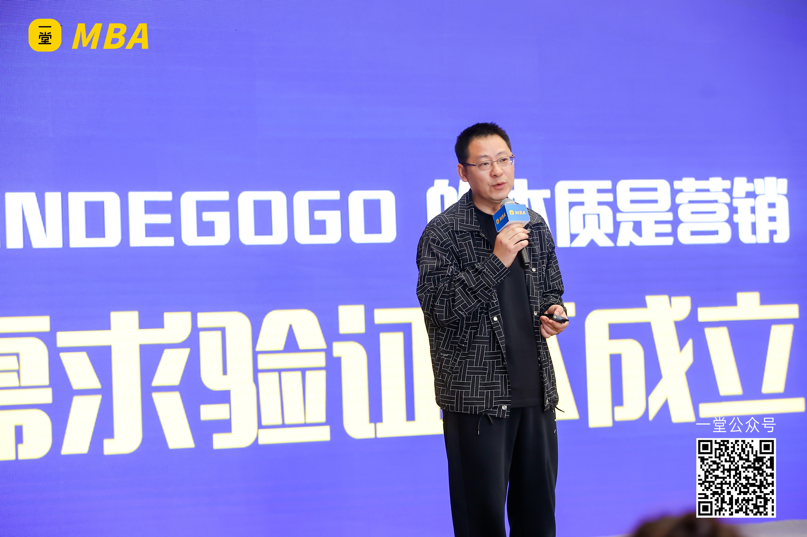 | 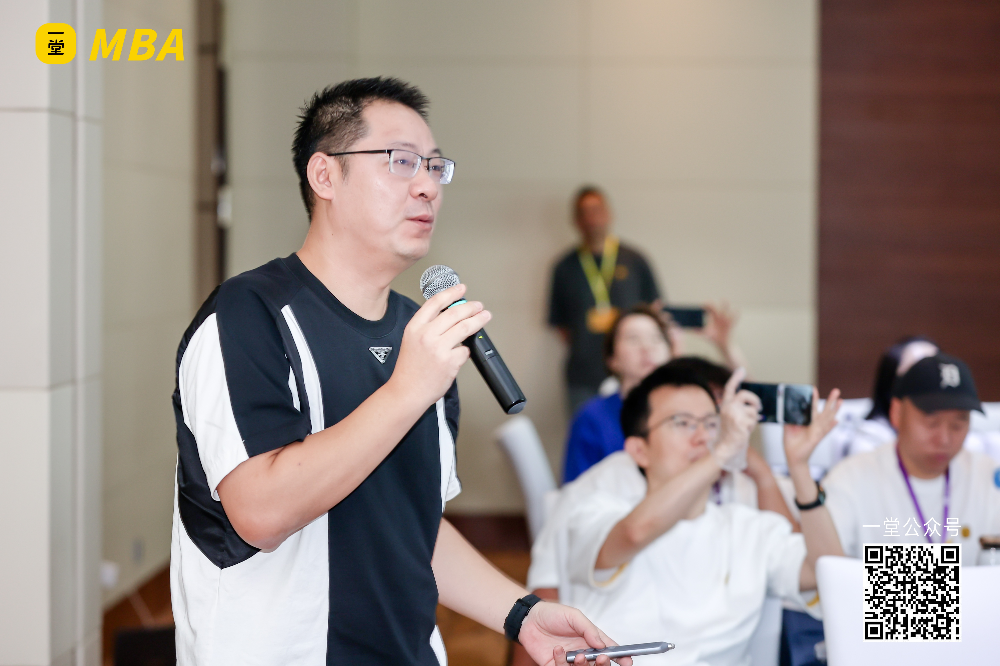 | 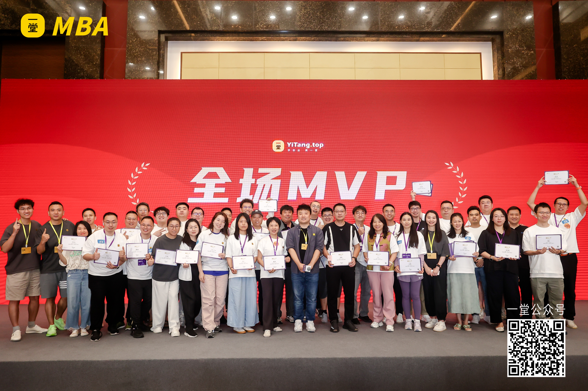 |

**我在商业管理领域的经验，几乎持续积累在ToB/ToG的业务上：**

- 我是做==**人力资源出身**==，04年毕业进入跨国公司，05年加入华为；

- 07年加入某专网通讯龙头上市公司，开始和==**营销**==杠上了，负责过==**海外业务**==和==**国内销售管理**==工作，主要客户是ToB和ToG，具体点就是公检法司，电网水利，石油石化，铁路林业等大客户生意。

- 12 年加入亚洲最大的工业设计公司，做CEO。

- 15年前后，下场创业，横跨ToC、ToB、ToG领域，做过*无人机，机器人，物联网和人工智能设备*。

- 18年前后，斗胆开始陪伴一些头部公司和创业公司进行**组织和战略升级**，在工信部专精特新小巨人和北京大学智能科技研讨班，担任创业导师和IPO商业顾问。这些年==**参与和操盘过三家公司上市**==。

- 我在一堂还有一节正式的必修课：《重新理解"战略会"》

除了连续创业者，还有一个我特别想说的身份，我是一堂的**连续**==**MVP**==：

- 2025年，复盘营第一次拿MVP，再到MBA线下营初进高阶，我一共拿了4个MVP，据说目前这个比较稀缺；

- 2026年，Truman邀请我成为MBA线下营教练，一堂同学生猛，我们班级也拿了进阶营和高阶营全场MVP：）

### 为什么要讲

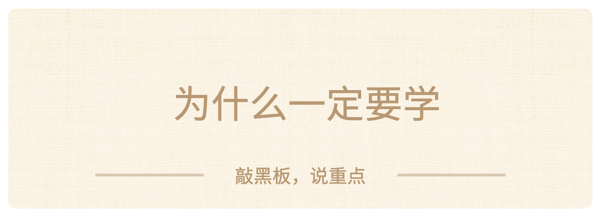

今天来分享，倒不是为了证明我很会卖东西。这已经是很久远的事情了。

为了让大家更有代入感，我先问一个更具体的场景，尤其是在做的ToB/ToG业务的同学，或者带销售队伍的同学，应该会有感觉。

你们公司有没有这样一种业务？

里面总有两三个人特别能打，客户也认他，业绩也靠他。可一旦你问：**这个项目为什么能成？换一个人能不能接？项目风险在哪里？大家就说不清楚了。换一句，不说清楚。**

最后往往只剩下几句话：**关系搞到位，客户挺支持，应该差不多**。

如果你是老板/业务负责人，或者管理销售队伍，这种状态应该不陌生。看上去每个人都在忙，单子也在往前推，但组织层面其实看不见过程。只能等最后那个结果回来：**成了，大家松一口气；丢了，再找一套解释。**

**心若在，梦就在，只不过是从头再来。**

十几年前，我花了很长一段时间，就在处理这个问题。

我最早不是做销售的，我是做人力资源出身。先去了华为，后来进入专网通讯龙头，从海外大客户销售做起，再管理国内事业部的大客户业务。

**一堂让我今天来分享这个案例，不是因为我天生特别会卖东西。**恰恰相反，我刚开始连大客户的门道都摸不着。

如果让我自己定义，我觉得自己更像一个==组织塑造者==**。**说白了，我关心的不是培养一/多个销冠，而是**能不能让一批新人也做到七八十分，让客户关系不只长在某一个人身上，让一件事的成功可以被解释、被训练、被复制，然后持续。**

后来，这套东西在国内事业部逐步跑起来：

- 我们连续两年超额完成业绩。

- 在 18 个铁路局里拿了 14 个。

- 林业和消防的市场占有率从 30% 提升到 60%

这组结果在十几前当然重要，但今天更重要的，是我探索这件事的过程：**一个原来依赖个人能力的大客户销售团队，怎样慢慢长出组织判断。**

再往后，我又管过工业设计公司，经历过无人机/机器人/AI物联网方面的创业，也做过企业上市辅导。

**行业一直在换，客户一直在换，但有一件事没变：每换一个边界，我就得重新回到事实里，把原来的判断再修一遍。**

这也是我今天想借自己的经历，和大家把 Y 模型讲一讲的原因。

不是因为它能替你解决具体业务，也不是说用了它就不会失败。

我想讲的是：**做得多，但是到底怎样才会真的越来越会？一个人从实践里长出来的判断，又怎样变成组织下一轮还能接着用的能力？**

BTW，在这里先感谢李𬱖输出的逐字稿，如果一会我讲得还行，是她总结得好。如果一会得差强人意，是我的问题。

### 提前划重点

为了不让大家听到后面迷路，我先把今天的路线交代清楚。

我会讲自己对于大客户销售体系认知的五次迭代。

| 认知版本 | 时间 | 主要背景和认知 |
| --- | --- | --- |
| 认知1.0 | 2009-2010 | 接手某专网通讯龙头国内事业部，从现成的理论和经验出发，做出第一版销售流程 |
| 认知2.0 | 2011-2012 | 开始分组测试销售实践，复盘形成五要素 |
| 认知3.0 | 2012-2013 | 开始全面推行销售体系，开始加入组织配套 |
| 认知4.0 | 2013-2018 | 工业设计公司CEO，后又持续在创业中实践，持续跨行业迁移大客户销售认知 |
| 认知5.0 | 2015至今 | 遇到Y模型，进一步把大客户销售本质转化成公理 |

在这里，也先把一个边界说清楚：**不是我当年先学了 Y 模型，才有这些实践。**恰恰相反，前面很多事我已经在做了，只是我说不清自己为什么这么做。

后来扥到 Y 模型，把我背后的认识过程重新点出来了，我才知道，原来我一直在围绕目标、事实、框架、假设、反馈和边界做事情。

所以，今天我想带大家看的是：**怎样从照着别人的答案做，慢慢变成能自己提问题、找事实、修正模型；一个组织又怎样从依赖个人，变成下一轮向上出发。**

大家听的过程中，可以一直带着三个问题：

*第一，为什么一套看起来很完整的框架，反而会让团队更不会做？*

*第二，一个人脑子里的判断，怎样变成组织能共同使用的能力？*

*第三，换行业、换客户、换边界以后，到底什么能带走，什么必须重新做？*

好，我们直接回到 2009 年。2009年，我很怀念它。

## 认知 1.0：一套完整的流程

### 真实过程

当时我们做的业务，简单理解，就是把对讲机和专业通讯解决方案，卖给企业或政府客户。

**我当时国内业务，大概情况是这样的：**

- **不成体系：**过去以渠道和小 B 客户为主，真正的To大 B、To G 大客户能力不成体系

- **产值有限：**我接的是一个正在往大客户方向转的团队，团队大概二十五六个人，年营收三千多万元，人均一百多万元

- **下滑趋势：**业务又处在连续下滑中，队伍里每个人还都有自己的打法。

而我是什么背景？

我原来做人力资源，后来去海外做销售，算是比较有规矩的大客户打法。但**海外和国内不是一回事**。国内大客户更复杂，关系、吃饭、喝酒、各种台下动作都有，单子走到一半被抢，也不是稀奇事。

说白一点，我像一个原来在河里游泳的人，突然被扔进了海里。**那套动作我记得，但水有多深、底下有什么暗流，我得重新摸。**

我先做了两件事。

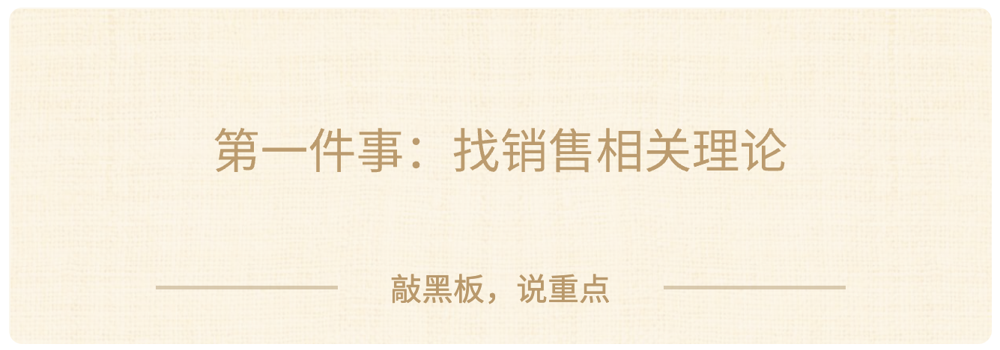

当时的我，碰到一摊自己摸不清楚的事，习惯常常是先找理论依据。**第一件事，找理论：**

- 我去看 IBM 的大客户销售、摩托罗拉的方法、华为的大客户打法

- 也看《输赢》这类当时很有影响的书

- 华为的铁三角、客户分类、项目运作，这些框架我都拿来参考。

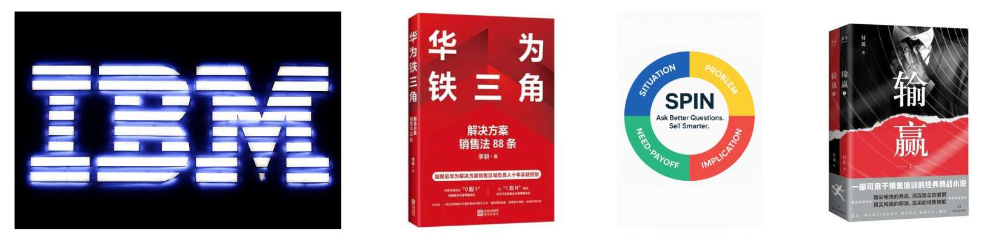

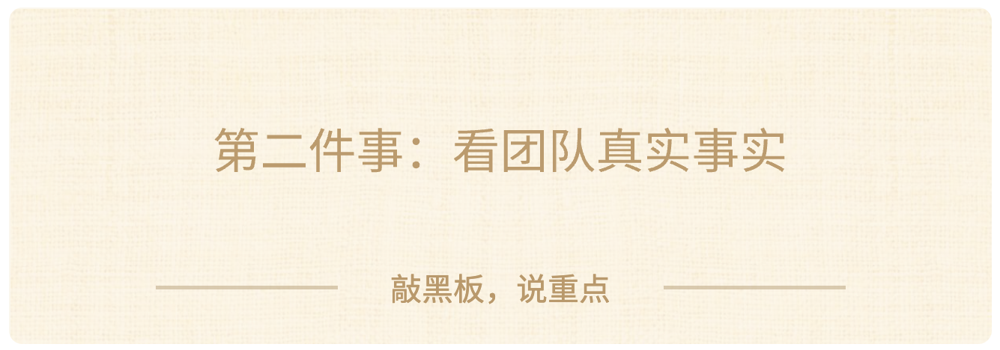

**第二件事，看事实。**我把团队过去成功的案例、失败的案例，找销售一个一个聊。总得知道，过去到底哪些动作有用，哪些动作是运气，哪些只是销售讲出来的故事。

拆完以后，我看到了几个很刺眼的事实：

- 少数几个人扛住了部门的大部分业绩，但大量线索却要很多人一起跟。

- 成熟的销售会控制自己的节奏。他明明有机会做两千万元，却只愿意领一千三百万元的任务。因为任务领得越高，下一年的业绩压力就越大。

- 大客户销售又常常在外地，过程不可控、不可考、难评价。组织最后只能看回款，看业绩，看利润。至于手上的项目是在变好还是变坏，谁也拿不出一套标准。要么不开张，开张吃三年。

- 更麻烦的是，团队打法五花八门。有人靠关系，有人靠行业理解，有人靠技术方案，还有人靠命。你让他讲，他讲的都是自己的招，别人学不了。

这时候我形成了一个判断：**大家不是不会做，而是组织没有一套标准：**

**我们不知道一个项目为什么成，也不知道它为什么丢；不知道风险是在变小还是变大；更不知道一个人的能力怎样教给其他人。**

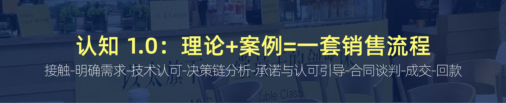

于是我把理论框架和案例实践拼在一起，做出第一版销售流程， 8 个销售里程碑：

接触 → 明确需求 → 技术认可 → 决策链分析 → 承诺与认可引导 → 合同谈判 → 成交 → 回款。

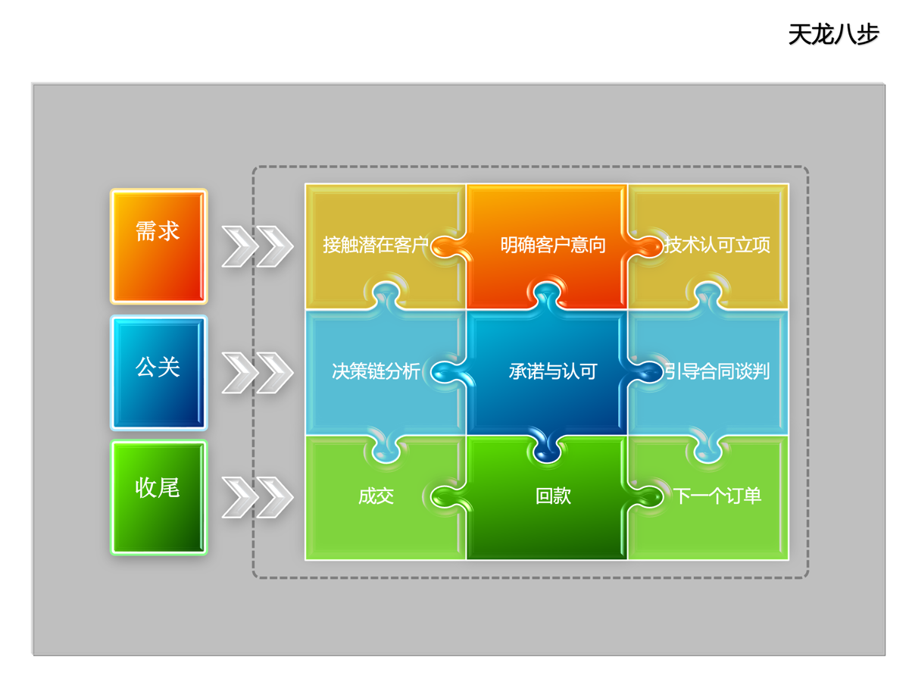

这套东西今天回头看，不难理解。它把一个大客户项目从找线索、做跟进、明需求、到招投标和交付，画成了一条清楚的线。逻辑自洽，框架坚固，流程清晰。

问题在于，我当时认为，只要所有人用同一把尺子，能力就统一了。

所以我不是先找一个组试，也不是先拿几个项目验证。我选择了在全公司强推。要求很快加上来了：

- *销售要写周报，甚至要求日报；*

- *要记录拜访，要反馈进度；*

- *要填流程，要反馈项目节点成果，要接受考核；*

- *说不清楚，还要罚*

- ……

我当时的想法很朴素：**过程清楚了，结果自然就会好。**

结果恰恰相反。

**第一，老销售头一个不买账。**他们觉得这套东西太死板。*我做了十几年销售，客户认的是我，单是我一顿顿喝出来的，你现在让我天天写报告，填这些表，有什么用？*他们对这套流程的反馈最差。

**第二，新人也没有接住。**对他们来说，这套系统太复杂。一个刚转销售的人，还没有形成业务手感。*一下面对 8 个里程碑、一堆表格和一堆判断，他不知道从哪里开始。最后只能机械地填，填完也不知道自己填的是什么。*

**第三，中间还有一批人，***本来能力就没有那么强，他们看到老人反对，看到流程复杂，也开始摆烂。表面上跟着做，实际上一动不动。以前靠嘴说故事，现在靠文字编故事。*

就这样用了三个多月，**业绩一塌糊涂，团队怨声载道**。

我那时候是空降管理者：

- 业务不熟，自己的队伍还没有带出来。

- 老人对我不满，新人也对我不满。

- 上面有业绩压力，下面没有信任基础。

所以，盲人瞎🐎，夜半临渊。第一版的全公司推行，只能暂缓。

### 背后思考

这次失败让我很难受，但逼着我把问题重新想了一遍。

错误归因嘛，指责他人最简单：**失败是因为团队不听话，老销售太顽固，新人能力不够。**

**这个解释最省事，也最没用。解决问题不行，我还不能解决提出问题的人？**

**不行。**

真正的问题是什么？至少有两件事没有成立。

IBM、摩托罗拉、华为的方法，都是其他企业从自己的事实里长出来的。我拿过来以后，只看到了它们的“形”：有哪些阶段，要填哪些表，要做什么动作。

但我没有先回答：在我们这个行业、这群客户、这个团队里，哪些动作真的改变了项目结果？哪些要素一旦不具备，项目就做不成？

在这种情况下，以为可行，但是没有结果验证，贸然全面推行，必然产生组织上的阻力。

我给团队规定了要做什么，却没有建立一套事实因果系统：同样的阶段，有的人做对了什么，有的人漏掉了什么；一个项目从有希望到没希望，中间到底发生了哪些事，做了哪些动作。

周报如果只是“我见了谁、我做了什么”，它记录的是动作。要能复盘，至少还得有：这个项目现在走到哪，我原来怎么判断，客户给了什么反馈，哪里和判断不一样，下一步准备验证/推进什么。

没有这些事实逻辑和因果关系，表格填得再满，也只是管理痕迹，不是组织能力。

当然，我也没有全盘否定第一版。错也要错得冠冕堂皇。

**如果没有前面的理论梳理和案例拆解，我连大客户项目大概要经过哪些节点都不知道。**理论不是没用，它至少给了我一个可选的骨架，让我知道应该从哪里看。

**但如果只有理论，没有事实和反馈，这个骨架就是一个空架子。**

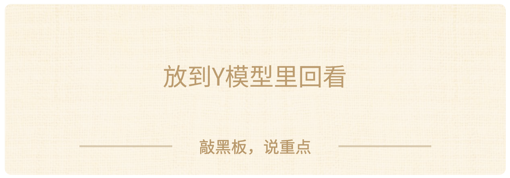

放到后世的 Y 模型里看：

- 我当时主要抓住了“理论”这一叉，只是做了一套管理动作。

- 事实我看了，但看得不够深；尤其是没有抓住因果关系。

- 假设和反馈也拿到了，但反馈没有变成下一轮框架的修正依据。

**更像是在用别人的答案，要求自己的团队交卷。**

所以第一次迭代真正留给我的，不是一个更好的流程。是一个新问题：

**既然不能靠强推让别人照着做，那我怎样才能先看见事实，再让团队从事实里形成自己的判断？**

那怎么办？

这就是第二次认知迭代要讲的事。请听下回分解。

书接上回。

## 认知 2.0：提炼销售五要素

### 真实过程

第一版强推失败以后，我不可能把所有人都换掉。这样做，老板估计要把我换掉。业务还得做，客户还在那儿，团队也不能一直耗着。

那我怎么办？

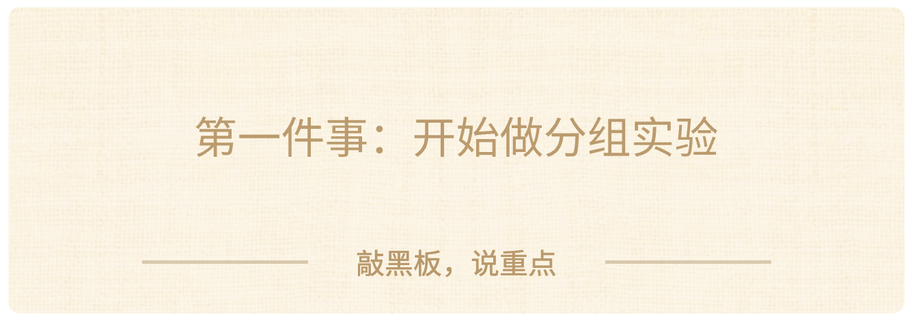

2010 年年初，我从学校招了 30 多个销售，实习先放到技术行销部练技术。这个岗位是做售前方案支持的。新人先跟着看现场、摸产品、做方案，练一两个月，再从里面挑适合做销售的人，正式入职转到销售岗。

这里说个细节，为什么让他们先练技术？大客户销售如果连客户的需求都听不懂，连技术方案能不能匹配都不知道，他只能回去讲关系。先有一层技术底子，再到项目里做判断，至少不会歪。

**原来的销售队伍，我没有再用同样要求把所有人绑在一起，而是分成了两类。**

**一类是能力很强、独立性也很强的老销售，作为A组。**他们有自己的一套，也有自己的客户。我暂时搞不定，那就晚点搞。先不硬改，你们继续按自己的方式做，前提是把结果交回来。

**另一类是愿意往新方法上靠、但能力还没有那么强的人，组成 B 组。**B 组不能只接业绩，要按新的流程记录过程，参加复盘，把每一步为什么这么做讲出来。

再加上我自己带的新人，实际上就是三组并行：**新人组、独立老销售A组、新方法B 组。**

这套安排，里面有大胆实验，也有心酸妥协。

**你不能让所有人承认自己过去可能是不对的，也不能让业务停下来等大家想通。**那怎么办？

**让不同做法先并存，让结果慢慢说话。**

所以，那次不是争取说服所有人，而是让假设有了比较的机会。

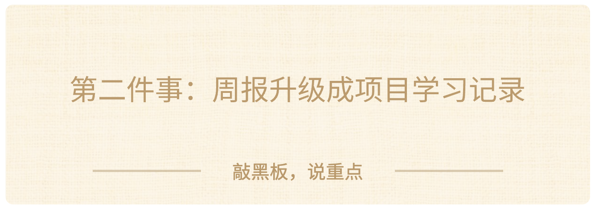

**分组只是第一步。**真正难的是，怎么知道一个人这一周到底做了什么、为什么做成、为什么没做成。

之前第一次尝试，我也让销售写周报。但那个周报更像管理检查表：拜访了谁，跟到哪一步，下周继续。写得很满，拿回来还是不知道怎么判断。

**第二次，我把周报改成了项目学习记录。**格式大概就四件事：

- 这个项目这周推进到了哪个阶段；

- 具体做了什么；

- 哪些判断对了，哪些动作错了，下一次应该怎么做；

- 下一步准备验证/推进什么。

听起来还是很朴素，对吧。

和原来的周报有一个==**本质区别**==：**原来记录的是“我很忙”，现在记录的是“我原来的判断，和客户给回来的事实有没有对上”。**

比如，一个销售这周说，我要约客户的关键人吃饭，把技术问题讲清楚。到了下周，他没约出来。原来的周报可能写“继续跟进”。这句话等于没写。

真正有用的复盘要往下追：*是电话没打通，是他不愿意单独见，是采购流程变了，还是你的技术方案根本没有进入他的关注范围？你原来以为约出来就能推进，这个判断为什么不成立？*

这个里面，你只有把项目拆在固定流程里，才能追问。否则很多老销售从 A 点直接跳到 C 点，B 点到底是做了关键动作，还是碰上了死耗子，谁也说不清。

当然，只让销售自己评价自己，也有问题。人会美化自己。哪怕这件事没做好，周报里也可能写成“客户极度认可，正在努力推进”。

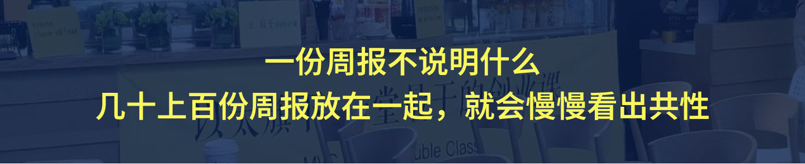

所以，**一份周报不说明什么，几十份、几百份周报放在一起，才会慢慢看出共性：到底哪类动作真实有效，哪类动作只是证明我很勤奋。**

各位如果正在带团队，可以想一想：你们一周一次的复盘，到底是在汇报动作/结果，还是在核对关键判断？如果大家只写“见了谁、做了什么”，却说不出原来怎么判断、现实哪里不一样、下一步验证什么，那个复盘基本无效。

周报解决的是颗粒度。**但周报只看一个项目，很容易陷在局部。**

有的项目做成了，不代表方法对；有的项目丢了，也不代表动作全错。

*客户的预算出了问题？*

*友商技术实力太强大？*

*销售人员见神磕头，遇庙抽签？*

。。。。。。

你要是做过大客户销售，就知道什么叫做**不确定性**。就知道什么是**波粒二象不可测。**

那怎么从一堆项目里判断，什么才是真正影响成败的？

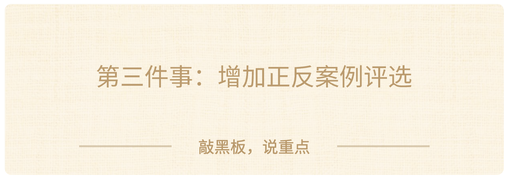

**我们又加了一个动作，叫正反案例评选。**

每个月把成功和失败的案例拿出来，评选好案例前三、坏案例前三，8 个区域经理和我一起评。

这个评选有一个很关键的标准：**不是按结果好坏评，而是按案例分析的深度和典型性来评。**

有句话叫做，*事已至此，来都来了，大过年的。*

事情已经发生了，单子成了就是成了，丢了就是丢了。我们要看的是：**你原来阶段是什么，每个阶段的判断什么，客户实际反馈什么，中间发生了哪几个关键变化，哪个判断导致项目走不下去，哪个判断让项目拐到了南泥湾。**

所以，周报和案例集不是一回事：

- 周报看细颗粒度的过程：这一周发生了什么，下一步怎么办。

- 案例集看跨项目的东西：哪些要素反复出现，在不同项目里谁的权重更大

说白了，**周报帮我还原事实，看实事；案例集帮我比较事实，找规律。**

比较得多了，**销售五要素**才开始一点点成形。

**最早，我重点盯的是**==**预算**==**和**==**关键决策链**==**。**因为一个大客户项目，如果没有预算，或者你连谁拍板都不知道，后面很多动作都是空的。

但是，项目很快给了我一个反例。有些单子，预算已经摸清了，关键决策人也搞定了，大家以为差不多了。**继续往技术里走，才发现技术根本不匹配。**前面关系做得再顺，方案过不去，这个单子还是做不了。**所以，**==**技术认可**==**必须补进来。**

**多说一嘴，强扭的瓜不甜。生命中所有不属于你的灿烂，终将要用你的寂寞来偿还。**

再往后，==**客户需求、友商竞争**==也进来了。同一个项目，如果客户真实需求没有摸清，你拿的方案再完整，也只是自己觉得完整。

**如果友商已经在客户内部设了标准、做了参数、拿住了关键关系，你还按正常节奏往前推，就可能一直是在陪跑。**

这样一步步走，最后才形成**预算、需求、技术认可、关键决策链、友商**这五个要素。

### 背后思考

这里我要说清楚：**五要素不是我坐在办公室里列出来，再拿到现场验证的。它也不是一次性设计完整的。它是项目做回来以后，不断发现“这个判断还少一层”，再一点点补出来的。**

模型不是我想完整的，是被项目和失败一步一步逼出来的。

那五要素出来以后，原来的 8 个里程碑还有没有用？

有，而且两者不是并列的两套东西：

- **8 个里程碑管的是项目走到哪**：从接触、明确、技术认可、决策链分析，到承诺、谈判、成交、回款。

- **五要素管的是，你走到这一步，到底要看什么、判断什么、接下来做什么。**

你可以理解为，**八步是进军路线和里程碑，五要素是每一步必须核对的战术动作。**

**比如刚开始收客户信息、做客户分类，不是每个客户都要往上冲。**先看需求匹不匹配，实在不匹配就早点放弃，不要把团队的时间耗进去。

**到了技术认可这一步，才重点去摸关键决策链、组织结构、中间人、内部支持者。**谁是使用者，谁提技术标准，谁有否决权，谁最后拍板，这些东西要一层一层梳理。

*问一个问题：可不可以同时做？*

*第二个问题：第一个要做的是什么？*

**首先是预算。**

**不展开了，如何做预算都可以单开一门课。**

**至少不能只写一句“客户有预算”。**预算怎么编，钱从哪里来，谁参与审批，什么时间窗口能影响，这些都要变成具体动作。

|  |  |  |

| --- | --- | --- |

| 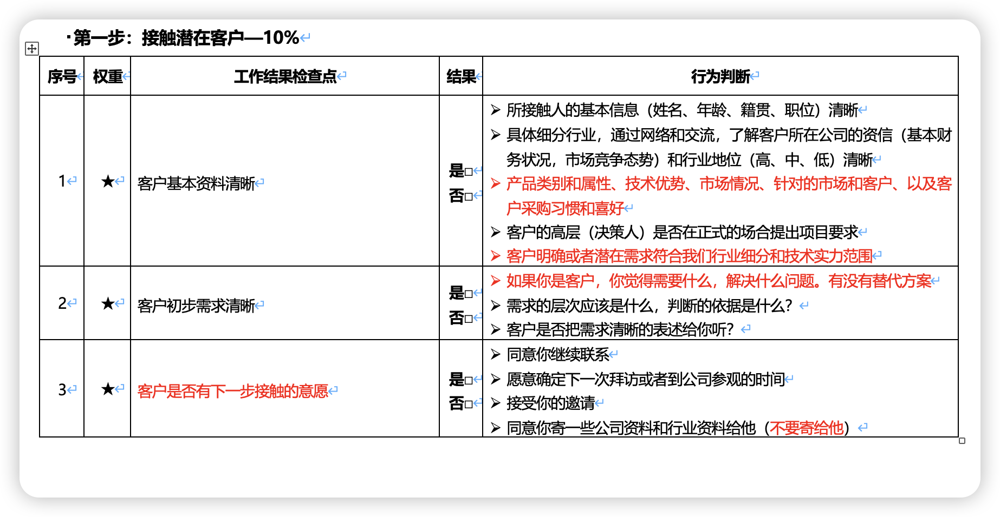 | 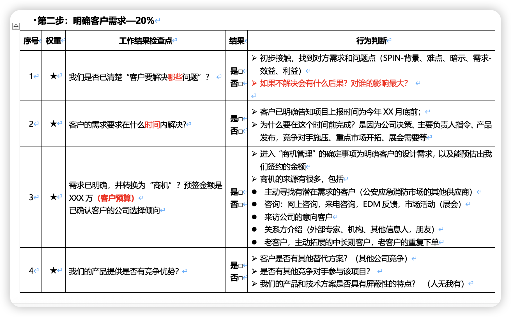 | 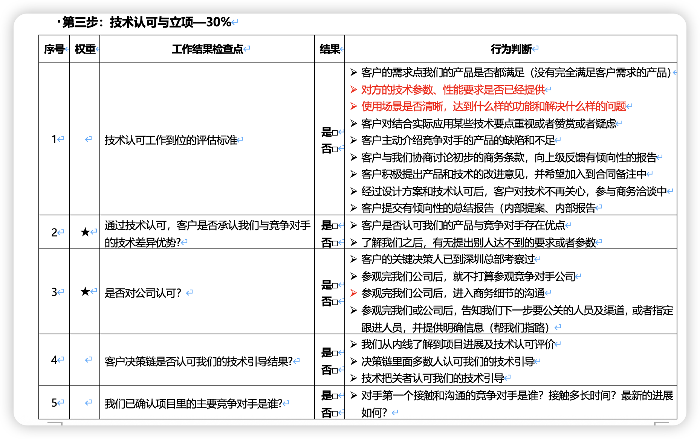 |

| 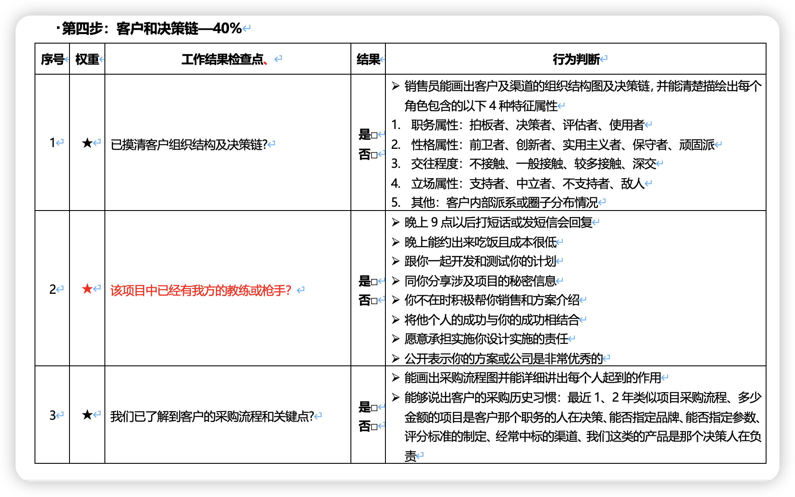 |  |  |

|  |  |  |

| --- | --- | --- |

| 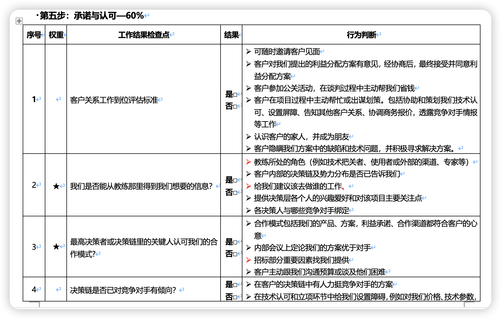 | 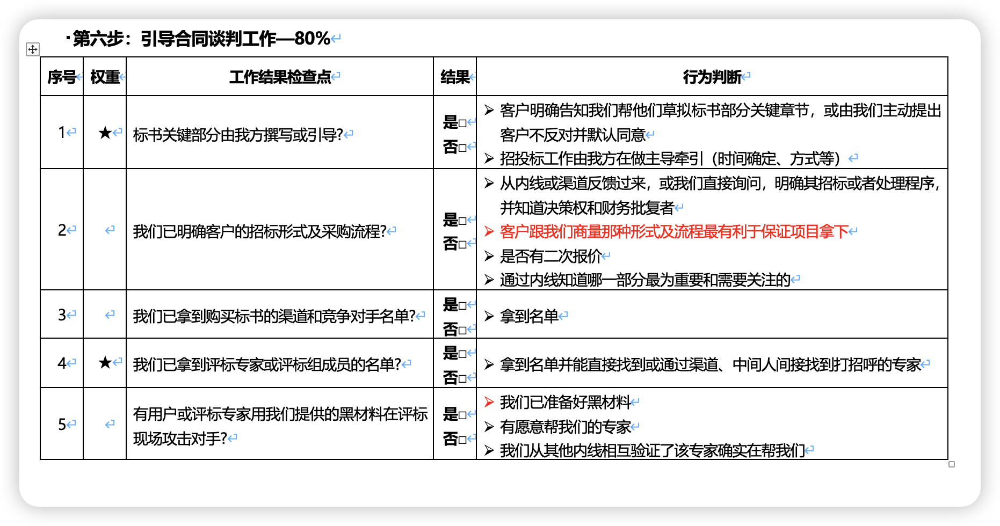 | 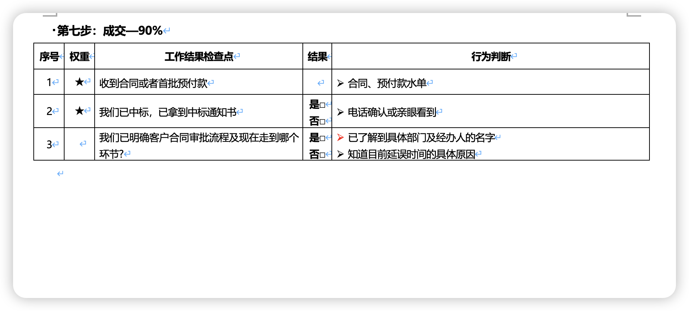 |

| 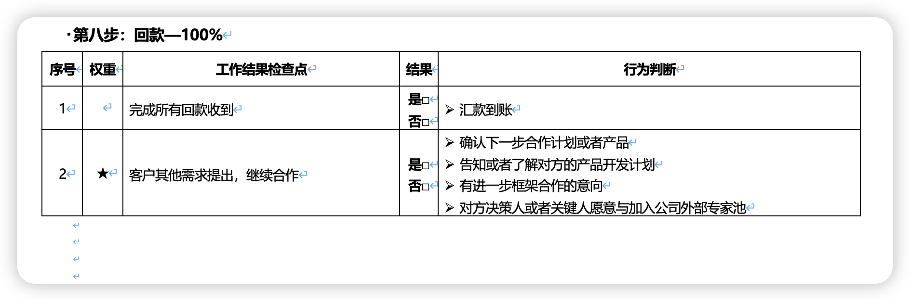 |  |  |

**△天龙八部 checklist**

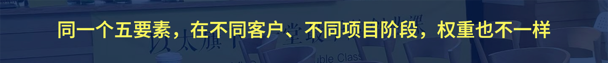

**同一个五要素，在不同客户、不同项目阶段，权重也不一样。**大项目和小项目不一样，新技术和老技术不一样，有预算和临时立项也不一样。

八步告诉你什么时候做什么，五要素提醒你，做这件事到底要拿到什么事实和判断。

这套东西不是第一次讲就都会。我们大概用了六七个月，才把第二次模型磨出来。

到 2010 年下半年，B 组和新人的销售业绩开始起来。这个时候，团队里反对和质疑的声音才慢慢变少。

为什么？不是因为我讲得更好了，是因为他们真看到了：同样一批客户，按这套方法做，项目结果确实在变。

也只有到了这个时候，8 个里程碑和五要素才具备==全面推行==的条件。

我后来回看第二次迭代，会发现它其实已经在做一件很接近 Y 模型的事：**先有一个判断，再把它放到项目里做，拿回事实，比较结果，错了就修模型，再指导下一步实践。**

当时没有Y模型这一套，我们就是被项目逼到那儿了，只能用这种笨办法一层层试。后来学了 Y 模型，我才反过来把它说清楚。

第二次迭代解决的是“**怎么让事实可比、让实践迭代认知、让模型长出来**”。

**但新的问题又来了：**这套方法如果只能靠我盯着，离开我就跑不动，那它还是个人能力。怎么让区域经理自己带复盘，怎么让好案例变成培训，怎么让新人一批批接上来？

这就是第三次迭代要讲的事。

## 认知3.0：增加组织配套

### 真实过程

第三次迭代，我关心的已经不是“这套方法对不对”，而是另一个问题：**一个人从项目里修正出来的认识，怎样才能变成组织下一次还能接着螺旋提升的能力？**

我们先做的**第一件事，是让销售过程看得见。**

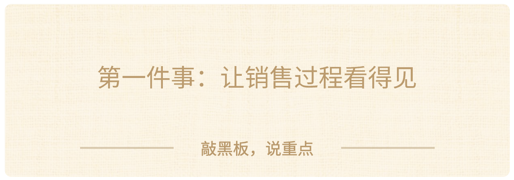

成立了销售运营部，专门管理整个销售过程。出差前后要留下什么，客户信息怎么记录，项目走到哪个阶段，复盘资料怎么收、怎么提取，都要能记录下来。记录下来还不算完，还要能回溯，能拿出来分析。

有了过程数据，管理才有抓手。但数据和记录只是把事实留下来。留下来以后，还得有人带着大家把梳理明白。

这就到了**第二件事：复盘从被动变成主动。**

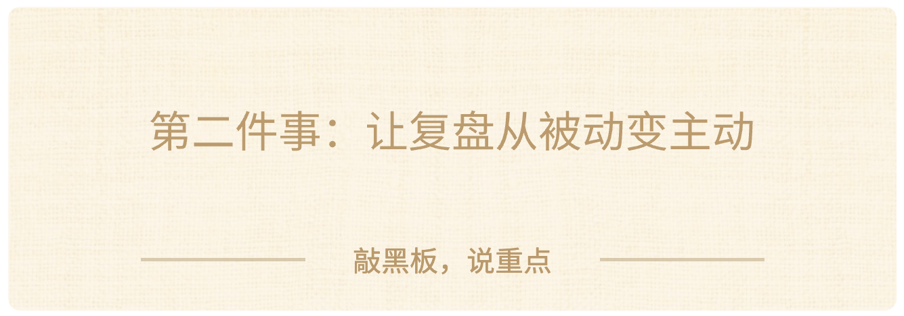

以前更多是上面要材料，下面交材料，复盘像一次检查。后来我们把这件事交给区域经理，让他们带着自己的团队做。复盘资料要上交，要评比，也要进入过程考核。

区域经理不能只问“这周见了谁、下周准备干什么”，他要往下追：你原来以为这个客户最在意什么？客户实际怎么回应？哪一句话、哪一个动作让事情发生了变化？你说客户认可了，认可的是公司、方案，还是你个人？下一步要拿什么事实来验证？

这么追问，一开始很多人不舒服。因为大家习惯了汇报动作，不习惯把自己的判断摊开。但组织要长能力，就绕不过这一关。**复盘不是把做过的事再说一遍，而是找出原来的判断和客户事实在哪里对不上。**

运营让过程可记录，复盘让因果能讨论。接下来还有**第三件事：把这些修正变成可以教、可以练、可以检查的东西。**

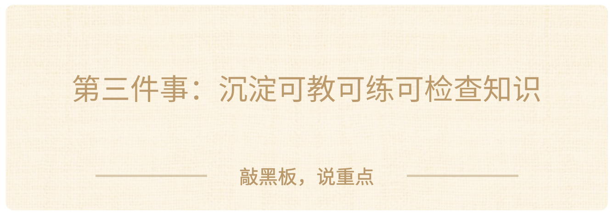

行业分析怎么做，客户分析怎么做，决策树怎么画，这些不能永远停在优秀销售的个人经验里。**要把它们形成文档，形成操作指南，形成培训材料，最后细到销售一周关键动作，拿着一张清单就能对照。**

到了我最喜欢的环节，按照清单划勾划叉，哪里不会点哪里。

|  |  |  |

| --- | --- | --- |

| 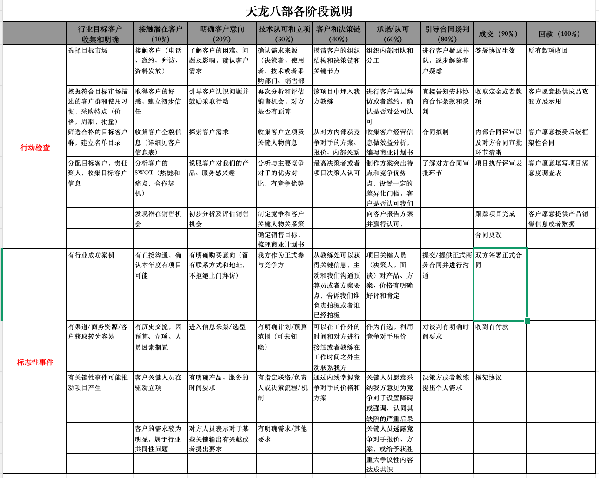 | 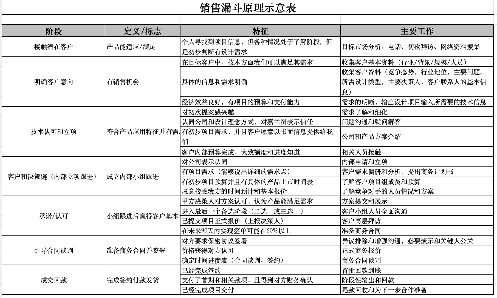 | 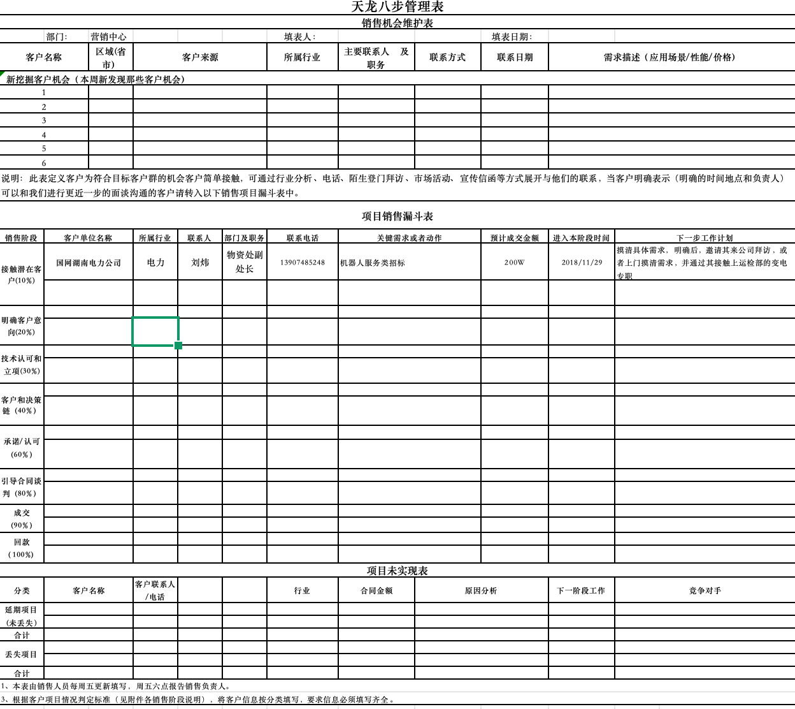 |

| 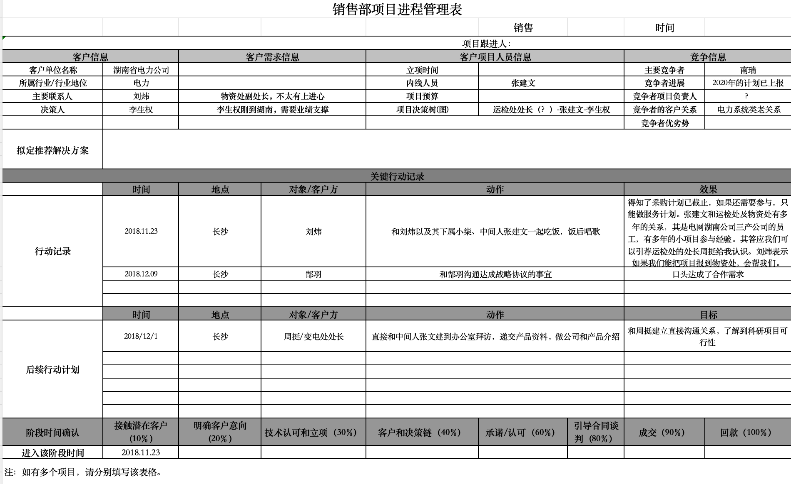 | 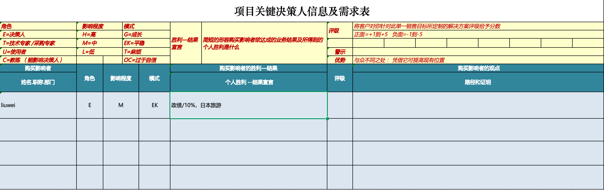 |  |

市面上会做大客户销售框架的公司不少，八步、五要素这类名字，网上也能找到相似的说法。**真正难的不是把框架画出来，而是解决项目到底卡在哪一步。**

*你知道要“破冰”，不等于你张开嘴就知道第一句话怎么说；你知道要“建立客户关系”，不等于你知道第一次拜访该怎么约、吃饭该怎么安排、方案该怎么讲。*

我们后来把这些销售基本功叫作“十八般武艺”。它不是在八步之外再造一套框架，而是把**完成八步所需要的动作，拆到新人能够观察、能够模仿、能够练习、也能够被检查的颗粒度**。如何邀约，如何第一次见面、请客户吃饭、展会怎么做、样板点怎么打、技术方案讲解、异议如何处理、报价、标书制作、客户关系树等等，都是这里面的具体功课。

我举两个很小的例子，大家感受一下这个颗粒度。

**比如见客户的第一句话怎么说。**

很多新人一见面会这样介绍：“孙处你好，那我是某某公司的某某某。我的公司做什么，我们的产品是什么……”这句话不能说他没礼貌，但它一开口是从自己出发的。客户听到的是“又来一个卖东西的”，不是“这件事和我有什么关系”。

所以第一句话也要设计。我们当时会练一种“钩子话术”。比如先说：“孙处，我上次跟您联系过，前面您提到项目里有一些问题，我今天来给您做个汇报。您看在这个场景下，现在最让您头疼的是哪几件事？哪些是我能帮您解答的？”

它不保证客户马上认可你，但至少把话题从“我有什么产品”转成了“你正在解决什么问题”。客户开始讲自己的问题，后面才有交流。

**再比如，见一个大客户，到底应该穿得正式一点，还是随意一点？**

我们内部也争论过。后来在大量实践和复盘里发现，一个比较稳妥的做法，是**比客户稍微正式一点点**。**太随意，显得不专业；过于隆重，又容易给对方压力，拉远距离。只正式一点，既表达尊重，也还能保持亲和。**

测试，当你看到一个西装革履，言语规范，彬彬有礼的人向你推荐，你第一感受是什么？

谢绝推销。

当然，这不是到处都能套的礼仪定律，不同行业、不同客户、不同场合还要重新判断。但它说明了一件事：SOP 不是只写到“注意职业形象”这种程度就结束了。如果一个动作反复做到位，就要继续往下拆，拆到他能练习，经理能看见，团队能反馈。

可是有了 SOP，还不等于有了能力。手册发下去，大家看一遍，知道了，现场还是不会。真正难的是练。

**我们不是把十八般武艺写出来就结束了，而是带着团队一遍遍练。**

*区域经理要示范，新人要演练；*

*真实客户现场，经理要看他是怎么开口、怎么问问题、怎么处理异议的；*

*回来以后再复盘，哪一句有效，哪一步被客户带走了，下一次怎么改；*

*奖励惩罚。*

这里我还想补一个组织惯性的问题。

老人在一个位置上待久了，会疲惫，也会形成路径依赖。哪怕原来的方法有效，做久了也可能变成机械重复。所以组织不能只靠老人守成，要不断引入新人，让新人带着问题去冲击旧逻辑，也要让位置流动起来。

我们当时有一条比较硬的规定：**每半年，8 个大区里排名最后的一把手免职，由排名第一的区域副手接任。**

**这条制度能用，**==**有一个前提**==：标准动作已经相对统一，客户关系和项目记录留在组织手里，而不是绑在某一个人身上。否则你一调人，客户也跟着走了，那就不是组织能力，只是换了一个人重新开始。

### 背后思考

这些配套慢慢跑起来以后，整个销售情况有了一些改观。

==**业务结果上：**==

- 连续两年超额完成。

- 18 个铁路局拿下 14 个。

- 消防、林业占有率从 30% 提升到 60%。

==**业务管理上：**==

- 销售流程可控、销售结果可预测，

- 客户联接从销售个人转到组织。

==**人才培养上：**==

- 新人成批成长速度明显加快；

- 区域经理（总监级）成长速度加快。

还有个微妙的变化，我发现管理语言变了。

举几个例子来看。

**以前一个销售说“这单快成了”**，管理者只能问“关系怎么样”“什么时候签”。

**现在我们会看五要素：**

- *预算走到哪一步，*

- *真实需求是什么，*

- *技术认可还差谁，*

- *决策链上还有没有反对者，*

- *友商是不是已经设了标准。*

*销售说快成了，管理者反而能指出，现在还有哪几个风险点没有解决。*

**以前一个新销售问“这个客户我拿不下来”，**可能只能得到一句“再跟跟”。**现在区域经理可以带他回到流程里看：**

- *是客户选错了，*

- *是需求不匹配，*

- *是技术没有过关，*

- *是关键人找错了，*

- *还是竞争路径从一开始就没设计。*

你看，同样是带团队，前面靠的是个人经验，后面靠的是共同语言。客户信息、项目判断和复盘结论，也慢慢从销售个人脑子里，进入组织的记录、培训和检查里。

这个过程没有那么顺利。有人会抵触，有人会觉得动作太细，有人练了也还是做不好。但组织能力本来就不是把所有人变成一样的人，而是让所有人，知道该练什么、做到什么程度、遇到问题找谁、下一次怎样比这一次做得更好。

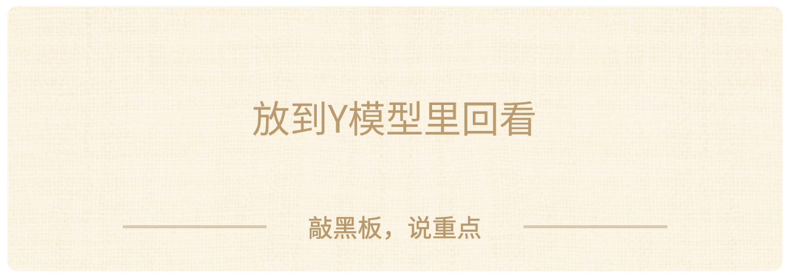

放回Y模型来看，**组织配套完全是一个实践科学，**光有头脑中“推演”的爽感还不够。组织配套是很多时候Y模型真正发挥价值的关键。我经常讲“目标路径资源节奏”，前面目标路径再好，没有资源，也没办法落地。

所以第三次迭代真正解决的，不只是流程更完整，而是形成了一种组织认知迭代的**加速度**。

**加速度不是每一单都机械地跑得更快，而是当一个新事实出现以后，组织能更快地把它变成一次复盘、一条新的判断、一个动作修正，最后进入下一次循环。**

如果一个人走了，客户资料、项目过程和判断依据还在；如果一次失败发生了，不只是罚一个人，而是能修改组织下一轮的做法；如果新人进来了，不用从零开始重新踩一遍，那这个组织就开始有自己的记忆了。

这比某一个人特别会卖东西重要得多。

**所以在这家公司不同阶段的认知变化，小结一下：**

- 第一阶段是照猫画虎移植优秀经验，

- 第二阶段从形里提取规律，五要素让体系推进一大步

- 第三阶段用组织复盘和配套把零散行为变成组织习惯。

但是，在这家公司这套东西能跑，那如果换一个行业，客户买的东西变了，决策方式变了，交付结果也变了，这套东西还能不能带过去？

这就是第四次迭代要回答的问题。

## 认知4.0：实现跨行业迁移

### 真实过程

2012 年前后，我去了当时亚洲最大的工业设计公司，给客户做产品的外观设计、结构设计，简单理解，交付的是产品效果图和市场品牌服务。

这和上家公司完全不是一回事。

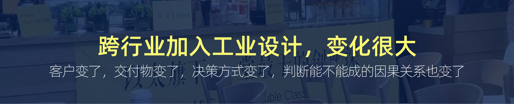

**客户变了，从原来ToG为主，变成ToB业务。**

原来在上家公司，主要是做军队、公安、消防、石油石化、电力能源、铁路、林业这些客户。

而这家工业设计公司的客户构成基本是大B小B混合，有3C数码比如手机、手环、手表、电脑的品牌，也有医疗设备类的厂商，小米，联想，华为，摩托罗拉，迈瑞，还有三一重工、中联重工这样的重工类客户，甚至还有矿泉水瓶子的品牌。

买个关子，你们可能想不到是哪一家矿泉水。

**交付物上，从标准化产品变成非标设计服务。**

上家公司卖给政府和企业的是对讲机、通信解决方案，最后有一个实实在在的产品。

这家公司卖的是设计服务。客户把项目交给你，你给他几张图、一套结构方案，他认可了再往下开模、生产、销售。

手机、医疗设备、重工机械、3C 产品，客户都做，需求千差万别。

同样做一个手环，成熟大品牌和创业公司要的东西不一样；同样的医疗设备，面向医院和面向家庭，审美、成本、使用方式也不一样。厚一点、薄一点，方一点、圆一点，用什么颜色、什么材质，都没有一套固定答案。

所以这次，客户变了，交付物变了，决策方式变了，判断一笔生意能不能成的因果关系也变了。

需要说一下，这家公司本身很强。公司有 200 多名工业设计师，很多人拿过红点、iF 这类奖项。按我当时的理解，行业里想找外部设计公司的客户，很多会找到它。品牌、设计师、交付能力，都是它的优势。

**但也正因为公司一直很强，团队形成了一套很顺手的业务惯性**：我熟悉这个行业，我认识这个客户，公司出活快，价格稍微高一点也能接受，过去就是这么卖成的。所以提案的时候，经常先讲公司多厉害、拿过多少奖、做过多少大项目。

这套打法有没有用？在品牌本身就能带来信任的时候，有用。

但它有一个问题：它证明的是“我很成功”，没有证明“你为什么能成功”。客户听完知道你很强，却不一定知道，你为什么真的理解他的产品、他的市场和他的生意。

**如果我当时直接把上家公司的八步、五要素和十八般武艺搬过来，会怎么样？**

大概率也会出问题。因为那些动作是长在上家公司那个业务里的。这家公司客户买的不是一个标准产品，也不是一套技术参数明确的解决方案。你拿旧答案来套新问题，表面上动作都很熟，实际上判断可能是错的。

那怎么办？

先别急着改，**第一件事，先把事实看清楚。**

我花了大概一个月时间，**去看他们原来怎么做销售、怎么见客户、怎么提案、设计团队怎么画图、项目最后怎么成交**。我关心的不是他们哪个动作看起来不专业，而是这套业务真正靠什么往前走。

客户为什么买工业设计？预算是怎么来的？谁决定用哪家公司？他更在意品牌、价格、创意，还是产品能不能卖好？友商是谁？一个项目从第一次接触到签约，中间到底经过哪些关键节点？

**没有调查，没有发言权。**

上家公司的五要素，是我在通信行业的事实里一层层摸出来的。到了这家公司我也得重新摸一遍。摸完以后，我才发现，**五要素的名字好像都还在，但它们的内涵、权重和先后关系，已经变了。**

在上家公司，我们最早用两个维度看客户：**有没有钱，进入难度高不高。**两个维度一分，四象限，基本就能判断一个客户值不值得投入。

到了工业设计，这个颗粒度不够了。

同样是“有预算”的客户，行业不同、规模不同、品牌定位不同，愿意为设计付的钱完全不一样。一个成熟手机品牌做旗舰产品，和一个创业公司做第一款产品，对设计的要求、预算的上限、决策人的关注点都不一样。

所以客户分类要重新做。我们后来用==**行业特性、客户规模、定位要求**==三个维度，每个维度再分三档，形成一个九宫格。这个分类不是为了画得漂亮，它直接决定一个客户的交易价格上限，也决定你该用什么方式去打。

**上家公司面对的大客户，很多是国家预算、单位预算。钱一旦列进去，什么时候花、怎么审批、走不走招投标，相对有规律。**

**工业设计面对的是商业预算，客户可花可不花，可以增加，也可以临时取消，**还要看产品上市的紧急程度、市场竞争和供应链准备。

预算不再是一个静态数字，而是一个会变化的经营选择。

**在上家公司，技术认可经常是主战场。**你的产品行不行、方案能不能过、参数符不符合要求，过不了这一关，关系再好也没用。

到了这家公司，情况不一样。它本来就是行业头部，客户对它的设计能力有基础信任。**技术认可不是不重要，**而是不再需要花那么大力气证明“我能不能做”。真正要证明的，变成了“我做的这个东西，能不能帮你在市场上赢”。

这家公司的竞争对手大概分成两类：一类是大量的小型设计公司，一类是同样有品牌、有规模的头部设计公司。

面对前者和面对后者，你靠的东西不一样。有时候靠设计能力，有时候靠品牌，有时候靠价格，有时候靠你对客户行业的理解。竞争策略不能笼统地写一句“打败友商”。

To G 的大项目，往往要从预算开始，一路做技术认可、关键决策链、招投标、合同、交付，周期很长。工业设计经常一两次交流就能把需求、预算和竞争情况摸个大概，真正决定胜负的是提案现场。

路径短，不等于事情简单。它只是把原来分散在几个月里的判断，压缩到了一两次高密度的交流里。你在现场能不能快速理解客户、匹配预算、找到技术边界、说清竞争差异，反而更难。

这里有个有意思的点，过去团队习惯带三个方案，让客户从 A、B、C 里挑。看起来给了客户选择，实际上经常把判断责任又推回给了客户。

我后来遇到一些团队搞不定的客户，也会去上阵提案，但是我只带一个方案。

不是因为我拍脑袋觉得哪个好看，而是前面要把信息摸够：客户到底为什么现在要做这个产品，他的预算和上市时间是什么，竞争对手是谁，供应链准备到什么程度，关键决策人过去喜欢什么风格。信息够了，我再给一个最有把握的推荐。

现场讲的重点也变了。我不再问客户“你想做一个多好看的东西”，而是告诉他：你的企业现在为什么需要这个产品，这个产品在市场上应该长成什么样，才有更大的机会成功。

说白了，我要让客户感觉到，我不是来卖一张图的，我是站在他这边，帮他降低产品失败的风险。

不过，“只带一个方案”不是一个到处都能用的招。它依赖前期信息足够充分，依赖你对客户和市场的判断，也依赖客户对你的信任。前面没摸清楚，只带一个方案，风险反而更大。

这就是迁移里最关键的一层：**五要素的名字没有变，但每一个要素里装的事实变了，权重变了，因果关系也变了。**客户分类、预算性质、技术认可、友商竞争、销售路径、提案方式，都得重新长。

后来，这套调整在这家工业设计公司跑出了结果，人均月产出从 1 万提升到 3 万。

再往后，人生不甘平凡，哪怕倾家荡产。我开始自己下场创业，做过无人机，机器人，也做过电力行业的 AI 产品。

**无人机这段，迁移反而顺一些。**

客户还是公安、消防、电力、石油石化这些 To G 客户，销售路径、样板点、试用、小批量、预算逻辑，很多都能接上原来的经验。

难的地方不在销售方法，而在资源有限、市场要教育、组织要等它慢慢长起来。打个不太准确的比方，还是卖油翁那套手艺，只是葫芦变小了，倒的时候要慢一点。

这个阶段，我们的市场占有率，三年内做到公安、消防、电力、石油石化四个行业第一。

机器人不再赘述，参见案例Leo的狗，一堂的书里面有。你买来看，肯定有帮助。

|  |  |  |

| --- | --- | --- |

| 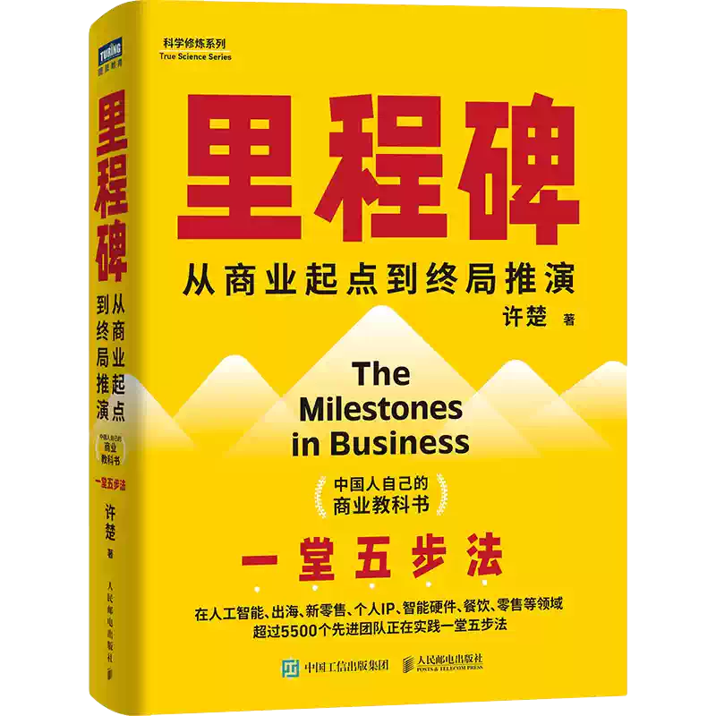 | 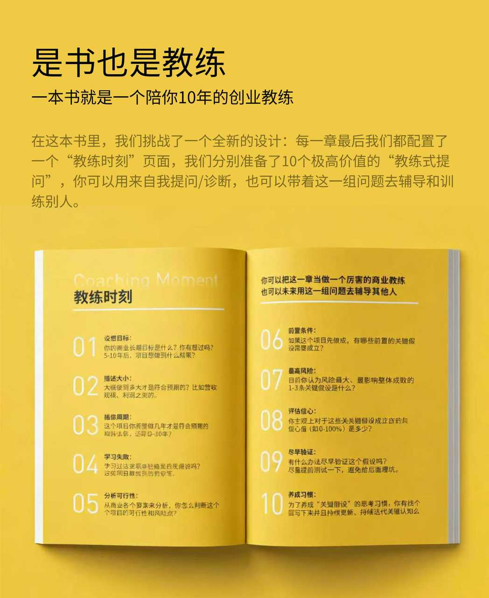 | 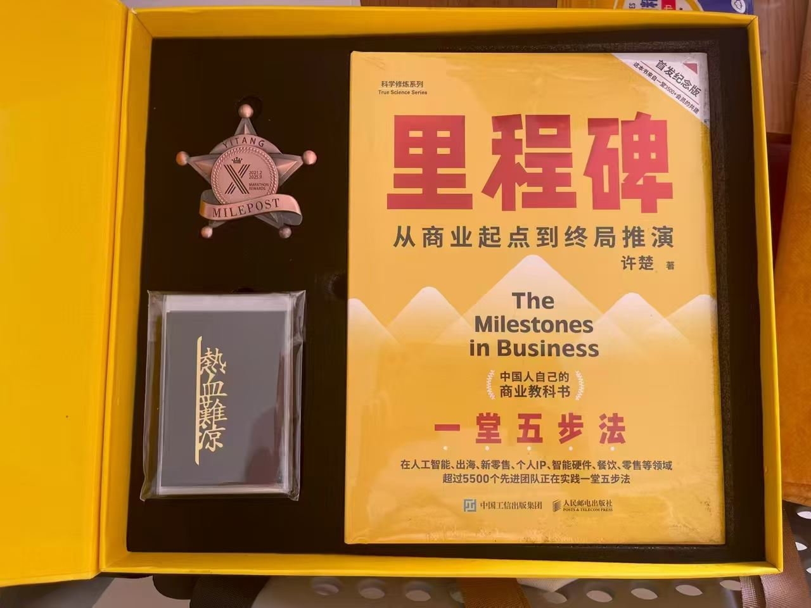 |

> 京东图书搜索“里程碑”，即可购买

**电力 AI 就不同了。**

只有一两个销售，只做一个行业，产品适用性还很窄，前面很长时间只能靠样板点一点点验证。这个时候，你拿着过去的成功经验，不会立刻变成订单。边界离得越远，模型要重新长的部分就越多。

|  |  |  |

| --- | --- | --- |

| 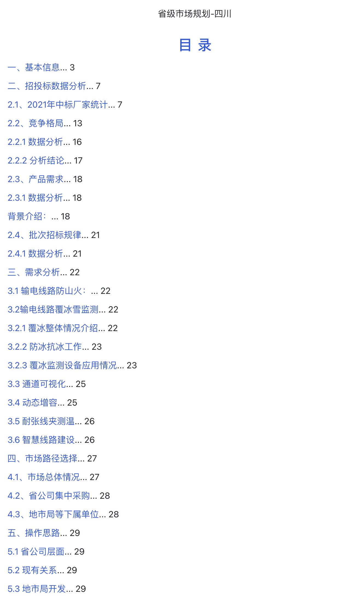 | 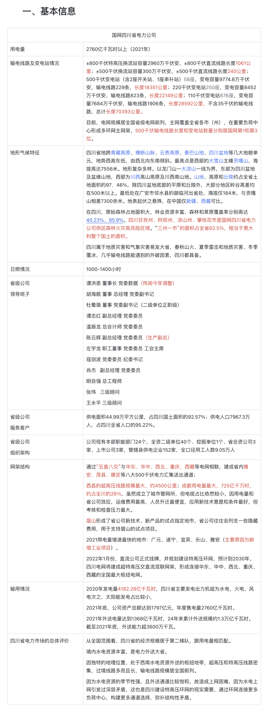 | 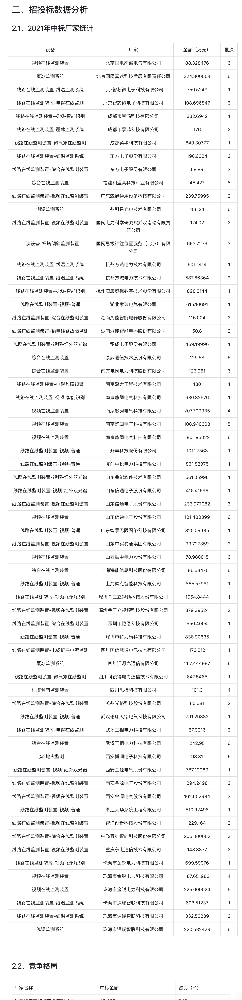 |

| 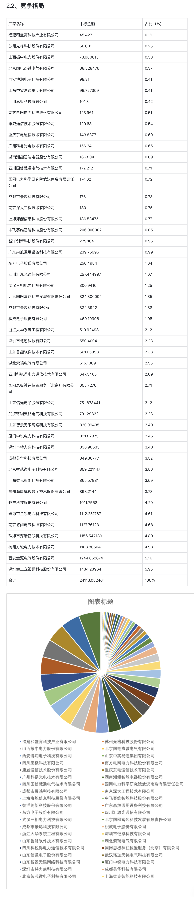 | 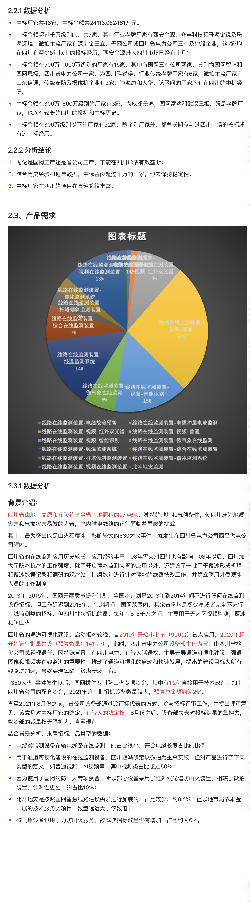 | 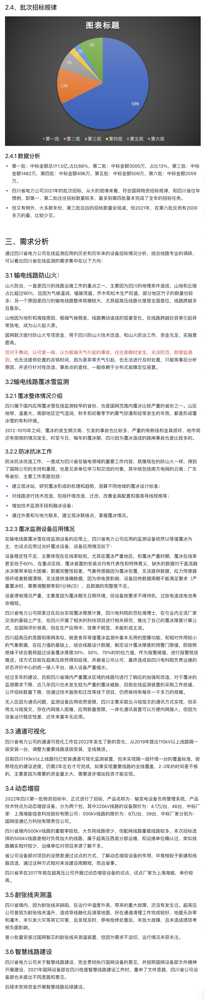 |

| 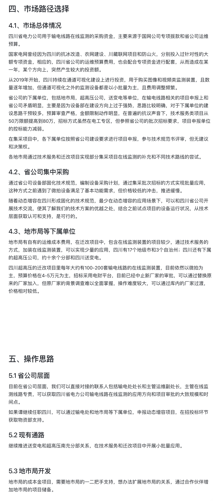 |  |  |

### 背后思考

后来回看，我越来越确定一件事：**能带走的不是一套固定动作，而是重新面对事实、重新定义问题、重新建立模型的能力。**

上家公司的动作到了工业设计公司，很多都不能照搬；工业设计公司的提案方式到了无人机，也未必完全适用。但只要还愿意回到客户、预算、需求、竞争、决策链这些事实里，模型就能重新长出来。

反过来，如果每次都从旧答案出发，路径依赖会越来越重；如果每次都把过去全扔掉，又从零开始，组织也永远积累不下来。

所以真正的难处在这两个极端之间：**哪些东西必须跟着边界变，哪些东西换了行业以后，底层的因果关系还是一样的？**

我的答案是，==**只有物理事实和现实情况不可转移**==**。**换句话说，经验和方法可以带走，但每门生意当下的事实不能跟着你走。客户是谁，预算怎么来，谁拍板，竞争怎么打，你手里有什么资源，每到一个新边界，都得重新看。经验可以帮我提出假设，不能代替事实。

**所以不能路径依赖，也不能完全照搬以前的经验。边界条件和外部环境一变，原来的模型就要往上再走一层。**不是把名字换一遍，而是重新提取关键变量，重新判断谁更重要、谁影响谁，再把动作、组织配套和做事次序一起微调。

但往上走一层，不等于把过去全都推翻，也不等于每次从零开始。**可以变的是动作，真正稳定的是底层的因果关系。**很有可能你做的两个动作完全不一样，但它们贴近的本质是一样的。

所以从那时候开始，**我不再只关心下一套具体动作怎么设计，而是开始往更底下追**：**这些不断变化的客户、预算、竞争和资源背后，大客户销售有没有稳定的因果关系。我意识到，自己已经从“找方法”，走到了“找本质”。**

这个变化，把我带到了第五次迭代。

## 认知5.0：真正不变的底层

在展开这个阶段之前，还是要再强调一下：

前面这些事，不是我当年先学了 Y 模型，再照着它去做的。恰恰相反，专网通讯公司、工业设计、无人机、电力 AI，这些事情发生的时候，我并不知道 Y 模型。我是已经做了很多年以后，才遇到这个模型。

初次遇到Y模型的感受，也不是“我终于拿到一个正确答案”。更像是：原来我一直在这么做，但说不清；现在终于有一套语言，能把我原来的认识过程重新点出来。

关于大客户销售本质的推动，来自一次MBA高阶营的线下讨论。

当时Truman和我说，曾经聊大客户销售的课题，几个都做过大客户的人，连“大客户销售到底是什么”都没有共识。有人讲关系，有人讲流程，有人讲产品，有人讲决策链。每个词都对，但放在一起，说的不是一回事，最后几乎吵起来。

我当时想，能不能试着统一一下。不是统一大家的说法，是看看这些不同案例背后，有没有一条共同的因果关系。

我就把前面这些项目、失败、复盘、迁移重新往回捋。后来借 Y 模型，把目标、事实、框架、假设、反馈、边界这些原来散着的东西摆到一起，慢慢收成了三句话。

如果现在一定要用一句话说，我会暂时把它概括成：

什么叫非线性？不是你有产品、他有需求，两边一对接就完了。中间隔着风险、信息差、决策层级和资源消耗。你的资源刚好能接住他的问题，这个结合点找到了，事情才往前走。

这句话我还一直在磨，不一定最后就长这样。

这句话也不是突然从天上掉下来的。很多年前我已经有一个模糊版本，只是一直没有把它磨准。那次线下讨论，才逼着我把它和后面的三条公理接起来。

**第一条，风险转移公理。**

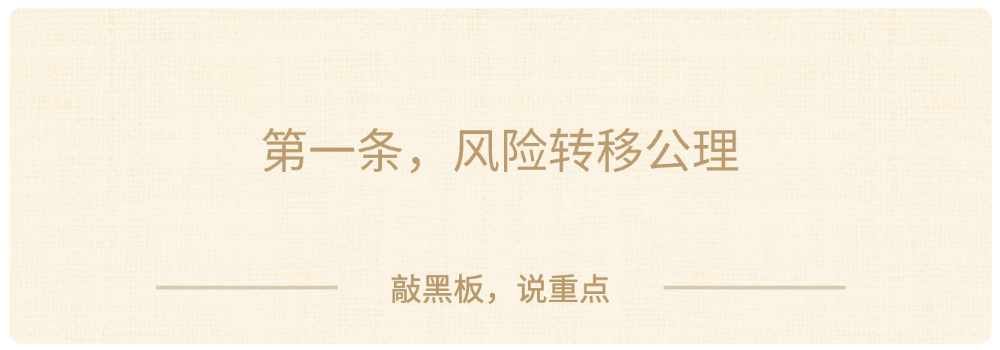

**ToB、ToG 的交易，本质上是客户把一项业务风险转移给供应商。**比如上一套系统失败了，客户要承担停产、返工、错过市场窗口的后果。他找供应商，不只是买一个产品，也是在找一个能替他把这类风险接住的人。

**所以客单价的上限，不是由你有多辛苦决定的，而是由这项风险对客户的影响价值决定的。**说白了，客户买的不是一堆功能，是风险降低量，或者效益提升。

再回头看工业设计的提案，我不再只证明公司多强，而是告诉客户：这个东西为什么能帮你在市场上赢。本质上，就是在降低他做错产品的风险。

**第二条，交易成本公理。**

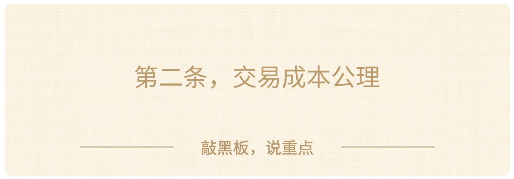

**ToB 的总耗费，不只是产品价格，还要加上客户为了搞清信息、协调决策、评估方案所付出的交易成本。**

决策链每多一层，信息就可能衰减一部分。按我的经验估计，大概会衰减 20%—30%。这不是一个精密公式，但它提醒你：客户不是只听你一个人讲完，就能把信息原样传到老板那里。

这对应的就是关键决策链。客户要花时间搞清谁能拍板、谁会影响、谁有顾虑。销售如果只会催单，其实是在把客户的交易成本继续推高。

反过来，我把前面的信息摸够，只带一个最有把握的方案，不是在替客户做决定，而是在降低他的评估成本。他不用在三个都差不多的方案里反复猜，到底哪一个更适合。

**第三条，资源非均质公理。**

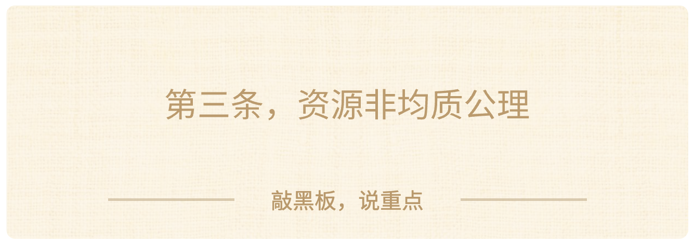

服务大客户和小客户、To 大 B 和 To 小 B，资源消耗完全不一样。不能因为八步和五要素看起来是同一套东西，就用同一种投入方式覆盖所有客户。

**有些客户值得一个团队跟半年，有些客户只值得一次快速判断，不匹配就尽早放弃。**核心只有一句：**客户不同，你能压上去的资源强度也不能一样。**

那么，谁是你的客户。课后有个Candy，可以自行检查。

电力 AI 就是这样。只有一两个销售，只做一个行业，产品边界还很窄，那就不能把每个客户都当成必须饱和攻击的大项目。前面很长时间只能靠样板点一点点验证，先把最值得投入的场景认出来。

这三条不是三个并列口号。风险转移回答客户为什么买，交易成本回答客户多大成本买，资源非均质回答你该用多大代价去卖。三个一放回去，八步和五要素才不再是动作清单，而是能解释一笔生意为什么成、为什么丢的因果关系。

所以 Y 模型帮我的，不是凭空发明了这三条。它帮我把原来埋在项目里的事实，经验、判断和因果关系，最后提取成了可以说清楚的三句话。

上次，跟一堂团队一起打磨马拉松案例，我回看自己的知识库，里面有三个文件夹，第一个叫实事求是，第二个叫解放思想，第三个叫知行合一。一堂的教研路禹看见以后说，大哥，你这个讲的不就是 Y 模型吗？

我说，其实我没想那么多。

不是一开始照着 Y 模型画了一张图。是我先按自己的方式积累，后来才发现，原来我一直在沿着类似的结构做事。

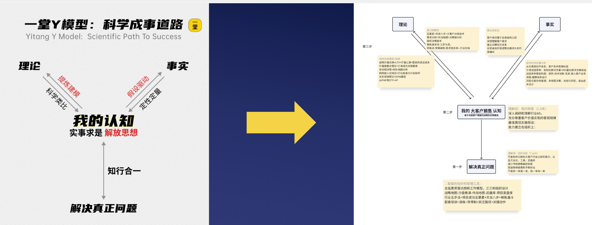

## 最后总结和升华

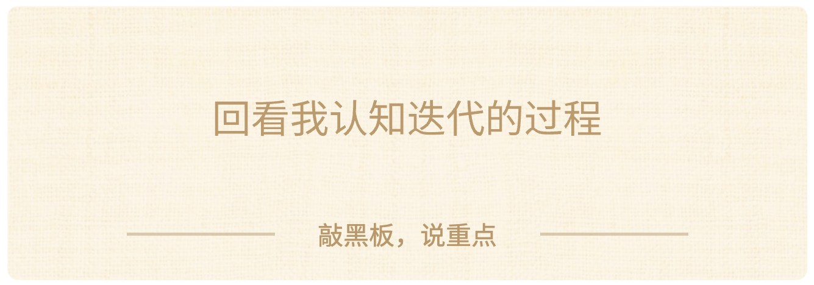

**现在把五次迭代串起来**

- 1.0，我从现成的理论和成功经验出发，做出了一套看起来完整的流程。结果框架有了，团队反而不会做。

- 2.0，我不再急着改所有人，先让不同做法在真实业务里跑，拿事实比较，慢慢找出预算、需求、技术认可、关键决策链和友商这五个要素。

- 3.0，我发现光靠简单复盘不够，要把销售运营、复盘、SOP、训练和人才接力接起来，让组织能接住每个人拿回来的修正。没有配套，一切白搭。

- 4.0，换了行业，旧动作不能直接搬。事实一变，模型就得重新来一层递进提升。螺旋式上升。

- 5.0，是把前面这些具体经历再往底层压：客户为什么买，交易为什么难，资源该怎么配。最后才留下那三条更稳定的因果关系。

夸一夸一堂教研，他们发现，这五次没有一次是“我突然想明白一个高级方法”。每一次都是旧办法撞到了边界，新的事实逼着我重新判断。

今天虽然一直在讲大客户销售，但对我来说，它只是我用 Y 模型的一个具体样本。

后来我去理解组织、战略、OD，甚至做人力资源，动作当然都不一样。我不可能拿销售的五要素直接套组织。

但底下那套认识方式没变：**先看事实，划边界定目标，找到关键变量，搭框架，做验证，再拿反馈回来改。**

所以 Y 模型更大的价值，**不是所有问题都有一套现成答案，而是你能从一个具体案例里，把这种认识方式练出来，再迁移到别的对象上。**

那 Y 模型到底带来了什么？

它不是从零给你一个正确答案，也不是用了就一定能成功。它把我原来做成、但说不清的东西，变成了可以命名、可以检查、也可以教给别人的结构。

它加快的不是订单速度，而是你从事实出现，到发现判断错了，再到修正模型的速度。

所以真正的笃定来自哪？

在我看来，**来自行，也来自知。知是行之始，行是知之成。**

一开始不要相信任何一个理论就是正确答案。先把它当成一个可能出错的假设。你按它去做，拿真实反馈回来，该修正就修正，该推翻就推翻。这样的次数多了，你才会知道不是背会了一套话，而是真的有了面对新事实的能力和底气。

这个东西有了以后，事情还是难，但是你不慌。因为你至少知道，下一轮该看什么、该验什么、该改什么。

从问题的本质逻辑上来说，**问题等于期望与现实的差距。事实一般难改，所以解决问题，要么解决自己的能力，要么解决提出问题的人。**

如果今天只带走一个动作，不要先急着抄八步、五要素，也不要先背三条公理。拿你手头正在做的一个项目，写下四句话：

- 我现在的判断是什么？

- 最关键的事实是什么？

- 什么反馈能证明我错了？

- 下一步最小验证是什么？

做完这一轮，再回来改你的判断。认知不是坐着想出来的，是一轮一轮做出来、碰出来、修出来的。

这就是我这些年从最初 1.0，走到今天的过程。

谢谢大家，下面把麦克风交给贺雷～

# 贺雷：从医学循证，到科学做个人AI

## 开始上课

各位同学，晚上好，我是贺雷。

哈哈，第一次在一堂的直播间出现，还是要做一下自我介绍：

> - 毕业于华西，之前学的是医学、药学，在医药行业工作了20多年。

> - 2003年起，曾在两家上市药企，从管培生做到高管，见证了中国第一个重量级创新药从立项到商业化的全过程；

> - 2016年自己创业，做医药行业深度介入式咨询，作为业务负责人把上市公司处方药规模从几千万做到6亿+；

> - 2019开始作为联创，将一家中华老字号的中医药企业做到产值增长4倍，年销售额突破10亿；

> - 2025年12月，加入今天案例中的医颉集团，担任CEO。

> - 不是软件开发背景，但是自己研究AI，案例还上了26年秋马大课。

|  |  |  |

| --- | --- | --- |

| 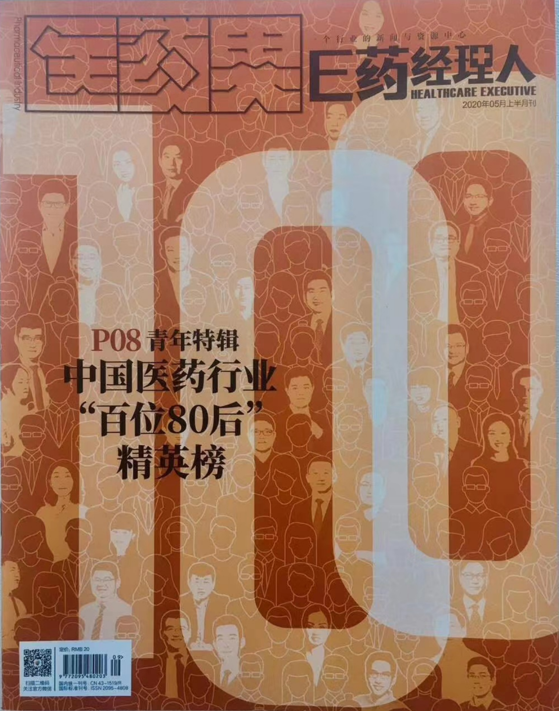 | 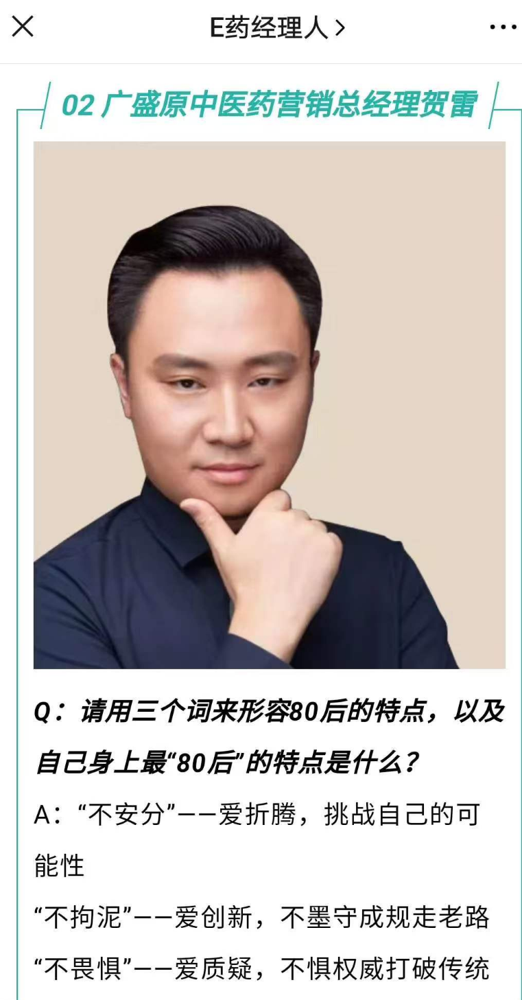 |  |

|  |  |  |

我的自我介绍，不是为了报一份履历。它们刚好让我从三个位置看同一件事：

- 医学教育让我知道，任何判断都要经得起真实世界的验证。医学里我们叫做“循证”，即基于科学证据进行决策。科学证据来源于课本与指南，更来源于实践与研究。

- 创业经营让我知道，事情常常等不到信息齐全就要作决定。经营中我们叫做“复盘”，即必须清楚知晓做这个决定的理由，并允许用结果去修正、甚至推翻这个理由。

- 学习和应用Y模型也好，用 AI和做个人AI也好，面对新领域，我们不能等把所有事情都想清楚，每个技术学明白再行动。

所以，今天我更想和大家一起看：**一个人怎样从一个没想完整的问题开始，用事实修改判断，再把修改后的认识带到下一轮。这是医生的思维方式，也是创业经营的思维方式，更是Y模型刻意训练我们的科学思维方式。**

为了不让大家听到后面迷路，我也提前给大家划个重点。

我今天分享的题目，是“Y模型和科学应用”。海报上还有一句话，我很喜欢：科学迁移，从医学循证，到科学做个人AI。

今天会用三类场景、4个例子，来给大家讲"科学"在不同的事情上，是怎么应用的：

- **先看医学问诊。**它不讲高深知识，只讲医生怎样从一句简单的“肚子疼”开始，最终如何为你诊断复杂的疾病。

- **再看两个开发个人 AI 的案例。**第一个讲找不到方法时，如何破局；第二个讲方法太多时，如何决策。

- **最后看一个真实的企业经营案例。**进入全新领域时，如何快速提升认知，重新定义事实，提出全新假设，拿到期待结果。

三个场景需要的专业知识完全不同，看似都没有什么关联，但是底层的动作是很统一的：**先说清现在凭什么这样判断，再让下一份事实有机会修改它。**

请大家现在挑一件自己的事放在心里。

可以是一件迟迟没有开始的事，也可以是一件已经做了很多次、却总觉得在原地打转的事。不需要宏大，一个客户问题、一次项目选择、一项工作改进，都可以。

我们先把它留在心里。后面听到关键转折时，请把自己的事放进来对照。到最后，我希望你带走的不只是我的故事，而是自己下一步更清楚了。

## 第一部分：医学上的"科学"

在正式开始案例分享之前，我想先讲一次近期在一堂的交流。

我和另一位一堂同学杏树林的创始人聊到Y模型，他们是协和背景，我是华西背景。大家发现医学院校出身的人对Y模型有一种很自然的亲切感。

不是因为学医的人判断一定正确，更不是因为我们对所有事情都懂。恰恰相反，医学训练经常提醒我们：**眼前的解释可能不完整，后来的事实可能改变现在的判断。**

怎么理解呢？

我们先进入今天的第一个小例子，也是一个大家都能理解的场景说这件事。

### 案例1：医生问诊

一个患者来找医生，说：“我肚子疼。”

==【互动🙋🏻♀️】==假如你是医生，接下来你会做什么？

————

是哪里疼？怎么疼？疼了多久？

有没有其他不舒服？以前有没有类似情况？

这些问题没有立刻给出一个病名。它们是在寻找事实：哪一条信息会让某一种判断更有可能，哪一条又会让它下降。

同样三个字“肚子疼”，后面可能有不同的判断。医生会借助已经掌握的专业知识，先形成几种可能，再选择值得追问的信息。

有时问完还不够。医生会查体。哪里按下去疼？手松开疼不疼？如果再不清楚，还会安排检查。

可能几次问询之后，判断越来越明确；也可能一个新信息出来，医生发现原来的思路不对，要转向另一个方向。

### 放回Y模型看案例

医学训练反复给我的，正是这个动作：

当然，医生也会依靠经验，而且很多时候必须在几秒钟内作出判断。医学训练的价值，不是让人永远不下结论，而是即使已经形成判断，也知道什么样的新事实可能推翻它。

经验让我们更快看到熟悉的模式。检验让我们有机会看到熟悉模式之外的东西。两样都有，判断才既有效率，也有继续修正的余地。

科学不是一开始就必须有一个完整答案，它可以是一个粗糙的假设，它允许被验证，允许被推翻，也恰恰因为这样，科学才能不断地进步。

这里有两个条件同时成立：

- 有一个当前假设，才知道接下来要看什么；

- 愿意接受检验，才知道现在的解释站不站得住。

我对Y模型最有共鸣的地方，就在这里。

它让我把理论、事实、自己的认识和接下来的实践放在一起看。我的认知不是贴在中间的一个静态结论，而是这几方面不断往返时形成的判断。

**有时，一个反常的事实先引起了注意，我再去找理论解释它。**

**有时，先学到一个新理论，我开始想：它在我的问题里有没有用？**

**两个入口都可以开始，但最终都要回到我们正在面对的真实世界。**

我们医颉有一句经营理念：

**以科学方法论探索世界，永葆对生命与商业本质的好奇。**

这句话对我不是装饰。做医药与健康相关业务，我们一方面要理解产品为什么有价值，另一方面要理解它怎样在真实使用和经营中创造价值。

一个产品有科学依据，并不意味着用户自动理解它；一个市场结果很好，也不意味着我们对原因的判断一定正确。

前者需要研究生命与健康，后者需要研究人的选择、组织的行为和商业运行。两个方向都不能只靠“我觉得”。

后来学习Y模型，我发现它给这些习惯提供了一张更清楚的地图。过去偶尔做到的，开始可以有意识地做；过去卡住时只知道继续努力，现在可以停下来检查自己到底卡在哪一层。

今天，我不会把Y模型讲成一个保证成功的按钮。我更想给大家看：**它怎样帮助一个人在不熟悉的领域里开始，怎样在碰壁后修改认识，又怎样把这一轮留下的东西带进下一轮。**

接下来，我们进入今天的第二部分，我如何把“科学”的思考方式带进了一个自己并不熟悉的领域：个人AI。

## 第二部分：个人AI的科学探索

### 案例2：语音交互难题

在正式开始这个案例之前，我得先声明一句，我不是软件开发出身，但这些年一直在使用AI，后来又独立开发适合自己与经营者工作方式的个人Agent。做这件事的时候，我需要不断进入不熟悉的领域。很多技术名词我第一次听到，很多路线也不知道该怎么选。

我最早使用AI，是为了读资料、研究问题、辅助分析，它已经给了我不少帮助。后来我越来越多地把它放进工作，也越来越清楚自己的需求。

我不知道大家有没有这样的体会，很多经营者和管理者，不可能总坐在电脑前，对一个任务敲字，再等它慢慢跑完。更多时候，人是在开会、在差旅、在移动中。

前一个问题还没想完，下一件事已经进来了。你刚听到一个新说法，就想到它会不会影响昨天的判断。路上又来了一个消息，你想找回之前讨论过的背景，却不能一直守着电脑翻资料。

除此之外，移动办公、会议、差旅时，我们会产生很多新的想法。等回到电脑前，有些已经忘了，有些又需要重新进入状态。我们需要一个自然的入口，能把正在形成的思考留下来，继续往前推。

一开始，我试过用手机远程操控桌面。能用，但操作和打字并不舒服。于是我想，移动端更适合的入口，可能是实时语音。

我也试了当时最前沿的实时语音产品。聊天很顺，反馈很快，这种体验确实很吸引人。但是，它和桌面上用来深入研究、操作工具的工作环境，没有按我需要的方式连起来。

它可以跟我聊，却不一定掌握桌面的资料和任务；我在桌面上已经做过的工作，也不一定自然进入这段对话。

这时，我提出了一个初步设想：

前台实时语音和我自然交流，不因为后台正在查资料就一直停在那里；后台使用更完整的上下文，做深入的研究和执行；结果回来以后，前台还能用更新后的信息接着跟我讨论。

这就是我当时想改善的工作体验：

问题也恰恰出在这里。

有些话，需要立即回答。有些问题，需要先查资料再回答。有些任务，要交给桌面的推理模型慢慢研究。还有些动作，涉及实际执行，不能只靠一句自然语言就自行发出去。

我们一开始觉得，既然实时语音能听懂人话，那它自然能够判断：我这句话只是聊天，还是需要查资料？是随口一提，还是正式交办？哪些事情应该马上回答，哪些应该交给后台，哪些动作还要经过我确认？

在我们的设想里，**语音端既维持交流，又理解这些不同状态。它知道什么时候要立即回应，什么时候应该静默查证，什么时候交后台，什么时候把后台结果带回来。**

这个想法听起来很自然。甚至可以说，我当时对“智能助理”的想象，就是这个样子。

可真正用起来，麻烦很快就来了。

它有一次很肯定地告诉我：“放心，这个事情我已经安排后台去做了。”**结果后台根本没有收到任务。**

这件事放在普通聊天里，不算什么。你发现不对，再问一遍就完了。可放在工作里，性质完全不一样。你把工作交代完，以为事情已经交出去，就开始等结果，结果后台却什么也没有发生。

这就是我们碰到的第一个具体问题：

所以我们做了第一轮调整：

- 不能只让模型嘴上说“完成”，得有明确的任务状态；

- 任务状态不能由实时语音大模型掌握，必须由桌面端host掌握，正式交办要生成任务卡；

- 查资料的请求可以轻一些，真正对外发消息、改变系统状态的动作，必须由用户在手机端确认以后才能执行。

这轮设计不是多余。它要解决的问题很实在：我得知道“我交代了、系统收到了、事情开始做了”之间，到底有没有断。

可做完以后，新的问题又出来了。

它还是可能告诉我：“任务卡已经生成了。”实际一看，没有生成。

那怎么办？

这不是故意刁难系统，而是为了把真实世界的情况都覆盖住，我们只能不断增加规则：什么时候不能打断，什么时候要静默，什么时候可以播报，什么时候先等一等。

**每一条规则单独拿出来，都有道理。问题是，放到一起就不对了。**

后来我发现，**规则越多，它其实运转得越不畅**。有些正常的对话被挡住了，有些原来能完成的功能又走不通。刚把一个场景处理好，另一个场景立刻出现冲突。

那段时间，我前后卡了差不多一个月，在这件事上投入了很多轮。模型在分析，代码在改，测试也在补。**我们并不是完全不做验证，却经常在一个前提不变的情况下，继续修补它的实现。**

可补丁越多，系统越像一个满是开关的控制台。每个开关都有作用，可没有人能再一眼说清，整台机器到底怎样运转。

后来，参与设计、施工和验收的各路顶级模型开始纷纷举白旗：**这么多状态和规则互相交叉，继续按原来的方式追加，从数学上已经无法实现收敛。**

一边是全球最强的大模型，一边是完全不懂编程的我，这种反馈我听完后脑袋里只剩一个念头：“这个需求本身实现不了。”

==【互动🙋🏻♀️】==如果是你，已经投入了不少时间，连帮助你分析的最强模型都认为实现不了，你会怎么办？

放弃？等下一代更强的模型？还是再试一轮，反正也做了那么多轮了，也许下一轮就能补完？

————

这些选择都很自然，我自己也会在里面打转。

真正帮助我突破困境的，不是上面的任何一条，而是我们退回来问：**我一开始到底想要什么？**

我要的其实没变：**我要移动时能顺畅交流，后台能把事情做准，结果还能回来支持我继续思考。**

那我为什么把它写成了另一个问题：**必须让实时语音模型自己分辨所有状态，自己决定所有任务怎么调度？**

**这个“必须”，不是用户需求。**

**它是我当时基于需求推出来的一条假设。**我以为要实现自然协作，语音模型就应该承担这些判断。后来事实一再告诉我，它这样判断会制造大量困难，可我们还在原来的前提里继续修。

问题就是从这里开始变的：

- 我不再只问：“怎样让语音模型在所有情况下都判断准确？”

- 我开始问：“在人和 AI 协作的过程中，人只要在哪个关键位置明确一下，就能让整个系统简单很多、准确很多？”

**真正让我们走出去的，是一次人机的重新分工。**

普通交流时，它自然回应，也可以在后台查证需要的背景。真要交办一项工作时，我做一个明确动作，让它知道这不是随口讨论。涉及执行边界和对外动作，该由我决定的，就由我明确。

边界清楚以后，原来捆在一起的几件事第一次分开了：

- 前台负责实时交流；

- 后台负责深入工作和执行；

- 人负责关键交办与边界确认；

- 程序记录真实执行状态。

这时，前台还在说话，后台可以继续处理长任务；我正式交办时，有一个清楚的动作；后台有没有收到、做到哪一步，不再只靠模型用一句“放心”告诉我。

最折磨我的那种状态开始改变：它说做了，我不知道是真是假；我交出去以后，只能原地等。现在，任务有没有真的进入后台，执行走到哪一步，变成了可以核对的对象。

大家可能有个疑问：**人多做一个明确的动作，究竟是退步，还是更好的协作？**

如果只看自动化程度，我们可能觉得，最好所有事情都让AI自己理解，人一句多余的话也不说。

但**我的真实目标，不是让人绝对不介入，而是让这段工作更顺畅、更可靠**。如果为了省掉一个明确交办的动作，反而让我不断检查有没有误解、反复确认任务到底做没做，这笔账未必划算。

**所以我愿意在最关键的位置说清楚。**不是我来干后台的活，也不是我每隔一分钟都盯着它，而是在“这段讨论现在成为一个正式任务”的位置，由我明确一下。

**这种介入本身很轻，却可以改变系统需要承担的判断。**

这件事也让我重新理解了一个词：==智能==。

如果为了省掉一个明确交办的动作，我反而要反复猜它到底做没做、不断检查有没有误解，这笔账并不划算。

当然，我也不想把这件事讲成“加了一个动作，所有问题就消失了”。工程仍然要做，真实执行仍然要验证。

变化在于，**我们不再背着一个没有重新检查过的前提，继续往前投入。**

很想提醒大家，很多时候：

### 再回看：Y模型到底用在哪里

刚才我先把真实经过讲完。现在退后一步，把它放回 Y模型来看。

**我觉得 Y模型在这里最大的价值，是给了我一张“全局思考的画布”。**

这句话听起来有点大，落到现场其实很朴素。

项目卡住的时候，人最容易做什么？

盯着眼前那个报错。改一行，再跑一次；出现一个新问题，再加一条规则。

每一步都很忙，也都有理由。可忙着忙着，整件事原来的样子看不见了。

所以这个时候，**不是继续往前冲，而是先停一下，把整个项目摊在桌面上。**

在我这个案例里，我会先摆六样东西：

**第一，范围。**我们讨论的是会议、差旅、移动办公中的持续思考，不是要解决所有 AI 产品问题。

**第二，目标。**我要的是前台交流顺畅，后台执行准确，结果回来以后，思考还能接上。

**第三，已知理论或经验。**我当时相信：语音端已经能理解自然语言，就应该能顺便判断所有意图，自己决定哪些聊天、哪些查资料、哪些交给后台、哪些需要执行。

**第四，已知事实。**实际使用告诉我：它说已经安排后台，后台却没有收到；它说任务卡生成了，实际也没有；规则越加越多，正常交流反而被挡住。

**第五，我的认知。**实时语音端可以自己分辨所有状态，调度所有任务。

**第六，当前行动。**我们一直在加规则、加检查、打补丁，希望在原来的解法里把它修通。

这六样东西摆齐以后，我没有马上找新答案，而是先看它们还在不在一条线上。

这一看，问题就很明显了。

目标没有变，事实却一直在说“这条路不顺”，我们的行动还在继续往上加补丁。更关键的是，我把“必须让语音模型包办所有判断”当成了目标本身。

**可它不是目标，它只是我当时根据目标推出来的一条假设。**

这就是画布真正有用的地方。

它不是一张让人把空格填满的表格。六格都填上，不代表问题就想清楚了。真正有用的，**是把六块放在一起比较：目标、事实、认知和行动，彼此是不是还在同一条线上。只要发现哪里不一致，你才知道应该改哪一段，而不是继续在最近一个报错旁边打转。**

回到这个案例，事实没有自动替我生成新方案。

**事实先让我原来的认知站不住了**。然后我重新看目标：交流顺畅和后台准确都需要，旧的实现方式却不必保留。

**所以人重新提出一个新假设**：人只在关键交办和执行边界上介入，前台负责交流，后台负责深入工作，程序记录真实执行。

这时再把新假设放回画布：**目标还是那个目标；理论假设从“语音模型包办一切”，换成了“人和不同角色重新分工”；行动也从继续加规则，变成了实际检验新分工。**

接下来，AI 和工具负责把事情做出来、查清楚，人再看新的事实有没有支持这次修改。

这个感受特别像一堂的 S 级私董会。

大家带着一个精心准备的问题来，以为最需要的是解法。深入讨论以后，最大的收获却是：真正要改的，可能是问题本身。

问题不是从天上掉下来的。它就是我们基于当时的理论和事实定义出来的。认识一变，原来那个问题就可能需要重看。

给大家看看最终做出来的效果，说实话我非常满意，颉AI的很多设计比现在主流的办公agent更适合高层经营者的需求，我们看一下真实的产品使用效果。如果当时放弃了，我觉得真的会非常可惜。

[📎 71b7d89de04a558a199ae519c08c13f0(2).mp4](https://yitang.top/api/feishu/media/I74Ob96CZo9B9HxTrKpc6LG0nWg)

哈哈，我们再反过来想想，如果没有Y模型，这件事的走向会是怎么样？

我们当然不能说，没学过Y的人就不会科学思考。我自己有些早期实践，也会回到目标重新想。医学训练给过这种习惯，经营经验也会给这种提醒。

但对我而言，==**Y把这个动作变得更明确、更容易主动使用了**==**。**

原来碰到阻断，我可能只在几个选项中转：**再投入、再换模型、等技术进步，或者干脆放弃。**

现在，我多了一个==有意识的动作==：**把目标、掌握的事实、已经做过的尝试、现在已有的判断摆在一起，看它们还是否匹配。**

如果目标合理，只是路径出了问题，我就不必因为一条路走不通，否定整个需要。

如果目标本身也经不起事实检查，那同样可以重新调整。

它不是让我永远坚持，也不是让我遇到困难就换题。

它让我知道，应该根据什么判断该继续、该修改，还是该停止。

请大家回到开场自己挑的那件事，先不用想完整答案，只写四行：

- *我的目标是什么？*

- *我现在的认知是什么？*

- *哪些事实在支持它？*

- *哪些事实在反驳它？*

写完以后，看这四行是不是还在同一条线上。哪一格写不出来，那里可能就是你现在的卡点。

当然，Y 模型不保证每次都能给出一个漂亮答案。它也不能替人承担判断。但在卡住的时候，它至少给了我们一个停下来、摊开、重新看全局的地方。

这个案例让我从一条走不动的路退回来，重新看见真实需要。

可现实里还有一种更难的局面：**不是没有办法，而是办法太多。不同方案都有理论支持，也都有测试结果。这时候，你凭什么选？**

这就是下面我们要讲的案例。

### 案例3：技术方案的选择

个人 AI 能记住一些背景，能完成一些交办，已经很有价值。但对一个真正要长期使用的经营者和管理者来说，这还不够。

我们希望个人AI可以：可以持续跟进交办的任务，还能帮助经营者和管理者来做判断和决策。

所以我们研究的，不只是一台能回答问题的机器，而是怎样形成一个更懂自己业务、也能持续跟进工作的助理。

这件事往根上追，先会追到一件事：**它能不能在需要的时候，把过去真正有用的资料找出来。**

这件事自然把我们带到知识体系上：

- 如果资料根本没有进来，它当然找不到。

- 如果资料进来了，里面的字没有被好好读出来，它也找不到。

- 如果资料找到了，却没有真正进入最后回答，前面的工作还是白做。

- 更麻烦的是，事情一直变化。过去的判断、正在做的动作和新出现的事实，还要能接在一起。

就在这些真实需要里，我们内部遇到了一个很具体的分歧：

**给个人 AI 找资料，究竟要不要增加一种新的检索方式？**

我们集团的董事长谭总也在深度使用个人AI。有一次，他给我发来一份检索能力升级方案。

技术词我们先放一边，当时的讨论大致是两条路。

第一条路，让已经比较有能力的 Agent 带着问题，利用现有资料导航、关键词和阅读工具，自己==去找原文==。你输入什么词，它就去资料里找什么词；原文用了别的说法，它可能就找不到。

第二条路，就是提前把资料整理一遍，让 AI 不只认字面，还能把意思相近的内容带回来。用户就算想不起原文里用了什么词，也能==按“意思相近”去找==。

**举个简单例子。**

你记得材料里讲过：“客户嘴上说的要求，不一定就是真正的需求。”可你现在想不起原文到底用的是“客户”“要求”，还是“用户”“目标”。

按字面找，可能怎么输都不对。按意思找，就有机会把那段内容带回来。

谭总在他的实际使用里，确实碰到了“知道意思，却不容易找到原文”的问题。所以他觉得，应该把这条能力补上。

我听懂了他的需求，但我的第一反应，也很快。

我过去看过一些整理资料的做法，也知道 AI 本身在进步。所以当时脑子里很快跳出一个判断：*现在的 AI 已经比过去强了，未必需要提前把资料切碎、分类、重新整理。有些处理还可能把一段完整的意思拆散，反而影响它后面的理解。*

**这个判断有没有来由？**

有。

**但它是不是已经足以回答谭总的问题？**

当时我并没有真的检查过。

后来，谭总没有停留在“我觉得需要”上。他把更详细的材料和测试发给了我。我一看就发现，他不是听到一个新词，就急着往系统里装。他已经在自己的真实问题里做了研究，拿出了事实。

那一刻，我心里很清楚：**我不能再用自己的旧经验回复他了。**

我不是说，对方有测试，我就必须完全接受他的结论；而是我要把自己的判断也放到同一个可检查的层面，我不能再只拿“我以前见过什么”来结束这场讨论。

==【思考🤔】==如果你和同事，或者你和老板，在一个你们都不完全熟悉的问题上，各有一套说法，你通常怎么推进？

再找一个专家投票？

谁更有权威听谁的？

还是先商量，什么才算“更好”？

————

既然两边都觉得自己有道理，我们能不能先不争谁对？能不能先一起说清楚：**看到什么结果，才足以让我们改变今天的判断？**

但这句话说出来容易，真要执行，里面还有很多细节。

我当时提出，用 Y模型做一轮验证。

这不是为了今天讲课，后来补出来的想法。当时真实发给谭总的文件，题目就是《致谭总：语义检索研究反馈与 Y 模型首轮验证计划》。

|  |  |  |

| --- | --- | --- |

|  |  |  |

|  |  |  |

|  |  |  |

这份文件题目的原话里有几个技术词，我们先不管名字。翻成大白话，它研究的就是：

> 谭总提了一个“按意思找资料”的办法，我们不要凭感觉说它好或者不好，拿一件真实业务，让原来的做法和这个新加的做法都做一遍，看看最后到底差在哪里。

计划一开头，我写的是一个前提：

> 不能先决定一定要加“按意思找”，再回头寻找支持它的证据。

> 如果最后一定要证明自己的办法好，试验很容易变成找证据。

> 那这轮研究就没有选择空间了。

所以我们真正要问的是：

> 在我们的真实经营资料和问题里，这条新增能力比当前完整流程多解决了什么？

> 有没有更简单的改进，其实已经够了？

> 增加的效果，值不值得它带来的建设、使用和维护成本？

增加的效果必须和真实现状比，不能找一个故意很弱的对手。

简单理解：

- 今天先把最原始流程叫 A。

- 把明显能修好的地方修好，然后再跑的流程叫 B。

- 在B的基础上，再加谭总说能力，可以按“意思相近找”的技术路线叫 C。

**我们真正要看的是，C 比 B 多出来什么。**

不是只拿 C 去赢 A。因为 B 已经先把现有流程里明显能修的地方修了。如果 C 只比 A 强，你根本不知道最后赢的是新入口，还是旧流程本来没做好的那一块。

所以第一件事是：

我们选择真实的拜奥益生菌业务，作为首轮研究范围。

为什么一定要用真实业务，而不是几个演示题？因为我们关心的不是一个检索工具在演示里好不好看。我们关心的是，它能不能帮我们找到适用的依据，完成真实工作。

**我们尽量让三套做法面对同一件业务、同一批资料、同一个问题。**

==【互动🙋♀️】==假设一个方案更早写出第一版答案，另一个方案稍晚一点，但关键依据已经核清。你会怎样比较它们？

————

简单说，我们约定看三件事：

- **答得对不对：**不是找到了很多相关文字，而是把业务问题讲清楚，有适用的原文依据，不漏关键条件。

- **整体够不够快：**看从问题到可用回答的整段过程，不只看搜索模块。

- **增加的负担值不值得：**因为一个功能不是装上去就结束了，后面还要有人维护它，更新资料，处理异常。

这些问题，都要允许事实来回答。

事前不说清什么算更好，结果出来以后，快就看速度，不快就看成本，成本也不行，再找一个局部例子。任何一个办法都能找到一块有利的数据。

所以，**共同标准不是为了给实验增加手续，它是为了让我们真的有机会接受同一份事实。**

当时的计划还明确允许几种结果：

- 不用加。

- 只在某一类问题上加。

- 或者当前证据还不够，需要换一个角度继续查。

这很重要，这就使测试有了真正的选择空间。不是“必须试出一个成功”，而是要试出一个有依据的下一步。

当时计划里把路线分成三个层次：

- 第一层，看现有完整流程。我们的Agent本来会怎么找、怎么读、怎么回答，先把这个现状看清。

- 第二层，在现有流程上，把已经确认的资料导航、工具使用和核证环节改好。看看不增加新检索能力，能改善多少。

- 第三层，再增加语义候选，观察相比第二层到底多了什么。

|  |  |  |

| --- | --- | --- |

|  |  |  |

|  |  |  |

为什么分开？

**因为如果你同时换模型、换资料、换工具、改提示词、加上新的检索方式，最后结果变好了，你未必知道是哪一项起了作用。那下一次面对另一件事，还是没有积累出可靠判断。**

**相反，把变化拆开，哪怕先做一轮小范围开发对照，也能让一些争议变得具体。**

这一点**和医学研究里的对照思路很相通。**不是说这次软件测试就是一场临床试验，而是我们在迁移一种纪律：**比较条件要讲清，标准要提前设，结果回来以后，能分析差异来自哪里。**

我不是软件专家，但这个研究思路是熟悉的。

这里不得不说，AI让实验的成本大大降低。

如果这些方案都要靠两个人自己去搭环境、找资料、逐条记录、做比较，成本会很高。很多时候我们虽然知道应该验证，最后却还是凭经验选一个，原因很简单：**没有时间或成本太高。**

AI进入以后，这件事发生了变化。

它可以帮我读方案、把测试要用的资料和步骤准备好、整理资料范围。可以按约定的做法运行，保存执行记录。也可以把不同结果摆到一起，方便人比较。

几套做法可以分别推进，不必先靠两个人争出一个唯一答案，才有资格开始。

还是得强调一下，前提是，人先知道这一轮为什么要试、比较什么、什么结果才值得改变判断。否则，AI也可以很快给你生成一堆结果。一堆结果看起来都不错，却没有回答你到底该怎么选。

Y模型帮助我们把验证设计出来，AI把其中许多可执行的工作加速。两者配合，才让这种研究真正容易发生。

那最后的结果是什么？

并不是我的整套想法被原样采用，也不是谭总的整套想法被原样采用。

现有 AI 助手已经能帮我们找到不少关键资料。但找到以后，阅读、引用和回到原文核对仍然有问题。

**另一方面，我原先觉得现有 AI 加现有工具已经足够，这个判断也需要修正。**我们发现，有些文件虽然能够点开阅读，里面的正文却没有全部进入 AI 能找到的范围。**文件放进同一个地方，不等于所有字都能被稳定找出来。**

**谭总那边的方法，确实有值得吸收的地方：**资料处理改造之后，让资料从同一个地方找，确认该进来的文件真的都进来了，确认文件里的字真的被读出来了。

但是，在这次同一件业务的并排比较里，没有出现一个可以让我们放心宣布的全面优势。

这里有一个很有意思的小细节。

加了“按相近意思找”的那一路，最初写出答案确实更早。可后来还补了重要的证据说明。比较最终正文，两路只差几秒，大约 5 分 57 秒和 5 分 53 秒。

|  |  |

| --- | --- |

|  |  |

如果只拿最初写出来的时间说事，会得到一个很漂亮的提速结论。可我们真正要比较的，是能够交给业务继续使用的答案。不能省掉关键说明，再拿那个时间邀功。某一步变快，不代表整件事同样变快。

当然，这轮结果也不能用来宣布“按相近意思找”没用。

我们只能在自己的这批问题里，==更清楚地知道==：

**哪些能力应该保留，哪些缺口需要补，哪些方向还要继续观察。**

**最后形成的方向，不是全部上，也不是全部否定。**后来，我们把这叫第三种方案。是保留现在这套做法里有效的部分，吸收谭总在整理资料、读文件上的长处，把“按相近意思找”作为需要时再打开的一条辅助路。

AI 把各方得失摆得更清楚，人再根据这次事实，重新组合下一步。我觉得，这比“我用实验说服了老板”更有意思。

**因为最后发生的，不是一个人证明自己从头到尾都正确。而是两个人都从对方和测试里，看见了自己原先没有看见的东西。**

### 再回看：Y到底用在哪里

刚才这段经历，看起来是在争一个找资料的办法。放回 Y模型，它其实是在处理一个更普遍的问题：

**当理论和经验同时存在，而它们又互相冲突时，人怎样让事实进入自己的判断？**

**左边是理论和经验：**行业里的做法、AI 能力的变化、按意思找资料的办法，还有我和谭总各自过去的实践。

**右边是事实：**我们自己遇到的找资料缺口、对方已经做过的测试、后来在同一件真实业务里完成的比较。

两边合在一起，形成的不是一句永远正确的技术结论，而是我们当时可以采取的下一步。

**这次 Y模型到底改了什么？**

**第一步，它把问题从“哪个办法更先进”，改成了“在我们的真实业务里，怎样才算更好”。**目标不清，后面的比较就没有意义。

**第二步，它让双方都把自己原来的判断说出来。**原来不是只有我有一套判断，对方也有一套。如果不先把各自相信什么写下来，结果出来后，人很容易倒过来解释。结果好，就说是自己对了。结果不好，就换一个标准再证明。

**第三步，它把验证拆开，让事实能指出问题到底发生在哪。**

是资料没有进来？

是进来了，却没有被好好阅读？

是读到了，却没有进入答案？

还是前面都做好了，只是多加的按意思找资料没有表现出足够价值？

**如果不拆开，所有变化都混在一起，最后只知道“好坏”，不知道“为什么”。**

**第四步，它允许事实改变原来的行动。**

可以增加，可以不增加，可以只在一类问题上增加，也可以暂时不决定，继续验证。**这时，一个失败的结果也有价值。**

有人可能会问：**不用 Y模型，难道我们就不会试吗？**

当然不是。很多人看到新办法都会试，看到别人成功也会模仿。

**差别不在“试不试”。**

差别在试之前，有没有先定义目标，有没有可比较的对象，有没有统一尺度。

试完以后，能不能说清楚，自己原来的判断究竟改在了哪里。

随便装一套工具，跑出一个还不错的答案，说一句“挺好”。这是一次体验。

体验有价值。但它未必足以支持下一次选择。

当我们事先说清楚要和什么比、为什么比、哪些结果会改变原判断，再把结果和原因留下来，才更容易把一次尝试变成可继续使用的认识。

当时那份验证计划，还用了**Y模型的STEPS**来组织。这里不讲英文，只翻成五个大家能用的问题：

- **范围：**这次先研究哪一件真实业务，不要一开始包打天下。

- **目标：**我们最终要改善什么，什么结果对用户才有用。

- **框架：**影响成败的要素可能是什么，别只盯着成败的结果

- **预判：**现在各自相信什么，看到怎样的事实会调整判断。

- **配套：**用什么资料、工具、条件和记录，才能真正完成比较。

这些不是为了画一张漂亮的表。它们是在开跑之前，让我们把同一场试验说清楚。

更有意思的是，这些材料并不需要全靠人手工填。AI学习了方法之后，可以先按我们的真实任务组织出草稿；我们检查目标、边界和条件，再让它去执行。

结果回来后，它又帮我们做一件事：把原来的预判、现场事实、修改后的判断放在同一张表里。

当时我和教研看到这组原材料，都觉得它很适合放进课程。因为它不只是在结果出来后说“我们用了Y模型”，而是过程里就明确写出了怎样用、怎样检验、怎样修改。

到这里，个人AI的两个案例的差别也就清楚了。

第一段，是一条解法走不动以后，回到全局审视当初的认知。

第二段，是多个解法都合理时，先建立可以共同接受的验证，再据此作选择。

接下来还要问：**它能不能让 Y模型持续发生？**

我们尝试把Y模型教会AI，让他从理论和事实两侧，分别帮助人持续积累认知，目前拿到了一定进展。

我和谭总都有一个习惯，看到一个感兴趣的新技术、新观点，会先发给自己的AI助理。

有时候早上刷牙，刷到一个视频或者一篇文章，发现似乎与我们正在做的事有关，就交给它：先研究一下这件事到底怎么回事，和我们现在的工作有什么关系。

这听起来只是一句话，但背后有一个条件：这个Agent已经长期参与我们的工作，对经营目标、历史和约束有一定了解。

因此，我不必每次从“我是谁、公司做什么、我们现在在哪”重新讲起。它可以把新材料与已有背景放在一起比较。

假如它不熟悉你的工作，就先补几项关键背景。这不是提示词越复杂越好，而是它要知道你到底想改善什么。

拿本体这类研究来说，有些资料很长，概念也多。我未必能马上把一大份材料逐页读完。但我可以让AI先读，再请它回答几个很具体的问题：

> *它原来解决什么问题？*

> *适用场景是什么？*

> *它的核心机制在哪里？*

> *和我们当下的做法有哪些相似，又有哪些不同？*

> *哪些地方值得进一步试？*

**AI在阅读、获取信息、比较不同材料方面，能帮我加快很多。它也会给出一些类比，提出可能的应用方向。**

但类比回来以后，工作并没有结束。**“听起来像”，和“可以直接用”，中间还有距离。**它可能忽略了我们的规模，也可能忽略某个业务条件；有时又会把别人的目标，当成我们的目标。

所以人要继续问：

> *这真是我现在最需要解决的吗？*

> *它成立的关键条件，在我们这里是否具备？*

> *如果不具备，要改哪个部分？*

有些类比带来的是直接可用的做法，有些带来的只是一个新角度。但这个角度可能启发我们重新建模，提出原来没有想到的假设。

这就是AI在理论侧的帮助：**不只是给一段知识摘要，而是让我们更快地把外部知识带进自己的问题里。**

注意：**借鉴不是伴奏别人的答案，而是弄清它为什么成立。**

另一侧，**AI可以帮助我们获取事实、组织比较，并完成它能够执行的测试。**刚才的检索案例里，这种帮助已经很具体了。

过程中，人先明确要比较什么，AI帮助把验证方案组织出来，再准备可用环境、读取资料、运行不同路线、记录工具调用与结果。等结果回来，再对照预判，看看哪一种解释受到了支持，哪一种需要修改。

这里的加速，**是把那些原来需要花很多手工时间的环节，变得更容易执行，让事实真正回来。**

对于软件和资料处理任务，有些比较可以直接借工具完成。对于销售、用户研究或实际业务行动，它可以辅助设计和整理，但现场的数据、真实行为，仍然要从现实里取得。

同样，收集了很多资料，也不自动等于验证。要看这些资料是否回答了这一轮真正的分歧。所以，我会要求它不只告诉我“方案A更好”，还要说明：哪一个观察支持这个判断，和原来预判有何差别，哪里仍不够确定。

这让人更容易作出下一轮选择。

很多AI使用方式，看起来像一次考试：人出一道题，模型交一份答案，人给一个满意或不满意。

**而持续研究更像一段有来有回的工作。**

我提出当前的疑问和假设，AI去读、去找、去比较；看到结果后，我的理解更清楚，问题也会改变，再把更具体的方向交给它。

有时，AI先给出一个很有启发的类比，我据此提出新的假设；有时，是现实里出现了反例，我们一起回头找原来漏掉了什么。

**这个过程中，人的作用不是只负责按“确认”。**人要决定哪些问题值得投入，理解建议的前提，比较选择的代价，把不同证据组合成自己的判断。AI可以参与很多中间工作，但这次我们吸收两方长处、形成第三种方案，最终仍然是人作出的综合选择。

还有一项我很在意的工作，是让个人AI为重要事项保留连续记录。我给它提的要求，不是只把每次会议整理成一篇漂亮纪要，然后散落在不同文件夹里。

从一件事开始研究时，就要能看见：当时有哪些事实，有哪些约束，我当时怎样理解它，基于这个认识提出了什么问题，准备采用什么解法。

后来有了新事实，要能继续记录：它影响了哪条判断？我为什么改？哪些认识仍然保留？下一步准备怎么做？

**这里最重要的不是字段有多完整，而是留下认识变化的原因。今天课程结束后，我给大家分享的课后candy，是我开发的一个叫“持续研究助手”的skill和学员上手卡，让你的个人agent成为你运用Y模型和训练你科学思维方式的有力帮手。**

如果只存最后答案，下次很容易忘记它为什么成立；如果只存聊天全文，下次又要从头翻一遍。我想让它帮助我保留的是中间这条线：**原来的认识，遇到了什么事实，因此走向了什么新的认识。**

有了这条线，什么时候要复盘，就更容易找到当时真正的节点；遇到新问题，也能从过去的经验里看见哪些条件相似、哪些不同。

它还可以慢慢成为我的研究教练：这次有没有又把假设当事实？是不是只看到了支持自己的信息？有没有一条关键条件，过去已经提醒过自己，这次却又忽略了？

准备今天的课时，AI帮助我找了大量原始素材。包括开发记录、当时的沟通、验证计划和后来形成的结论。但它并没有因为资料找得多，就自然知道什么值得讲。

我们前几版稿子的问题，就是找出了一些事实，却没有真正讲清事实之间的关系。教研李頔看着不理解，我自己也觉得不是那个意思。

李頔不断问我：这个地方和Y模型是什么关系？如果不用这套方法，会有什么不同？为什么应该拿这个例子，而不是另一个？这些问题让我自己的理解也更清楚。再把新理解交给AI，它才有了更准确的修改方向。

**所以人机协作不是把人的思考抽走，恰恰是让人的思考不断成为下一轮工作的输入。**

我的语音助理、知识体系、工作台、实时语音双向翻译，都是在这样一轮轮实践中继续发展的。Y模型帮助我研究它，做出来的工具又帮助我研究Y模型在更多工作里的用法。

接下来，我们把视线从软件移开。我们来看一个日常业务经营的例子。这种问题里，Y模型和AI还能怎样配合？

我想用一个持续进行中的小红书案例，给大家再看一轮。

要说明一下，这项业务并不是在最近的个人AI做好以后才开始的。它和我们的AI使用、经营研究一直交织推进。

## 第三部分：业务经营的科学探索

### 案例4：小红书投放的分歧

我们第一次认真接触小红书投放，是在 2025 年底。

我们开始尝试小红书这类C端传播时，对它并没有现在这么多认识。所以一开始，是用了一个长期合作的外部团队来做这件事。

后来，公司内部孵化的一个新零售团队看了，说这一版做得不好，他们能做老板就拍板，让第二个团队也试一版。

第二版做出来，新团队认为自己做得很好。原来那一边又完全不认可。事情很快就不只是两套内容、两组数据。原团队和公司更熟，过去合作时间也长。新团队也拿出了自己的数据，大家站在各自的位置上，都能讲出一套理由。

我正好在这个时候接手。

这种处境，很多经营者都会遇到。你不完全懂一门新业务，对方又能把报告讲得很漂亮。你究竟凭什么判断，而不是凭谁更会讲、谁关系更近？

我不想用行政方式替这种争论画句号。因为今天我可以拍板选一方，明天遇到新问题，团队仍然可能回到原来的立场。

那怎么办？

我没有先问“谁更好”。

我问大家：**我们先别争，能不能用同一把尺子，测一次？**

第一轮，我没有直接比 ROI。两个团队使用的平台、内容形式和人群承接并不完全一样。直接比 ROI，很容易把平台、产品和执行差异混在一起。

那这一轮比什么？

**比同一个策略、同一个池子里的人群触达、流转和投放执行效率。**说白了，先看谁更能把合适的内容送到合适的人面前，谁能把投放这件事执行得更专业。

结果出来，新团队明显更强，甚至超过了我们当时参考的大盘。

所以我们先得到一个判断：**至少在执行上，新团队更专业。**

原团队很快又提出一个问题：**“*投放效率高有什么用？销售又没有增长，对生意没有帮助。*”**

这句话听起来像不服气。但我仔细想，它其实也问得对。**投得专业，不等于生意一定增长。**

于是有了第二轮。

这一次，我们没有等结果出来再商量什么叫好。事前就把比较对象、时间范围、转化口径和判断条件定下来：

> *和哪个竞品比？*

> *和大盘比，差多少算正常，超过多少算更好？*

> *如果结果和预判不一致，哪些情况叫有效，哪些情况只能算暂时看不出来？*

这些要先说。不然结果一出来，每个人都能挑一段对自己有利的数据。

第二轮的结果同样不错，**比我们约定的竞品和大盘都好。**

事情到这里似乎可以结束。可销售团队又站出来，说了一句更关键的话：

“***这个 ROI 虚高。很多人不看小红书，本来也会买。***”

这句话很关键。它不是简单否定投放，也不是销售团队不懂平台规则。它把另一个问题摆到了桌面上：

**平台算出来的成交，和这次投放真正新增的生意，是不是一回事？**

平台的归因有它自己的规则。在当时讨论的典型情况里，用户看了内容或点了帖子，又在规则规定的时间里完成购买，这笔成交就可能算到这次投放上。

这个数据有用。它能告诉我们，哪些内容和哪些成交发生过联系，也能帮执行团队优化内容、人群和投放链路。

可它没有自动回答另一个问题：**如果这次不投，这些人本来会不会买？**

一个原本就准备买的人，看过内容以后买了，这笔成交可以满足归因规则。但他是不是被这次投放“新增”出来的，还要另问。

问题于是往前推了一步：

**我们原来问的是，平台给我们算回了多少成交。**

**现在要问的是，这次行动到底改变了多少生意。**

这不是说平台数据不能信，也不是换一个更高级的词。

**归因帮我们看内容与成交的联系，增量帮我们判断，如果没有这次行动，生意会不会一样发生。**

我们后来尝试用三本账去拆。

|  |  |  |

| --- | --- | --- |

|  |  |  |

|  |  |  |

- **第一本，归因账本。**平台说，有多少成交按它的规则与这次内容发生了关系。

- **第二本，生意账本。**我们自己在约定的产品、渠道和时间里，真实发生了多少净成交。这里要把退款和口径说清，不能拿订单笔数和成交金额直接对比，也不能一边看单品、一边看全店。

- **第三本，反事实账本。**名字听起来有点学术，其实是在问一句很朴素的话：如果没有本轮投放，本来会发生多少生意？

第三本最难，因为它不是一张可以直接从后台下载的表。事情已经发生了，我们不能把同一个世界倒回去，让它在完全相同的条件下再经历一次“不投放”。

所以，它是一种需要检验的估计，而不是另一个真实发生过的销售记录。

可以看历史同期，也可以看近期自然趋势、促销安排和渠道变化。有条件时，还可以找合适的比较对象。

但不同估计方法会给出不同结果。这些结果不能只拿来选一个最漂亮的，而要用真实业务数据继续检查：哪种解释更符合后来的变化，哪种漏掉了别的因素。

最核心的关系其实很朴素：

**估计增量成交，来自实际生意结果减去“不做这次行动，本来会发生什么”的估计。**

再用这个估计增量，除以本轮投入的成本，得到相应的增量GMV ROI。

==【特别提醒💡】==特别要注意，不是拿平台归因成交减去自然基线。归因账本与实际生意账本，不是同一本账。

下面这组数字，完全是为了解释算法，不是我们的实际项目业绩。

假设这次投放花了10万元，平台按规则归因了50万元成交，归因 ROI 是5。

再看相同产品、渠道、时间范围里的生意账本，真实净成交是120万元。我们估计如果不做这次投放，本来会成交100万元。那么估计的新增成交就是20万元，除以10万元投入，增量GMV ROI是2。

如果更合理的反事实基线是110万元，新增就只剩10万元，增量 ROI 变成1。

同一轮投放，5和2回答的不是同一个问题。一个不天然骗人，一个也不天然正确。尤其那个2，它依赖“不投本来会有100万元”这个估计。

所以大家看，减法和除法最简单。真正难的是：**我凭什么说，不投也会有100万元？**

我们不能因为想要一个漂亮回报，就把自然基线往低了选；也不能把历史里受其他活动影响的销售，轻易叫作自然成交。

如果碰上大促，去年同期、今年趋势和促销条件就需要一起看；如果新品没有足够历史，可能需要寻找合适参照，并把估计的不确定性保留下来。

讨论盈利时，还需要进一步看毛利和相关成本。增量成交的倍数，不等于利润倍数。

我今天不打算把它讲成一堂完整的效果测量课。最想让大家看清的是：一旦从归因走向增量，许多过去可以直接接受的解释，都要重新检查。

我们在这件事上的状态，也需要说清楚。**三本账的方案已经形成，但模型形成，不等于它已经被证实。**

接下来还要拿真实投放数据回来，看不同基线估计能不能解释业务变化，看差异来自趋势、促销、渠道还是新品，最后再看它能支持哪一种经营决策。

如果做了一轮还是解释不了，就继续看缺了什么条件。出现和预判不同的结果，也不能把数据修到符合自己的想法。

AI 可以帮我们找估计思路、整理口径、对照结果、寻找遗漏因素。但哪些解释符合业务，哪一种证据算足够，最后还得由人判断。

### 再回看：Y到底用在哪里

故事讲到这里，我们先把它放回 Y模型。

**左边，是我们原来的理论和经验。**行业里习惯看归因 ROI，过去的供应商也用这套口径解释结果。我自己原来的判断也很直接：谁投得更专业，谁就更值得继续。

**右边，是两轮测试带回来的事实。**第一轮，新团队的投放执行更好。第二轮，转化结果也超过了约定的大盘和竞品。可销售团队又拿出一个事实：平台归因的成交里，有一部分人本来就会买。

这几个事实放在一起，原来的解释就不够了。

它不再是“哪个团队更专业”一个问题，还多了一个问题：我们到底用什么口径，判断这次投放有没有改变生意？

**中间的“我的认知”，因此发生了变化。**

- 我开始把“谁对谁错”改成“各自在回答哪个问题”，

- 把“ROI 高不高”改成“这是归因 ROI，还是增量 ROI”，

- 把“结果好，所以判断成立”改成“还缺哪一种事实”。

**新假设和行动，就是三本账和后续的数据检验；实践再带回新的事实。**

没有 Y模型，我们会不会做测试？

也会。

很多人看到两个团队争论，也会让他们比一比。差别在于，比之前有没有说清：这一轮回答什么问题，和谁比，什么结果算有效，结果回来以后由哪条认识接受检验。

没有这些，测试很容易变成双方各自寻找支持自己的证据。

假设驱动，是先承认三本账也是一个假说。

定性定量，是既听团队怎么解释，也把人群、成交、退款和成本这些事实摆出来。

提炼建模，是把一次次讨论收成一个能继续检验的经营模型。

知行合一，则是这个模型必须回到真实投放里去，不能停在 PPT 和公式上。

再给大家分享一点我们的新认知：

当我们研究小红书时，还有一组工作在研究GEO（生成式引擎优化），简单说，GEO 就是“让AI在回答问题时，主动提到你、信任你、推荐你”的新技术。

为了做GEO，我们也需要做内容建设，**让 AI 在脑子里记住我们，在写答案时“替我们说话、把我们当成资料来源引用出来”**。

为了讲得直观，我们把小红书这一类日常内容传播叫“种草”，把长期的证据与知识内容建设比作“种树”。“种树”是我们自己的比喻，不是要求大家记一个新的行业术语。

种草比较容易让人看到当期的兴趣和转化。种树强调长期积累：持续提供可以核对、有适用条件、有来源的内容，让用户以及搜索、AI系统在需要时有依据可查。

两条线原来是不同团队在做，看起来也不完全相同：

- 小红书团队关心，怎样让用户理解产品、产生兴趣，并进入后续选择。

- 另一条线关心，AI面对相关问题时，能不能找到恰当、有证据的资料。

后来我们发现，这两边可能不是互不相关。

**以益生菌这个品类为例。**

用户选择时，可能先关注牌子、菌株数量、活菌数量等容易比较的指标。而从科学评价的角度，还应追问具体菌株、具体场景与适用条件下，有什么证据支持相应主张。

问题是，我们准备了这些知识，用户未必会这样问。他可能只说：“哪个牌子好？”或者用一句很宽泛的话描述自己的需要。AI接到不同的问题，寻找资料的方向和组织回答的方式，也会不同。

这时就出现一个新的设想：**我们在内容里帮助用户理解选择标准，会不会改变他后续向AI提问的方式？**

如果他从“哪个牌子好”，开始进一步问“针对我的需要，什么证据支持这个选择”，那AI面对的问题就更具体了。GEO工作线积累的相关知识与证据，也就更有机会回答这个具体问题。

而用户得到回答后，又可能修正或强化自己对选择标准的理解，下一次继续提出更具体的问题。

**所以我们提出“认知双边互动”这个假设：**

一边，是人的认知与提问怎样形成；另一边，是AI获得什么材料、怎样组织回应。两边可能通过持续提问和回答，相互影响。

这里不是说“让更多人这样问，就能直接改写基础模型”，也不是把AI当成替品牌背书的权威。如果证据不足，换一个传播入口也不能让它成立。我们要研究的，是更清楚的问题与更有依据的信息，能否真的改善理解和选择。

提出这个想法后，我让AI去查：有没有人研究过类似关系？它与已有的营销、传播和认知理论有什么联系？哪些只是换了一种表达，哪些是我们这个场景里值得继续验证的部分？

AI 找回了相关研究线索，也提醒我们，这不是所有内容都从零发明。这是理论侧的一次帮助：实践里产生一个新问题，AI 把相关知识带回来。

但人的工作没有结束：判断这些联系有没有用，决定这个假设怎样表达，哪些关系最值得先查。

**不能因为找到了一篇相近的文章，就宣布我们的模型已经被证明。别人研究的条件，和我们的经营场景也未必一样。接下来还是要回到事实。**

## 写在最后

今天，我们从医学里的问询开始，走到了个人AI的人机协作，再走到了多个技术方案的验证，最后回到真实经营中的投入与认知问题。

场景不同，需要的专业知识也不同，但有一条线是相通的。

**先依据当前认识提出一个值得检验的假设。让实践带回事实。发现不符合预期时，不急着维护原来的答案，也不轻易把整个目标否定掉，而是检查哪一部分需要修改。用新的认识，再去决定下一步。**

这就是我理解的科学迁移。

MBA山顶营线下活动的时候，很多同学分享了自己的一个卡点：**听完 Y模型，会说它有道理，可一回到工作里就停住了，总觉得自己研究的理论不够，或者是事实没调研充分，影响成败的要素也写不完善，总觉得还没准备好。**

这里我要给大家破处这个误区，你不用先画一张完整的图。先写下一个不完整判断，再拿眼前能拿到的事实去碰它。我说句实话，如果一定要准备完整才敢开始，那科学可能根本走不起来。

**科学就是从最简陋的假说开始的，Y模型也是有个粗糙的版本就能去实践拿反馈。**

请大家再回到开场选的那件事，现在，只留三句话。

**我现在怎样理解它，依据是什么？**

**什么新的观察，最可能让我改判断？**

**下一步做什么，结果回来以后从哪里继续？**

如果有一项已经比开场更清楚，今天这堂课就已经进入了你自己的工作。

谢谢大家。

# 作业与Candy

这节课，我给大家留了三个作业，你可以3选1完成。当然我鼓励你听完课后，都尝试写一写。

> 🔗作业链接

> https://yitang.top/homework/GlLo6af432a0171c/edit?_uds=pd_doc

**第一个作业：课程学习心得**

这节课我们请来了两位业务高手劉衞和贺雷，分享了他们眼中的Y模型，以及他们在真实业务中的落地。

听完之后，你有哪些新的理解和启发？哪些内容让你印象最深？请挑选其中的1～3个点，结合自己的经历，聊聊你的想法和收获。

**第二个作业：科学课题推演**

参考今天课上讲的内容，结合Y模型的12345，欢迎选择一个你自己感兴趣，对你长期特别有价值的课题，尝试用Y模型进行一次拉满式的推导。

可以对你是一个新课题，体会一下用Y模型的快速入门状态；也可以是一个有一定基础的课题，尝试把过往的认知都用Y模型统一串起来，感受到那种无限进步的状态。

你也可以通过和 **C Partner Y模型推演专家**（下周一中午12点前网页版限免使用）对话，一步步梳理和完善你的这份Y模型，并在作业最后贴上你最后的科学工作备忘录。

> ✅ Y模型·成长教学官 https://ai.yitang.top/chat/y-model-learning-guide

> ✅ Y模型·高阶推演专家 https://ai.yitang.top/chat/y-model-5step-reasoning

如果你可以很好的使用Y模型，还可以添加一些故事感，或者对课题分析的十分深刻，教研也可能会主动联系你来磨课~

**附加题：Y模型教学假设**

Y模型这个课题非常底层，也非常抽象。一堂想要把他作为战略级课题在新人阶段就推出来。假设现在让你穿越回过去的新人视角，你觉得学习这节课的卡点是什么？你认为一堂该怎么教你，更容易让你接受？

注意：最后2个作业==<u>默认公开</u>==，如果有特别具体&敏感的信息，请提前脱敏。提交作业会进入我们的案例库。

==【Flag🙋】==这节课做起来很辛苦，希望大家不要辜负。

来来来，希望大家一起立一个Flag（承诺），认真听课吸收，最后完成这次训练作业。

扣一句话吧：==一定作业！！==

提醒：新课免费内测，请务必按时学习提交作业，3次报名内测不写作业，后面不会再邀请。

==🎁 作业奖励Candy==

1. 劉衞：大客户分类技术

三个文档开源给大家，包括大客户分类维度核心框架、拓展特例、标准定义校验。如果你也有销售困扰，如果你也做大客户相关的业务，这个资料一定能对你有所启发

1. 贺雷：「持续研究助手」skill开源

帮你把自己的agent打造的更科学，基于过去的经验和事实，开始做研究，并且把研究接下去，帮你做出判断，帮你基于Y模型推导出结论。

## 奖励任务环节：特别礼物

最后，这次教研组的大家派我给大家送礼物，大家可以直接扣口令==**「我请客**====」==完成小任务，就可以领这次的特别礼物了。

这次我们给大家准备了1个礼物，是Y模型实操落地工具：**《一堂Y模型STEPS策略集V0.5》**。正面是Y模型画布，背面是策略小抄。

这张小抄最大的价值，就是帮你把一个“我想长期做好的课题”，一步步变成**有明确目标、有基本框架、有迭代方向，也有行动配套的科学实操方案**，真正找到“快速入门、无限进步”的路径。

|  |  |

| --- | --- |

|  |  |

拿到之后，你可以放在办公桌上，或者带到团队讨论里。每次研究一个新课题，或者一个老问题迟迟没有进展，就对照着看一看：问题是不是定得太大了？目标有没有判断好坏的标准？下一步还有哪些值得验证的机会？

你可以从眼前一个具体问题开始，一次次练习，把积累下来的认知和能力带到更多课题里。**这是一套值得以十年为单位反复修炼的科学做事基本功。**

那怎么领呢？任务在这儿：）

截止==<u>**周三中午12点**</u>==：你只要**成功邀请**==**1个人**==**及以上**，就可以获得A3硬膜塑封版的**《一堂Y模型STEPS策略集V0.5》**。

==【报名🙋♂️】==评论区扣一个口令：==我请客==。班班会在==<u>**当日/次日下午**</u>==把下面这组图片发给你，图片上的二维码换成你的ID定制版，分享图片、邀请同学即可，记得查收。

> *注意：观看录播回放的同学也可以扣「我请客」，领取任务，触发卡片~*

|  |  |  |

| --- | --- | --- |

|  |  |  |

你邀请来的同学，可以==免费免审==，绿色通道直接上课；而且朋友写作业可以==永久计入你的合伙人指数==。

好啦，今天的课程就结束啦，感谢大家陪我到最后～

### 复习：Y模型是什么

一句话：

Y模型，就是一张遇到难题时的“解题草稿纸”。

它帮你把三件事想清楚：

1. **我到底想要什么结果？**

2. **为什么现在拿不到这个结果？**

3. **我接下来怎么试一下，才能知道自己想得对不对？**

所以它解决的，不是“我知道不知道一个道理”，而是：

**这个问题我暂时不会，但我接下来应该先干什么。**

**遇到一个复杂、暂时没有答案的问题时你就可以用 Y 模型来解题：**

左边这一叉，叫**理论**——别人已经验证过的规律、总结好的方法；

右边这一叉，叫**事实**——你自己亲眼看到的、亲手做出来的真实情况；

中间交汇的那一点，叫**认知**——你拿理论和事实互相印证之后，长出来的那个判断；

再往下，这个判断必须回到真实世界里去解决问题，再拿结果回来，校正你的认知，也就是“**知行合一**”。

- **1：一个核心：因果规律**

- **2：两个基本点：理论，事实**

- **3：三大必备原则：知行合一，实事求是，解放思想**

- **4：四种迭代方式：科学类比，定性定量，假设驱动，提炼建模**

- **5：五步推理里程碑：问题范围，明确目标，基本认知，预判进步，组织配套**

很多人第一次听Y模型，会觉得：要找到因果、要实事求是、要知行合一——这些听起来都对，但好像没什么用。

其实真正难的，从来不是说出这些原则。

真正难的是：当你面前有一个复杂问题，手上又没有现成答案，好几个方向看起来都挺有道理，你到底先信什么、先做什么、做完以后怎么知道自己有没有错？

Y模型解决的，就是这个。

说白了，它是在你没有答案的时候，帮你用一套科学的方法，把答案一步一步推出来：

**先圈定问题，再定结果，补理论和事实，搭一个因果框架，做出预判，配上动作，最后拿真实反馈回来修正判断。**

为什么它强调“因果”，因为**很多结果不是凭空发生的，背后通常有原因。**

你找到原因，才知道该改什么，你找不到原因，就只能靠感觉反复试。

所以Y模型不是让你显得更专业，而是帮你少做一件事：**少在没有想清楚为什么的情况下，急着找动作。**

假设你头疼，去找医生。你真正想要的“果”，不是“吃一片药”，而是“头不疼了，而且找到原因”。

医生不会一上来就随便给你开药。他会先问你：

> - “昨晚睡得好吗？”

> - “最近是不是太累了？”

> - “有没有感冒？”

这些就是他在猜“因”。

然后他会量体温、做检查，这些就是找事实。

最后，他可能先让你休息、喝水、观察一下；如果还不行，再换一种检查或治疗。这就是先做一个小验证，再看结果有没有变化。

这里最关键的是：

**吃药是动作，不是原因。**

找到头疼背后的原因，才是Y模型要帮你做的事。

---

换成工作里，也一样：假设你负责一场活动，结果报名人数很少。

假设咱们现在遇到一个问题：今晚直播的预约人数不理想，怎么办？

很多人的第一反应是：“多发几条群消息。”或者：“把海报再改得好看一点。”

但发消息、改海报，都是动作。动作不一定能解决问题，因为咱们还不知道，到底卡在哪。

第一步：圈范围

先别问“怎么让所有人都来预约”，这个问题太大了。

咱们把范围缩小：这次只看“最近看过课程介绍，但还没有预约今晚直播的同学”。

为什么先看这群人？因为他们已经接触过课程，至少没有停在“完全不知道这场直播”这一步。完全没看到的人，是另一个问题。

所以第一句话写下来：

**这次只解决：这批看过介绍、但还没预约的同学，为什么没有往前走一步。**

圈范围不是把目标做小，而是先让问题变成一个有边界、能分析的问题。

第二步：定目标

咱们要的结果，也不是“今天多发几条消息”，而是：

**在这批同学里，让更多真正感兴趣、今晚也方便的人完成预约，并且在9点来到直播间。**

如果想让目标更具体，可以假设这批人有100个，咱们希望今晚8点前，把有效预约从5个提到15个。

这里的关键是：目标要写结果，不要写动作。“发通知”不是目标，“让多少人完成预约并到场”才是目标。

第三步：补理论和事实

|  |  |

| --- | --- |

|  |  |

接下来，把脑子里的理论和手里的事实分开。

理论这边，咱们可以借一个已经有很多验证的行动规律：一个人愿不愿意行动，通常不只看他被提醒了几次，还要看他有没有看懂价值、相不相信这件事、此刻有没有时间，以及行动麻不麻烦。

事实这边，咱们去看已经发生了什么：

- 多少人看过课程介绍？

- 看到哪一步走了？

- 群里大家最常问什么？

- 上一场直播，预约的人最后来了多少？

而“大家肯定都太忙了”，在没有数据之前，只是猜测，不能直接当结论。

这一步很重要：理论给方向，事实纠正咱们的想象，猜测则要老老实实标出来。

第四步：搭一个因果框架1.0

现在，咱们把可能影响结果的几个变量摆到一起：

**预约人数，取决于有多少人触达、有没有看懂跟自己有关、相不相信值得来、今晚有没有时间，以及预约这一步够不够简单。**

这就是一个很粗糙的“因果框架1.0”。

它不保证正确，也不是标准答案。它的作用是先把咱们脑子里的假设摊到桌面上，让下一步能验证。

这里再强调一次：“发群消息”是动作，“没看懂这件事跟自己有什么关系”才可能是原因。因果框架不是任务清单，它要回答的是：哪个条件变了，结果才会变？

第五步：做一个预判

看完事实，咱们发现群里的问题很多都是：“Y模型到底是什么？”“这跟我工作有什么关系？”

那咱们先提出一个判断：

**这批人没有预约，可能不是提醒不够，而是还没看懂今晚能带走什么。**

如果这个判断成立，会发生什么？

咱们把通知从“今晚讲Y模型”，改成“今晚带你用一个方法，拆开一个正在卡住你的工作问题”，并给一个20秒的小例子。

预判就是：**这样改完，看过的人里，应该会有更多人预约。**

如果大家看得更多、问得更多，但预约几乎没变；或者很多人直接问“几点、有没有回放”，那就说明问题不只在“价值没讲清”。咱们要回来改判断。

第六步：配套动作

接下来，把判断变成能执行的动作。

比如，咱们规定清楚：

- 谁来做：班班来发；

- 发给谁：只看刚才圈定的那批同学；

- 什么时候发：今晚7点；

- 发什么：一个新的价值表达，但直播内容、时间、老师都不变；

- 看什么结果：看完人数、预约人数、私聊里新出现的问题；

- 什么时候复盘：今晚8点半。

这一轮只改“怎么表达价值”，别的先不动。因为一次同时改文案、时间、渠道和激励，最后就算有效，咱们也不知道到底是哪一步起作用。

第七步：行动，再拿反馈更新判断

咱们假设真跑了一轮。

结果发现：看通知的人多了，但预约只从5个变成6个，而且不少人问：“今晚几点？有回放吗？”

这时不用急着说“Y模型没用”。这次反馈其实告诉咱们：

“价值没讲清”可能有影响，但它不是唯一的卡点。“时间不确定”和“怕错过”很可能也是原因。

于是因果框架更新成2.0：预约不只取决于价值感，还取决于今晚的时间是否方便，以及错过以后有没有补救。

下一轮再配两个动作：把开播时间、时长和回放规则说得更清楚，并在8点45分做一次提醒。

大家看，完整跑一圈下来就是：

**圈范围，定目标，补理论和事实，搭因果框架，做预判，配资源，行动验证，再根据结果更新认知。**

这就是Y模型的完整使用方式。因果很重要，但它只是中间的一环；真正有用的是这一整条链。

### 第一次用，先盯住这几个关键点

第一，先圈范围。问题太大，什么都能解释，最后什么都验证不了。

第二，目标是结果，不是动作。不要一上来就写“我要改文案、做调研、开个会”。

第三，因果框架只是1.0。它不是用来证明自己聪明，而是用来被事实修正。

第四，动作不等于原因。每个动作都要能回答：它准备改变哪个条件？

> “改文案”“发消息”“加提醒”都是动作。

> “看懂价值”“担心错过”“预约麻烦”才是可能影响结果的条件。

> 为什么要追问“这个动作准备改变哪个条件”？

> 因为不追问，很容易变成：

> 我也不知道为什么，但别人都这么做，我先做了再说。

第五，一次只改一个关键地方。不然结果好了，你也不知道为什么好；结果不好，也不知道该改哪里。

第六，反馈不是给原判断找证据。支持就继续，不支持就更新。能让你发现“原来我想错了”，也是一次很有价值的进步。

==【划重点💡】==我们简化后，容易理解和讨论：**范围，目标，框架，预判，配套**

**我们找到一个刚好的翻译“STEPS模型”**：**S**cope，**T**arget，**E**lement，**P**redict，**S**upport。

|  |  |

| --- | --- |

|  |  |

==【划重点🎁】====**周一中午12点前**==，两个Y模型Partner==限免开放==（仅限YAI网页版使用）：

- T教学：Y模型 · 成长教学官   #对人责任

- C顾问：Y模型 · 高阶推演官  #对方案负责

前者负责你你的成长，带你理清价值、挖掘场景和带你把模型长在你的身上。

会给你一个《专属的Y模型学习资产报告》。

后者负责带你一步步解题，你拿出一个真实场景难题，他带你一步步推演、画画布。

给你一套《Y模型高水平工作备忘录》

希望大家可以抓住机会，去实践，去和Partner拉满工作。

📌Y模型正式作为一堂战略的全员必修课题来推。两周前，我们请徐剑、莫非、花总从业务、教练、AI三个视角拆解Y模型，反响非常好。

这周，我们又请了两位内部称为"大哥级"的业务高手，再次为大家解读Y模型，把“击穿”再往前推一步。

第一位，劉衞，做了近二十年大客户销售。他会讲清楚，靠关系、拼经验的大客户销售，如何长出一套能复制、能带人的科学模型？

第二位，贺雷，华西医学背景，医疗公司CEO。他会讲一段很少见的科学迁移经历：从看病到经营公司，再到和AI一起解决未知问题。同一种科学思维，如何一路迁移？

两个讲师都是十余年、多个领域的探索，他们会用自己的案例，带你理解科学和Y模型。

如果你还觉得Y模型不好理解、离自己的业务很远，这一场，强烈建议你来。

直播间的同学们，大家抓紧做个听课准备：

- 用手机的同学，快去打开你的**电脑**，画质更清晰，评论区互动更欢乐~

- 把你的椅子、靠垫、水杯等准备好，营造一个舒适的**学习环境**~

- 准备好沉浸式学习，和直播间几千人一起，开启今晚的<u>**高效成长**</u>之旅~

好，那接下来，把时间交给劉衞。

欢迎劉衞～～～

# **💡一堂活动信息**

## 城市活动招生

|  |  |

| --- | --- |

|  |  |

|  |  |

| --- | --- |

|  |  |

|  |  |

| --- | --- |

|  |  |

==【🙋🏻♀️互动】==已经来到直播间的同学，扣一下你所在的城市吧~

==【🙋🏻♀️提问】==还有同学还没进城市群吗？

来来来，新同学别迷路，先自己找一下组织。以后所有的城市活动都会在城市群内和大家同步。

==【🙋🏻♀️互动】==还有没进城市群的同学，**评论区扣口令，班班**==**下周**==**拉你进群。**

大家扣口令，陆续班班会拉大家进群。

> [!note] 📎 此处原文档嵌入了一个在线表格（飞书 Sheet），暂无法离线导出，请前往原文查看。

## 💃🏻城市活动

[📎 8_1681191996.mp4](https://yitang.top/api/feishu/media/S0CjbWRvyoXsH0xdEPpcpWE1nFV)

|  |  |  |

| --- | --- | --- |

|  |  |  |

|  |  |  |

## 读书俱乐部

2021年8月，我们发起了一堂首个兴趣俱乐部「读书俱乐部」，聚焦商业类书籍的专业深度拆解，**致力于将读书融入创业。** 目前群内聚集了一批喜欢读书、坚持输出、爱交流的书友们，除了日常好书/读书笔记分享之外，**每周二晚8-10点，**会定期举办拆书会。

主理人是一堂品牌顾问、一堂优秀学员水水，她来牵头带大家每周拆解一本商业相关的好书。

截至目前，读书俱乐部已经解读了**224本商业/创业相关书籍**（有文稿/无回放），会员同学可以免费学！

读《毛选》不是读结论，而是读一个人在具体处境里怎么判断、怎么取舍、怎么把判断变成行动。

本周二拆书，古董老师用 Y 模型重新拆解了《毛选》，把判断归纳为三步：先把情况弄清楚，再决定先做哪个，最后把资源集中上来。

不管你是想真正读懂这套书，还是事情太多、资源有限，在权衡先做哪一件，这期拆书都能给你一套能复用的判断顺序！

**回放&文稿&作业入口，**都在「读书俱乐部」群公告里啦！

==【🙋🏻报名】==还没进「读书俱乐部」的同学，可以直接私聊玖月班班口令：==加入读书俱乐部==

## AI 俱乐部

**2023年4月的会员日，我们发起了一次招募，应对ChatGPT带来的冲击。**

> **原定招募目标**：**俱乐部成员x1000、观察员x100、研究员x10。**

> **最后实际报名：**

> 1500+个**俱乐部成员**，大家进来学习、吸收信息、听分享。

> 500+个『**观察员**』，持续学习、持续思考，通过定期作业的形式，每个月提交自己的新认知、新观察、新案例发现。

> 100+个『**研究员**』，大量阅读和吸收信息，定期整理、归纳、汇总，变成工具集和武器库，甚至我带着大家尝试萃取了一些模型和方法论，指导我们的AI预判工作。

**我们筛选出了很多背景非常不错的同学加入研究员行列。**

> 乔同学，清华大学工学学士(自动控制)、清华大学理学博士(生物信息学)，在算法研究等多学科都有产研经验

> 韩同学，华为云数据中心解决方案架构师，有自己的团队，已经落地实际应用

> 王同学，在纽约高盛做投行，专注前沿领域初创公司融资，研究量子计算、自动驾驶等领域

> 林同学，国家级机构元宇宙顾问团队，有自己的研究落地

> 徐同学，中科院工科博士，在持续研究AI领域，近期关注AIGC和ChatGPT

> David，美国加州大学统计硕士，研究NLP，machinelearning，AI相关

> 周同学，美国统计博士，在美国工作曾参与推荐系统AI研究

> ……

到现在已经有**5000+**的同学加入，共同探索人工智能的实践落地。

==【报名🙋】==欢迎大家正式报名，直播间评论区扣口令：==加入AI俱乐部==

> *明后天陆续拉群；错过可以在会员群or私发玖月班班口令加入；*

为了和大家一起加速学习和使用AI，我们决定**把一堂使用AI的真实场景，给大家分享出来**。给大家看看我们是怎么用的，给一个参考借鉴的例子，所以就有了==**一堂AI落地Live。**==有几个特点：

- **真实性**：颗粒度有大有小，但都是真实场景，真实落地；

- **易用性**：从入门、到进阶和高阶，都尽量体现，覆盖各个层面的同学；

- **开放性**：你有什么想学的能力，抛出来，我们一起学；我们讲的不好的，你来纠正。

两年时间分享了49次，**每周三晚进行**，俱乐部的同学一定要关注群消息。

|  |  |  |

| --- | --- | --- |

|  |  |  |

|  |  |  |

整个分享受到同学们很多的正反馈，确实给了大家一些落地AI的思路。

|  |  |  |

| --- | --- | --- |

|  |  |  |

|  |  |  |

> [!tip] 📌
> 每周三晚上8点，AI落地Live分享，大家可以关注一下。

再重复一下，还没加入AI俱乐部的同学。

==【报名🙋】==欢迎大家正式报名，直播间评论区扣口令：==加入AI俱乐部==

## 私董会俱乐部

一堂私董会，起源于**一堂的同学相互梳理问题、学以致用**。

|  |  |

| --- | --- |

|  |  |

一堂同学往往：**有信任度，共同话语体系，务实开放，乐于分享。**

∴ 要围绕一堂展开：选课/学分/作业案例。

一堂是问题驱动的：**学习核心认知和方法论 - 解决问题 - 少走弯路。**

∴  不能太泛化：围绕创业/商业/团队问题展开。

######

进入私董会俱乐部的同学，都追求实事求是、知行合一，而且真诚互助。

==**淋过雨，愿意为彼此撑伞；**==

==**踩过坑，愿意找自己盲区。**==

至今我们共建了不少场，**面向大会员**的**“全国开放旁听”的**私董会直播：

> 全国C级直播累积**75**场，**210位**优秀幕僚同学参与现场讨论

> **2.3W+**人次同学旁听，提交互助建议作业**1w+**份。

|  |  |  |

| --- | --- | --- |

|  |  |  |

|  |  |  |

|  |  |  |

只要是**大会员学籍以上同学，联系班班，就可以加入私董会俱乐部群，**

每场私董会的介绍信息、旁听链接和快闪活动，**仅限进群的同学才能看到。**

==【🙋🏻口令】==还没进「私董会俱乐部」的大会员同学，可以私聊**玖月**班班入群，或直接扣口令：==加入私董会==

**🙋🏻如果你有创业难题，只要是大会员同学、学分90以上、产品有数据，可免费报名案主；**

**👇官方帮忙梳理和匹配幕僚，上百名同学会给你支持！**

|  |  |

| --- | --- |

|  |  |

## ⛰️一堂NPC共创领袖培养计划周日开启申请！（⏰限时1周）

## **Yitang活动小助手上线**

这是一项重要的服务升级，关乎到每一个一堂会员的体验升级。

我先说一下背景啊 ，很多同学来了一堂之后给了我们一个很有意思的的评价：*「一入一堂深似海」。*

你会发现在一堂，每一周都有大量的会员活动：四大俱乐部、城市活动、训练营、大航海····

我们的初衷是希望大家能在一堂有更多成长的机会，但是随着活动增多，我们发现大家陆陆续续遇到了一些困扰：

- **消息淹没：**活动通知被聊天记录淹没，转眼就错过报名

- **活动密集：**每周 4 大俱乐部、线上训练营、训战营活动扎堆，「选哪个」「会不会撞时间」纠结到放弃

- **收集困难：**在大量的活动群里收到听课、回放、作业、报名提醒···信息收集非常不容易

大家的难处，其实班班们都看在眼里，也急在心里。

所以，这一次，玖月班班们主动发起了这个升级体验的假设：给每一个会员同学配上一个你的专属——==**Yitang活动小助手。**==

介绍一下小助手的作用，这是一个专门给大家**汇总活动类消息**，**个性化推送**的新账号，它有 3 个价值：

- **精准不打扰：**==你可以按兴趣====**订阅**====活动，我们只推 “你想看” 的活动==，想看的活动准时提醒，无关的消息一概没有～

- **省心不费脑：**每周自动汇总「线上活动精华」，「同城线下活动」，3秒掌握重点，省出80%筛选时间！

- **抢先有特权：** 你感兴趣的新活动上线…第一时间通知你，让你抢先报名！

简单来说，==**Yitang活动小助手**==就是给你们配了一个活动管家，一个助理，一个秘书。

大家注意啊，原来的玖月班班依旧会继续服务大家，不过以后2 个账号会有职责上的不同。

## 🟢 AI大航海，案主宣讲、创客/观察员报名进行中！

🎉 来啦来啦！大航海正式进入案主宣讲和观察员/创客报名阶段！

✅【创客/观察员启动报名】想组队实战参与项目，或是围观优质案主项目？及时查看案主清单、听线上宣讲，在11.15（本周日）前提交创客/观察员申请！

✅【线上宣讲】周二、周四至周六，我们陆续安排各大区的线上宣讲，请创客/观察员注意看宣讲回放！

🙋♂️报名创客：==（11.15周日截止！）==

🙋观察员报名：==（11.15周日截止！）==

📄完整案主名单：

🔴 【华北案主宣讲回放已更新！】

✍️【航行作业6】（11.15周日截止）

**📖【一页纸精选】陆续更新中：**

## 复习Y模型

带大家快速复习一下 Y 模型。
